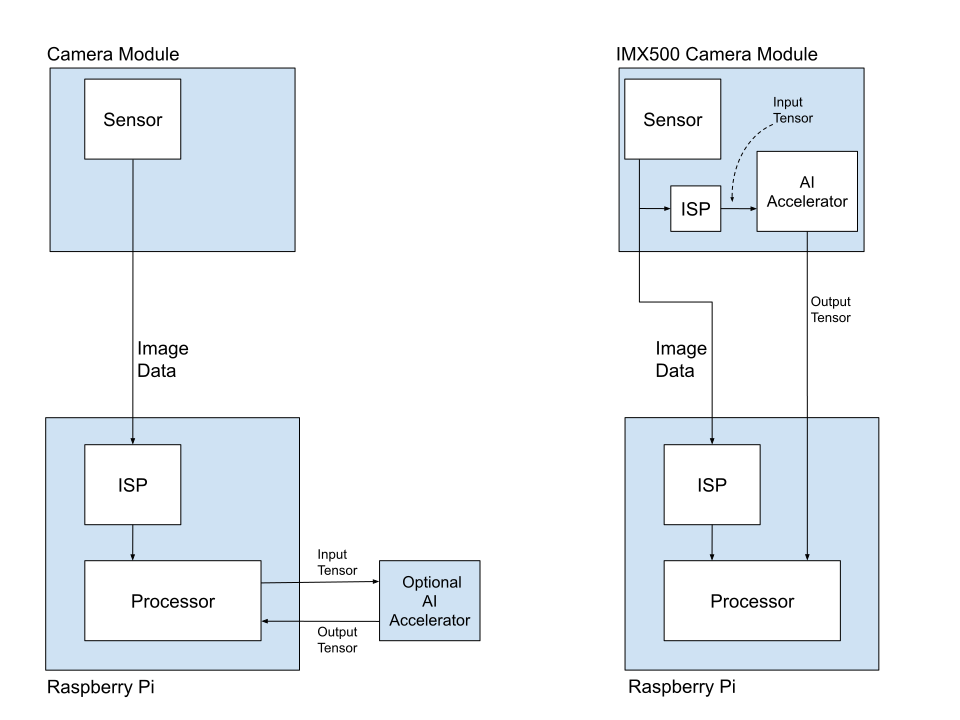
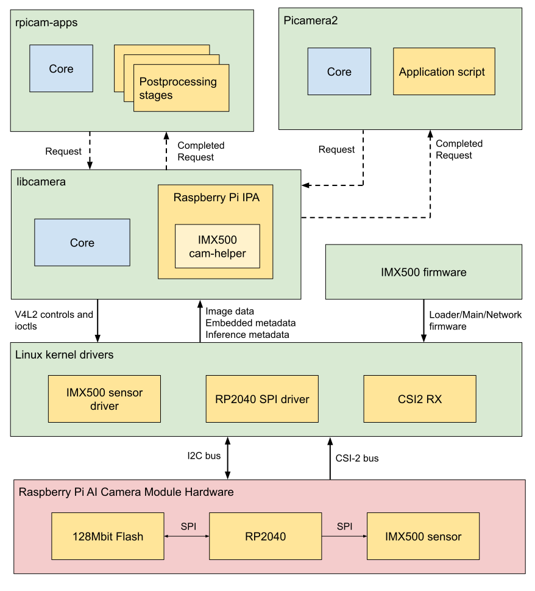

[[ai-camera]]
The Raspberry Pi AI Camera uses the 12.3 megapixel Sony IMX500 imaging sensor to provide low-latency, high-performance AI capabilities to any camera application.

Tight integration with xref:../accessories/camera-software.adoc[the Raspberry Pi camera software stack] allows users to deploy their own neural network models with minimal effort.

image::images/ai-camera.jpg[The Raspberry Pi AI Camera]

This section demonstrates how to run either a pre-packaged or custom neural network model on the camera. Additionally, this section includes the steps required to interpret inference data generated by neural networks running on the IMX500 in https://github.com/raspberrypi/rpicam-apps[`rpicam-apps`] and https://github.com/raspberrypi/picamera2[Picamera2].

== User guides

=== Getting started

The following instructions describe how to run the pre-packaged MobileNet SSD and PoseNet neural network models on the Raspberry Pi AI Camera.

==== Hardware setup

Attach the camera to your Raspberry Pi board following the instructions at xref:../accessories/camera-software.adoc#install-a-raspberry-pi-camera[Install a Raspberry Pi camera].

==== Prerequisites

These instructions assume you're using the AI Camera attached to either a Raspberry Pi 4 Model B or Raspberry Pi 5 board. With minor changes, you can follow these instructions on any other Raspberry Pi model with a camera connector, including Raspberry Pi Zero models.

First, ensure that your Raspberry Pi runs up-to-date software. Run the following command to update:

[source,console]
----
$ sudo apt update && sudo apt full-upgrade
----

==== Install the IMX500 firmware

The AI Camera must download runtime firmware onto the IMX500 sensor during startup. To install these firmware files onto your Raspberry Pi, run the following command:

[source,console]
----
$ sudo apt install imx500-all
----

This command:

* installs the `/lib/firmware/imx500_loader.fpk` and `/lib/firmware/imx500_firmware.fpk` firmware files required to operate the IMX500 sensor.
* places a number of neural network model firmware files in `/usr/share/imx500-models/`.
* installs the IMX500 post-processing software stages in `rpicam-apps`.
* installs the Sony network model packaging tools.

NOTE: The IMX500 kernel device driver loads all the firmware files when the camera starts. If the neural network model firmware hasn't been previously cached, this might take several minutes. The following demos display a progress bar on the console to indicate firmware loading progress.

==== Reboot

Now that you've installed the prerequisites, restart your Raspberry Pi:

[source,console]
----
$ sudo reboot
----

=== Run example applications

After all the system packages are updated and firmware files installed, we can start running some example applications. The Raspberry Pi AI Camera integrates fully with `libcamera`, `rpicam-apps`, and `Picamera2`.

==== `rpicam-apps`

The xref:../accessories/ai-camera.adoc#rpicam-apps[`rpicam-apps` camera applications] include IMX500 object detection and pose estimation stages that can be run in the post-processing pipeline. For more information about the post-processing pipeline, see xref:../accessories/camera-software.adoc#post-process-file[the post-processing documentation].

The examples on this page use post-processing JSON files located in `/usr/share/rpi-camera-assets/`.

===== Object detection

The MobileNet SSD neural network performs basic object detection, providing bounding boxes and confidence values for each object found. The file `imx500_mobilenet_ssd.json` contains the configuration parameters for the IMX500 object detection post-processing stage using the MobileNet SSD neural network.

`imx500_mobilenet_ssd.json` declares a post-processing pipeline that contains two stages:

. `imx500_object_detection`, which picks out bounding boxes and confidence values generated by the neural network in the output tensor.
. `object_detect_draw_cv`, which draws bounding boxes and labels on the image.

The MobileNet SSD tensor requires no significant post-processing on your Raspberry Pi to generate the final output of bounding boxes. All object detection runs directly on the AI Camera.

The following command runs `rpicam-hello` with object detection post-processing:

[source,console]
----
$ rpicam-hello -t 0s --post-process-file /usr/share/rpi-camera-assets/imx500_mobilenet_ssd.json --viewfinder-width 1920 --viewfinder-height 1080 --framerate 30
----

After running the command, you see a viewfinder that overlays bounding boxes on objects recognised by the neural network:

image::images/imx500-mobilenet.jpg[IMX500 MobileNet]

To record video with object detection overlays, use `rpicam-vid` instead:

[source,console]
----
$ rpicam-vid -t 10s -o output.264 --post-process-file /usr/share/rpi-camera-assets/imx500_mobilenet_ssd.json --width 1920 --height 1080 --framerate 30
----

You can configure the `imx500_object_detection` stage in many ways.

For example, `max_detections` defines the maximum number of objects that the pipeline detects at any given time. `threshold` defines the minimum confidence value required for the pipeline to consider any input as an object.

The raw inference output data of this network can be quite noisy, so this stage also performs some temporal filtering and applies hysteresis. To disable this filtering, remove the `temporal_filter` config block.

===== Pose estimation

The PoseNet neural network performs pose estimation, labelling key points on the body associated with joints and limbs. `imx500_posenet.json` contains the configuration parameters for the IMX500 pose estimation post-processing stage using the PoseNet neural network.

`imx500_posenet.json` declares a post-processing pipeline that contains two stages:

* `imx500_posenet`, which fetches the raw output tensor from the PoseNet neural network.
* `plot_pose_cv`, which draws line overlays on the image.

The AI Camera performs basic detection, but the output tensor requires additional post-processing on your host Raspberry Pi to produce final output.

The following command runs `rpicam-hello` with pose estimation post-processing:

[source,console]
----
$ rpicam-hello -t 0s --post-process-file /usr/share/rpi-camera-assets/imx500_posenet.json --viewfinder-width 1920 --viewfinder-height 1080 --framerate 30
----

image::images/imx500-posenet.jpg[IMX500 PoseNet]

You can configure the `imx500_posenet` stage in many ways.

For example, `max_detections` defines the maximum number of bodies that the pipeline detects at any given time. `threshold` defines the minimum confidence value required for the pipeline to consider input as a body.

==== Picamera2

For examples of image classification, object detection, object segmentation, and pose estimation using Picamera2, see https://github.com/raspberrypi/picamera2-examples/blob/main/examples/imx500/[the `picamera2-examples` GitHub repository].

Most of the examples use OpenCV for some additional processing. To install the dependencies required to run OpenCV, run the following command:

[source,console]
----
$ sudo apt install python3-opencv python3-munkres
----

Now download https://github.com/raspberrypi/picamera2[the `picamera2` repository] to your Raspberry Pi to run the examples. You'll find example files in the root directory, with additional information in the `README.md` file.

Run the following script from the repository to run the MobileNet SSD object detection demo:

[source,console]
----
$ python imx500_object_detection_demo.py --model /usr/share/imx500-models/imx500_network_ssd_mobilenetv2_fpnlite_320x320_pp.rpk
----

To try pose estimation in Picamera2, run the following script from the repository:

[source,console]
----
$ python imx500_pose_estimation_higherhrnet_demo.py
----

=== Model deployment

To deploy a new neural network model to the Raspberry Pi AI Camera, complete the following steps:

. Provide a floating-point neural network model (PyTorch or TensorFlow).
. Run the model through Edge-MDT (Edge AI Model Development Toolkit).
.. *Quantise* and compress the model so that it can run using the resources available on the IMX500 camera module.
.. *Convert* the compressed model to IMX500 format.
. Package the model into a firmware file that can be loaded at runtime onto the camera.

The first two steps are normally performed on a more powerful computer such as a desktop or server. You must run the final packaging step on a Raspberry Pi.

==== Model creation

The creation of neural network models is beyond the scope of this guide. Existing models can be re-used, or new ones created using popular AI frameworks like TensorFlow or PyTorch.

For more information, see the official https://developer.aitrios.sony-semicon.com/en/raspberrypi-ai-camera[AITRIOS developer website].

==== Model compression and conversion

===== Edge-MDT installation

The Edge-MDT (Model Development Toolkit) software package installs all the tools required to quantise, compress, and convert models to run on your IMX500 device.

The Edge-MDT package takes a parameter to select between installing the PyTorch or TensorFlow version of the tools.

[tabs]
======
PyTorch::
+
[source,console]
----
$ pip install edge-mdt[pt]
----

TensorFlow::
+
[source,console]
----
$ pip install edge-mdt[tf]
----
+
TIP: Always use the same version of TensorFlow you used to compress your model.
======

If you need to install both packages, use two separate Python virtual environments. This prevents TensorFlow and PyTorch from causing conflicts with each other.

===== Model optimisation

Models are quantised and compressed using Sony's Model Compression Toolkit (MCT). This tool is automatically installed as part of the Edge-MDT installation step. For more information, see the https://github.com/sony/model_optimization[Sony model optimization GitHub repository].

The Model Compression Toolkit generates a quantised model in the following formats:

* Keras (TensorFlow)
* ONNX (PyTorch)

==== Conversion

The converter is a command-line application that compiles the quantised model (in `.onnx` or `.keras` formats) into a binary file that can be packaged and loaded onto the AI Camera. This tool is automatically installed as part of the Edge-MDT installation step.

To convert a model:

[tabs]
======
PyTorch::
+
[source,console]
----
$ imxconv-pt -i <compressed ONNX model> -o <output folder>
----

TensorFlow::
+
[source,console]
----
$ imxconv-tf -i <compressed Keras model> -o <output folder>
----
======

IMPORTANT: For optimal use of the memory available to the accelerator on the IMX500 sensor, add `--no-input-persistency` to the previous commands. However, this disables input tensor generation that can be used for debugging purposes.

Both commands create an output folder that contains a memory usage report and a `packerOut.zip` file.

For more information on the model conversion process, see the official https://developer.aitrios.sony-semicon.com/en/raspberrypi-ai-camera/documentation/imx500-converter[Sony IMX500 Converter documentation].

==== Packaging

IMPORTANT: You must run this step on a Raspberry Pi running Raspberry Pi OS.

The final step packages the model into an RPK file. When running the neural network model, we'll upload this file to the AI Camera. Before proceeding, run the following command to install the necessary tools:

[source,console]
----
$ sudo apt install imx500-tools
----

To package the model into an RPK file, run the following command:

[source,console]
----
$ imx500-package -i <path to packerOut.zip> -o <output folder>
----

This command creates a file named `network.rpk` in the output folder. Pass the name of this file to your IMX500 camera applications.

For a more comprehensive set of instructions and further specifics on the tools used, see the https://developer.aitrios.sony-semicon.com/en/raspberrypi-ai-camera/documentation/imx500-packager[Sony IMX500 Packager documentation].

=== Overview

The Raspberry Pi AI Camera works differently from traditional AI-based camera image processing systems, as shown in the following diagram:

The left side demonstrates the architecture of a traditional AI camera system. In such a system, the camera delivers images to the Raspberry Pi. The Raspberry Pi processes the images and then performs AI inference. Traditional systems can use external AI accelerators (as shown) or rely exclusively on the CPU.

The right side demonstrates the architecture of a system that uses IMX500. The camera module contains a small Image Signal Processor (ISP) which turns the raw camera image data into an **input tensor**. The camera module sends this tensor directly into the AI accelerator within the camera, which produces **output tensors** that contain the inferencing results. The AI accelerator sends these tensors to the Raspberry Pi. There's no need for an external accelerator, nor for the Raspberry Pi to run neural network software on the CPU.

To fully understand this system, familiarise yourself with the following concepts:

Input tensor:: The part of the sensor image passed to the AI engine for inferencing. Produced by a small on-board ISP which also crops and scales the camera image to the dimensions expected by the neural network that has been loaded. The input tensor isn't normally made available to applications, though it's possible to access it for debugging purposes.

Region of interest (ROI):: Specifies exactly which part of the sensor image is cropped out before being rescaled to the size demanded by the neural network. Can be queried and set by an application. The units used are always pixels in the full-resolution sensor output. The default ROI setting uses the full image received from the sensor, cropping no data.

Output tensors:: The results of inferencing performed by the neural network. The precise number and shape of the outputs depend on the neural network. Application code must understand how to handle the tensors.

=== System architecture

The following diagram shows the various camera software components (in green) used during our imaging and inference use case with the Raspberry Pi AI Camera module hardware (in red):

At startup, the IMX500 sensor module loads firmware to run a particular neural network model. During streaming, the IMX500 generates _both_ an image stream and an inference stream. This inference stream holds the inputs and outputs of the neural network model, also known as input and output **tensors**.

=== Device drivers

At the lowest level, the IMX500 sensor kernel driver configures the camera module over the I2C bus. The CSI2 driver (`CFE` on Raspberry Pi 5, `Unicam` on all other Raspberry Pi platforms) sets up the receiver to write the image data stream into a frame buffer, together with the embedded data and inference data streams into another buffer in memory.

The firmware files also transfer over the I2C bus wires. On most devices, this uses the standard I2C protocol, but Raspberry Pi 5 uses a custom high-speed protocol. The RP2040 SPI driver in the kernel handles firmware file transfer, because the transfer uses the RP2040 microcontroller. The microcontroller bridges the I2C transfers from the kernel to the IMX500 through an SPI bus. Additionally, the RP2040 caches firmware files in on-board storage. This avoids the need to transfer entire firmware blobs over the I2C bus, significantly speeding up firmware loading for firmware you've already used.

=== `libcamera`

After `libcamera` dequeues the image and inference data buffers from the kernel, the IMX500-specific `cam-helper` library (part of the Raspberry Pi IPA within `libcamera`) parses the inference buffer to access the input and output tensors. These tensors are packaged as Raspberry Pi vendor-specific https://docs.libcamera.org/master/public-api/classlibcamera_1_1ControlList.html[`libcamera` controls]. `libcamera` returns the following controls:

[%header,cols="a,a"]
|===
| Control
| Description

| `CnnOutputTensor`
| Floating-point array storing the output tensors.

| `CnnInputTensor`
| Floating-point array storing the input tensor.

| `CnnOutputTensorInfo`
| Network-specific parameters describing the output tensors' structure:

[source,c]
----
struct OutputTensorInfo {
	uint32_t tensorDataNum;
	uint32_t numDimensions;
	uint16_t size[MaxNumDimensions];
};

struct CnnOutputTensorInfo {
	char networkName[NetworkNameLen];
	uint32_t numTensors;
	OutputTensorInfo info[MaxNumTensors];
};
----

| `CnnInputTensorInfo`
| Network-specific parameters describing the input tensor's structure:

[source,c]
----
struct CnnInputTensorInfo {
	char networkName[NetworkNameLen];
	uint32_t width;
	uint32_t height;
	uint32_t numChannels;
};
----

|===

=== `rpicam-apps`

`rpicam-apps` provides an IMX500 post-processing stage base class that implements helpers for IMX500 post-processing stages: https://github.com/raspberrypi/rpicam-apps/blob/main/post_processing_stages/imx500/imx500_post_processing_stage.hpp[`IMX500PostProcessingStage`]. Use this base class to derive a new post-processing stage for any neural network model running on the IMX500. For an example, see https://github.com/raspberrypi/rpicam-apps/blob/main/post_processing_stages/imx500/imx500_object_detection.cpp[`imx500_object_detection.cpp`]:

[source,cpp]
----
class ObjectDetection : public IMX500PostProcessingStage
{
public:
	ObjectDetection(RPiCamApp *app) : IMX500PostProcessingStage(app) {}

	char const *Name() const override;

	void Read(boost::property_tree::ptree const &params) override;

	void Configure() override;

	bool Process(CompletedRequestPtr &completed_request) override;
};
----

For every frame received by the application, the `Process()` function is called (`ObjectDetection::Process()` in the previous example). In this function, you can extract the output tensor for further processing or analysis:

[source,cpp]
----
auto output = completed_request->metadata.get(controls::rpi::CnnOutputTensor);
if (!output)
{
  LOG_ERROR("No output tensor found in metadata!");
  return false;
}

std::vector<float> output_tensor(output->data(), output->data() + output->size());
----

When completed, the final results can either be visualised or saved in metadata and consumed by either another downstream stage, or the top-level application itself. In the object inference case:

[source,cpp]
----
if (objects.size())
  completed_request->post_process_metadata.Set("object_detect.results", objects);
----

The `object_detect_draw_cv` post-processing stage running downstream fetches these results from the metadata and draws the bounding boxes onto the image in the `ObjectDetectDrawCvStage::Process()` function:

[source,cpp]
----
std::vector<Detection> detections;
completed_request->post_process_metadata.Get("object_detect.results", detections);
----

The following table contains a full list of helper functions provided by `IMX500PostProcessingStage`:

[%header,cols="a,a"]
|===
| Function
| Description

| `Read()`
| Typically called from `<Derived Class>::Read()`, this function reads the config parameters for input tensor parsing and saving.

This function also reads the neural network model file string (`"network_file"`) and sets up the firmware to be loaded on camera open.

| `Process()`
| Typically called from `<Derived Class>::Process()`, this function processes and saves the input tensor to a file if required by the JSON config file.

| `SetInferenceRoiAbs()`
| Sets an absolute region of interest (ROI) crop rectangle on the sensor image to use for inferencing on the IMX500.

| `SetInferenceRoiAuto()`
| Automatically calculates region of interest (ROI) crop rectangle on the sensor image to preserve the input tensor aspect ratio for a given neural network.

| `ShowFwProgressBar()`
| Displays a progress bar on the console showing the progress of the neural network firmware upload to the IMX500.

| `ConvertInferenceCoordinates()`
| Converts from the input tensor coordinate space to the final ISP output image space.

There are a number of scaling, cropping, and translation operations occurring from the original sensor image to the fully processed ISP output image. This function converts coordinates provided by the output tensor to the equivalent coordinates after performing these operations.

|===

=== Picamera2

IMX500 integration in Picamera2 is very similar to what is available in `rpicam-apps`. Picamera2 has an IMX500 helper class that provides the same functionality as the `rpicam-apps` `IMX500PostProcessingStage` base class. This can be imported to any Python script with:

[source,python]
----
from picamera2.devices.imx500 import IMX500

# This must be called before instantiation of Picamera2
imx500 = IMX500(model_file)
----

To retrieve the output tensors, fetch them from the controls. You can then apply additional processing in your Python script.

For example, in an object inference use case such as https://github.com/raspberrypi/picamera2-examples/tree/main/examples/imx500/imx500_object_detection_demo.py[imx500_object_detection_demo.py], the object bounding boxes and confidence values are extracted in `parse_detections()` and draw the boxes on the image in `draw_detections()`:

[source,python]
----
class Detection:
    def __init__(self, coords, category, conf, metadata):
        """Create a Detection object, recording the bounding box, category and confidence."""
        self.category = category
        self.conf = conf
        obj_scaled = imx500.convert_inference_coords(coords, metadata, picam2)
        self.box = (obj_scaled.x, obj_scaled.y, obj_scaled.width, obj_scaled.height)

def draw_detections(request, detections, stream="main"):
    """Draw the detections for this request onto the ISP output."""
    labels = get_labels()
    with MappedArray(request, stream) as m:
        for detection in detections:
            x, y, w, h = detection.box
            label = f"{labels[int(detection.category)]} ({detection.conf:.2f})"
            cv2.putText(m.array, label, (x + 5, y + 15), cv2.FONT_HERSHEY_SIMPLEX, 0.5, (0, 0, 255), 1)
            cv2.rectangle(m.array, (x, y), (x + w, y + h), (0, 0, 255, 0))
        if args.preserve_aspect_ratio:
            b = imx500.get_roi_scaled(request)
            cv2.putText(m.array, "ROI", (b.x + 5, b.y + 15), cv2.FONT_HERSHEY_SIMPLEX, 0.5, (255, 0, 0), 1)
            cv2.rectangle(m.array, (b.x, b.y), (b.x + b.width, b.y + b.height), (255, 0, 0, 0))

def parse_detections(request, stream='main'):
    """Parse the output tensor into a number of detected objects, scaled to the ISP output."""
    outputs = imx500.get_outputs(request.get_metadata())
    boxes, scores, classes = outputs[0][0], outputs[1][0], outputs[2][0]
    detections = [ Detection(box, category, score, metadata)
                   for box, score, category in zip(boxes, scores, classes) if score > threshold]
    draw_detections(request, detections, stream)
----

Unlike the `rpicam-apps` example, this example applies no additional hysteresis or temporal filtering.

The IMX500 class in Picamera2 provides the following helper functions:

[%header,cols="a,a"]
|===
| Function
| Description

| `IMX500.get_full_sensor_resolution()`
| Returns the full sensor resolution of the IMX500.

| `IMX500.config`
| Returns a dictionary of the neural network configuration.

| `IMX500.convert_inference_coords(coords, metadata, picamera2)`
| Converts the coordinates _coords_ from the input tensor coordinate space to the final ISP output image space. Must be passed Picamera2's image metadata for the image, and the Picamera2 object.

There are a number of scaling, cropping, and translation operations occurring from the original sensor image to the fully processed ISP output image. This function converts coordinates provided by the output tensor to the equivalent coordinates after performing these operations.

| `IMX500.show_network_fw_progress_bar()`
| Displays a progress bar on the console showing the progress of the neural network firmware upload to the IMX500.

| `IMX500.get_roi_scaled(request)`
| Returns the region of interest (ROI) in the ISP output image coordinate space.

| `IMX500.get_isp_output_size(picamera2)`
| Returns the ISP output image size.

| `IMX500.get_input_size()`
| Returns the input tensor size based on the neural network model used.

| `IMX500.get_outputs(metadata)`
| Returns the output tensors from the Picamera2 image metadata.

| `IMX500.get_output_shapes(metadata)`
| Returns the shape of the output tensors from the Picamera2 image metadata for the neural network model used.

| `IMX500.set_inference_roi_abs(rectangle)`
| Sets the region of interest (ROI) crop rectangle, which determines which part of the sensor image is converted to the input tensor that is used for inferencing on the IMX500. Specify the region of interest in units of pixels at the full sensor resolution, as a `(x_offset, y_offset, width, height)` tuple.

| `IMX500.set_inference_aspect_ratio(aspect_ratio)`
| Automatically calculates region of interest (ROI) crop rectangle on the sensor image to preserve the given aspect ratio. To make the ROI aspect ratio exactly match the input tensor for this network, use `imx500.set_inference_aspect_ratio(imx500.get_input_size())`.

| `IMX500.get_kpi_info(metadata)`
| Returns the frame-level performance indicators logged by the IMX500 for the given image metadata.

|===
