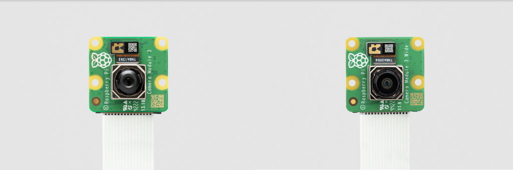
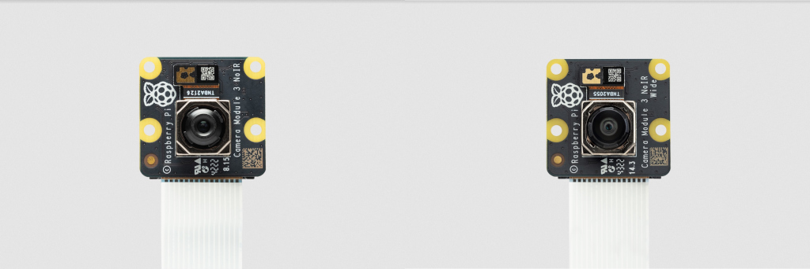
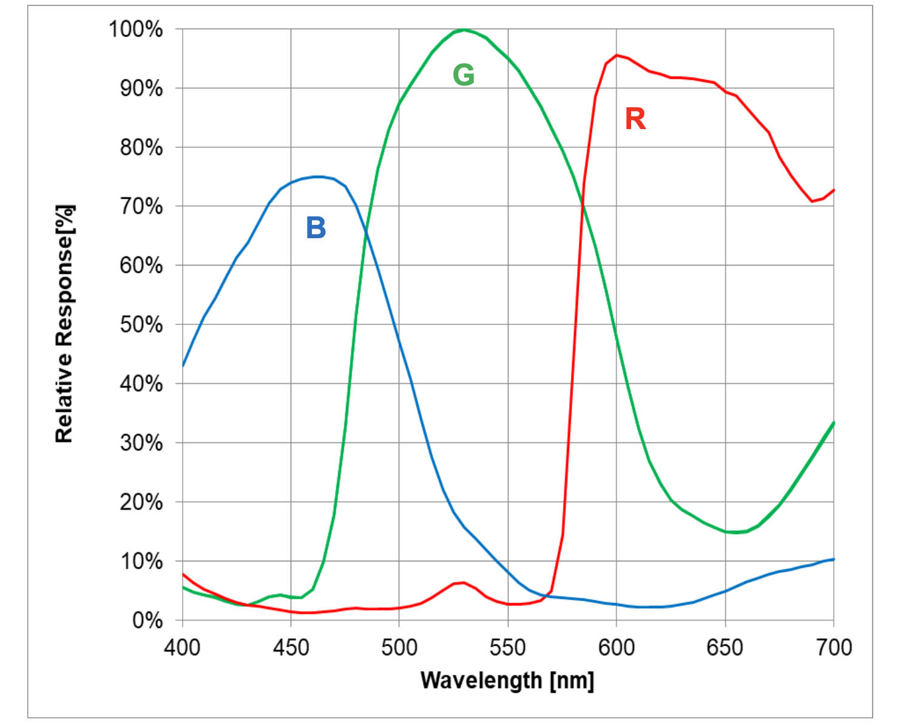

[[camera-module-3]]
This https://www.raspberrypi.com/products/camera-module-3/[12-megapixel camera] is built around the Sony IMX708 sensor with a resolution of 4608 × 2592 pixels. It has https://www.raspberrypi.com/news/new-autofocus-camera-modules/[powered autofocus] and can record an exposure time of up to 112 seconds.

== Variants

Camera Module 3 comes in the following variants:

* Standard, normal field of view (FoV)
* Standard, wide FoV
* NoIR, normal FoV
* NoIR, wide FoV

The standard variants capture visible light only; infrared light is filtered out. The NoIR variants don't have an infrared filter; they capture both visible light and infrared light.

// Use a NoIR camera with infrared lighting to see in the dark [add a link] or use it with the included square of blue gel to monitor the health of green plants.

All of these variants are also available for the standalone https://www.raspberrypi.com/products/camera-module-3-sensor-assembly/[Camera Module 3 Sensor Assembly].

.Camera Module 3 (left) and Camera Module 3 Wide (right)

.Camera Module 3 NoIR (left) and Camera Module 3 NoIR Wide (right)

For detailed information about the hardware characteristics and capabilities of this camera, see the xref:../accessories/camera.adoc#hardware-specification[hardware specifications].

NOTE: There's https://github.com/raspberrypi/libcamera/issues/43[some evidence] to suggest that Camera Module 3 might emit radio-frequency interference (RFI) at a harmonic of the CSI clock rate. This RFI is in a range to interfere with GPS L1 frequencies (1575 MHz). For details and proposed workarounds, see the https://github.com/raspberrypi/libcamera/issues/43[thread on GitHub].

== Transmission characteristics

The IMX708 sensor in Camera Module 3 has the following spectral sensitivity characteristics.

// Do we need another one of these for the NoIR characteristics?

== Camera Module 3 Sensor Assembly

The Raspberry Pi Camera Module 3 Sensor Assembly contains the same sensor and autofocus functionalities as Raspberry Pi Camera Module 3 AF (autofocus), enabling you to integrate the features of Camera Module 3 into a more diverse range of form factors.

It provides a low-cost way to add imaging capability to smaller devices, reducing manufacturing complexity and time to market.

.Specifications
* Sony IMX708 sensor
* Resolution: 12 megapixels
* Sensor size: 7.4 mm sensor diagonal
* Pixel size: 1.4 μm × 1.4 μm
* Horizontal × vertical: 4608 × 2592 pixels
* Integrated IR cut filter in standard variants; not present in NoIR variants
* Phase detection autofocus
* Operating temperature: 0°C to 50°C
* On-board EEPROM for storing camera data

.Documents
* https://pip.raspberrypi.com/documents/RP-009789-MM-1-sensor-assembly-product-brief.pdf[Raspberry Pi Camera Module 3 Sensor Assembly product brief]
* https://pip.raspberrypi.com/documents/RP-008969-SD[Raspberry Pi Camera Module 3 reference schematic]

.Obsolescence statement
Raspberry Pi Camera Module 3 Sensor Assembly will remain in production until at least January 2030
