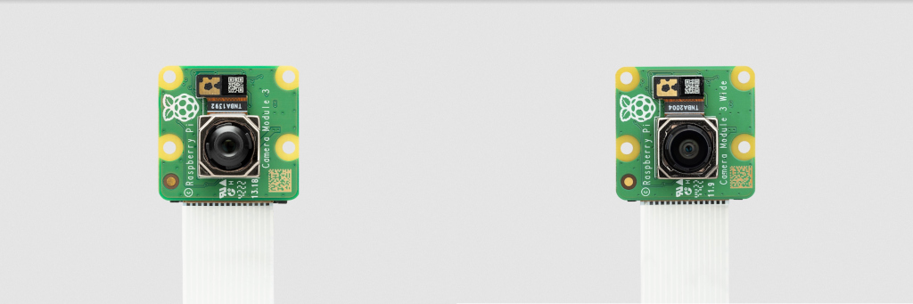
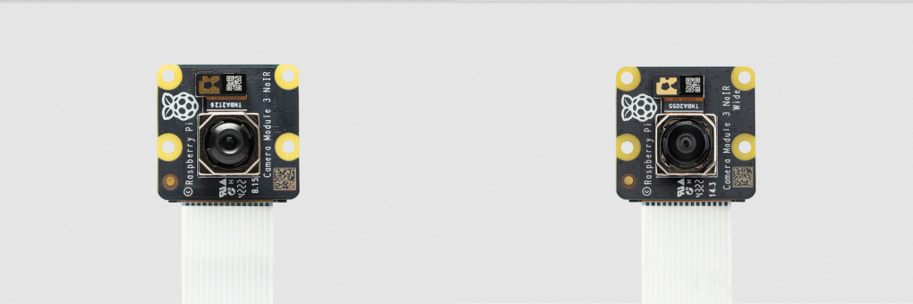
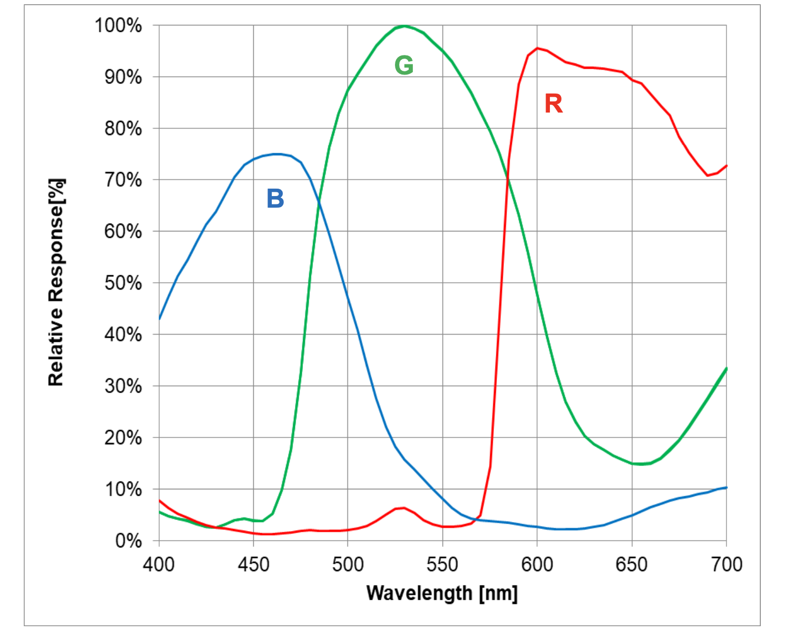

[[camera-module-3]]
This https://www.raspberrypi.com/products/camera-module-3/[12-megapixel camera] is built around the Sony IMX708 sensor with a resolution of 4608 × 2592 pixels. It has https://www.raspberrypi.com/news/new-autofocus-camera-modules/[powered autofocus] and can record an exposure time of up to 112 seconds.

== Variants

Camera Module 3 comes in the following variants:

* Standard, normal field of view (FoV)
* Standard, wide FoV
* NoIR, normal FoV
* NoIR, wide FoV

The standard variants capture visible light only; infrared light is filtered out. The NoIR variants don't have an infrared filter; they capture both visible light and infrared light.

// Use a NoIR camera with infrared lighting to see in the dark [add a link] or use it with the included square of blue gel to monitor the health of green plants.

All of these variants are also available for the standalone https://www.raspberrypi.com/products/camera-module-3-sensor-assembly/[Camera Module 3 Sensor Assembly].

.Camera Module 3 (left) and Camera Module 3 Wide (right)

.Camera Module 3 NoIR (left) and Camera Module 3 NoIR Wide (right)

For detailed information about the hardware characteristics and capabilities of this camera, see xref:../accessories/camera.adoc#hardware-specification[Hardware specifications].

NOTE: There's some evidence to suggest that Camera Module 3 and the standalone Camera Module 3 Sensor Assembly might emit radio-frequency interference (RFI) at a harmonic of the Camera Serial Interface (CSI) clock rate. This RFI is in a range to interfere with GPS L1 frequencies (1575 MHz). For details and proposed workarounds, see the https://github.com/raspberrypi/libcamera/issues/43[thread on GitHub].

[[camera-module-3-autofocus]]
== Autofocus

Camera Module 3 uses a voice coil motor (VCM) to move the lens and adjust focus. The Raspberry Pi camera software controls the VCM by automatically switching between two autofocus methods:

* *Phase detection autofocus (PDAF)* is the faster and more reliable method, but works with visible light only.
* *Contrast detection autofocus (CDAF)* works with both visible and infrared light, but is slower and less reliable than PDAF.

NOTE: When you use a NoIR variant with infrared lighting, autofocus relies on CDAF, so it's slower and less reliable than with visible light. Autofocus with visible light can behave in the same way in particularly challenging conditions, such as low contrast or high image noise.

== Transmission characteristics

The IMX708 sensor in Camera Module 3 has the following spectral sensitivity characteristics.

// Do we need another one of these for the NoIR characteristics?

[[camera-module-3-sensor-assembly]]
== Camera Module 3 Sensor Assembly

https://www.raspberrypi.com/products/camera-module-3-sensor-assembly/[Camera Module 3 Sensor Assembly] contains the same sensor and autofocus as Camera Module 3, but without the circuit board that carries the camera's support components. Use it to build Camera Module 3 imaging into a product that's too small for the 25 × 24 mm Camera Module 3 board.

The sensor assembly comes in the same four variants as Camera Module 3: standard normal FoV, standard wide FoV, NoIR normal FoV, and NoIR wide FoV. Field of view and <<camera-module-3-autofocus,autofocus>> behaviour are the same as the equivalent Camera Module 3 variant.

The Camera Module 3 Sensor Assembly has the following specifications:

* Sony IMX708 sensor
* Resolution: 12 megapixels
* Sensor size: 7.4 mm sensor diagonal
* Pixel size: 1.4 µm × 1.4 µm
* Horizontal × vertical: 4608 × 2592 pixels
* Integrated infrared cut filter (standard variants only)
* Voice coil motor (VCM) to control the lens
* Phase detection autofocus (visible light only)
* Contrast detection autofocus (visible and infrared light)
* Operating temperature: 0°C to 50°C
* On-board EEPROM for storing camera data

=== Connect the sensor assembly

You can't connect the sensor assembly directly to a Raspberry Pi device. Instead, it needs a carrier board that provides the support circuitry found on Camera Module 3, mostly power supplies. A small connector on the back of the sensor assembly's flexible printed circuit (FPC) plugs into a matching socket on the carrier board. The carrier board then connects to the camera connector on your Raspberry Pi device.

To design a carrier board, use the reference schematic and bill of materials (BOM) listed under <<camera-module-3-sensor-assembly-documents,Documents>>. The BOM includes the part number of the socket that connects to the sensor assembly. For the dimensions, focus range, and focal length of each variant, see the https://pip.raspberrypi.com/documents/RP-009789-MM[Raspberry Pi Camera Module 3 Sensor Assembly product brief].

=== Software

The sensor assembly uses the same software as Camera Module 3, including autofocus support. For setup and usage, see xref:../accessories/camera.adoc[Camera usage documentation].

Automatic camera detection doesn't work with Compute Modules. If your carrier board connects to a Compute Module, turn off automatic detection and add the `imx708` overlay to `/boot/firmware/config.txt` yourself. For instructions, see the xref:../computers/compute-module.adoc#attach-a-camera-module[Compute Module camera documentation].

[[camera-module-3-sensor-assembly-documents]]
=== Documents

* https://pip.raspberrypi.com/documents/RP-009789-MM-1-sensor-assembly-product-brief.pdf[Raspberry Pi Camera Module 3 Sensor Assembly product brief]
* https://pip.raspberrypi.com/documents/RP-008969-SD[Raspberry Pi Camera Module 3 reference schematic]
//TODO add BOM link

=== Obsolescence statement

Raspberry Pi Camera Module 3 Sensor Assembly will remain in production until at least January 2030.