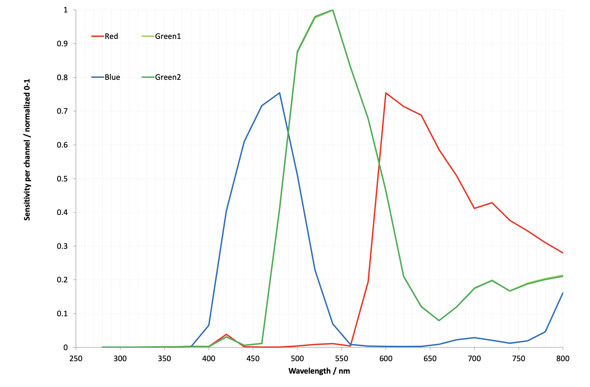
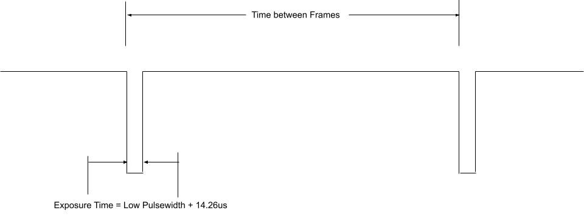
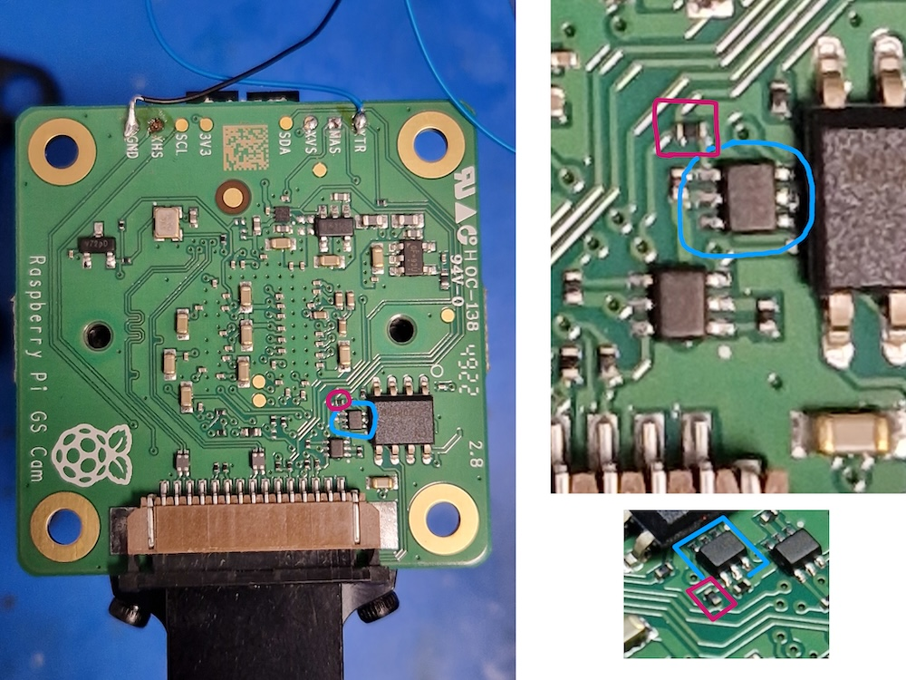
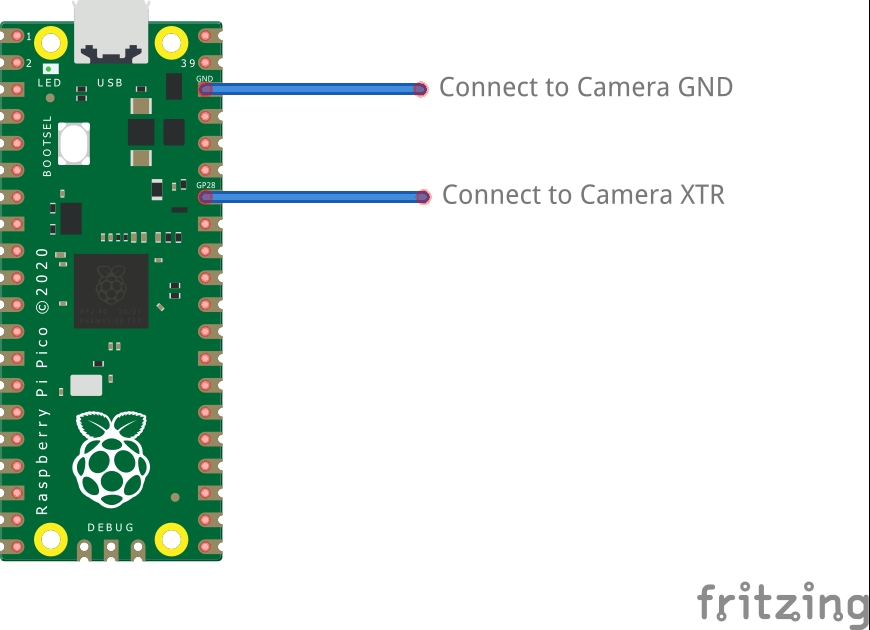

[[gs-camera]]
The 1.6-megapixel https://www.raspberrypi.com/products/raspberry-pi-global-shutter-camera/[Global Shutter Camera] captures fast-moving subjects and minimises distortion. It's built around the Sony IMX296 sensor with a resolution of 1456 × 1088 pixels.

The camera comes with a C/CS mount for compatibility with a broad variety of lenses. For more information, see xref:../accessories/global-shutter-camera.adoc#gs-lenses[Lenses].

You can trigger the Global Shutter (GS) Camera by pulsing the external trigger connection on the board. This feature enables you to synchronise multiple Global Shutter Cameras. For more information, see xref:../accessories/global-shutter-camera.adoc#external-trigger[External trigger on the Global Shutter Camera].

.Global Shutter Camera

For detailed information about the hardware characteristics and capabilities of this camera, see the xref:../accessories/camera.adoc#hardware-specification[hardware specifications].

== Rolling or global shutter?

Most digital cameras, including our other Camera Modules, use a **rolling shutter**: they scan the image they're capturing line by line, then output the results. This can cause distortion effects in some settings. For example, a photo of rotating propeller blades can make the image look as though it's shimmering rather than like an object that's rotating. This is because the propeller blades have had enough time to change position in the tiny moment that the camera has taken to scan across and observe the scene.

A **global shutter**, like the one on our Global Shutter Camera, doesn't do this. It captures the light from every pixel in the scene at once, so a photograph of something like propeller blades doesn't result in the same distortion.

This is useful because it makes fast-moving objects, like propeller blades, easy to capture; we can also synchronise several cameras to take a photo at precisely the same moment in time. Benefits include minimising distortion when capturing stereo images; the human brain is confused if any movement that appears in the left eye hasn't yet appeared in the right eye. The Raspberry Pi Global Shutter Camera can also operate with shorter exposure times (down to 30 µs, given enough light) than a rolling shutter camera, which makes it useful for high-speed photography.

NOTE: The Global Shutter Camera's image sensor has a 6.3 mm diagonal active sensing area, which is similar in size to the Raspberry Pi HQ Camera. However, the pixels are larger and can collect more light. Large pixel size and low pixel count are valuable in machine-vision applications; the more pixels a sensor produces, the harder it is to process the image in real time. To get around this, many applications downsize and crop images. This is unnecessary with the Global Shutter Camera and the appropriate lens magnification, where the lower resolution and large pixel size mean an image can be captured natively.

== Transmission characteristics

The Global Shutter Camera uses a Hoya CM500 infrared filter. Its transmission characteristics are as represented in the following graph.

image::images/hoyacm500.png[CM500 Transmission Graph,width="65%"]

If you want to enhance the Global Shutter Camera's sensitivity to infrared light, you can remove the infrared filter. This action is permanent and voids the warranty. For more information, see xref:../accessories/camera.adoc#ir-filter[IR filter].

Without its filter, the Raspberry Pi Global Shutter Camera has the following transmission characteristics:

== Advanced features and integration

[[external-trigger]]
=== External trigger on the Global Shutter Camera

The Global Shutter (GS) Camera can be triggered externally by pulsing the external trigger connection on the board (denoted on the board as XTR). Multiple cameras can be connected to the same pulse, allowing for an alternative way to synchronise two cameras.

The exposure time is equal to the low pulse-width time plus an additional 14.26 {sym-mu}s. For example, a low pulse of 10000 {sym-mu}s leads to an exposure time of 10014.26 {sym-mu}s. Frame rate is directly controlled by how often you pulse the pin. A pulse-width modulation (PWM) frequency of 30 Hz leads to a frame rate of 30 frames per second.

==== Preparation

WARNING: This modification includes removing an SMD soldered part. Don't attempt this modification unless you feel you're competent to complete it. When soldering to the camera board, remove the plastic back cover to avoid damaging it.

If your board has transistor Q2 fitted (shown in blue in the following image), then you need to remove R11 from the board (shown in red). This connects GP1 to XTR and without removing R11, the camera doesn't operate in external trigger mode.
The location of the components is displayed in the following image.

Next, solder a wire to the touchpoints of XTR and GND on the GS Camera board. Note that XTR is a 1.8 V input, so you might need a level shifter or potential divider.

We can use a Raspberry Pi Pico to provide the trigger. Connect any Pico GPIO pin (GP28 is used in this example) to XTR through a 1.5 kΩ resistor. Also connect a 1.8 kΩ resistor between XTR and GND to reduce the high logic level to 1.8 V. A wiring diagram is shown in the following image.

===== Raspberry Pi Pico MicroPython code

[source,python]
----
from machine import Pin, PWM

from time import sleep

pwm = PWM(Pin(28))

framerate = 30
shutter = 6000  # In microseconds

frame_length = 1000000 / framerate
pwm.freq(framerate)

pwm.duty_u16(int((1 - (shutter - 14) / frame_length) * 65535))
----

The low pulse width is equal to the shutter time, and the frequency of the PWM equals the frame rate.

NOTE: In this example, pin 28 connects to the XTR touchpoint on the GS Camera board.

==== Camera driver configuration

This step is only necessary if you have more than one camera with XTR wired in parallel.

Edit `/boot/firmware/config.txt`. Change `camera_auto_detect=1` to `camera_auto_detect=0`.

Append this line:
[source]
----
dtoverlay=imx296,always-on
----
When using the CAM0 port on a Raspberry Pi 5, Compute Module 4, or Compute Module 5, append `,cam0` to that line without a space. If both cameras are on the same Raspberry Pi, you need two `dtoverlay` lines, only one of them ending with `,cam0`.

If the external trigger isn't started right away, you also need to increase the libcamera timeout, as described in xref:../accessories/camera-software.adoc#libcamera-configuration[Libcamera configuration].

==== Starting the camera

Enable external triggering:

[source,console]
----
$ echo 1 | sudo tee /sys/module/imx296/parameters/trigger_mode
----

Run the code on the Pico, then set the camera running:

[source,console]
----
$ rpicam-hello -t 0 --qt-preview --shutter 3000
----

Every time the Pico pulses the pin, it attempts to capture a frame. However, if `--gain` and `--awbgains` aren't set, some frames are dropped to allow automatic gain control (AGC) and automatic white balance (AWB) algorithms to settle.

NOTE: When running `rpicam-apps`, always specify a fixed shutter duration, to ensure the AGC doesn't try to adjust the camera's shutter speed. The value isn't important, because it's actually controlled by the external trigger pulse.

[[synchronous-mode-xvs]]
=== Synchronous mode (XVS)

You can also operate Global Shutter (GS) Cameras in synchronous mode. However, the source camera records one extra frame. Instead, for GS Cameras we recommend using an xref:global-shutter-camera.adoc#external-trigger[external trigger source]. You can't synchronise a GS Camera and an HQ Camera.

For an overview of synchronous mode, see xref:../accessories/high-quality-camera.adoc#synchronous-captures[Synchronous captures] on the High Quality Camera page.

==== Connecting the cameras

Solder a wire to the XVS test point of each camera, and connect them together.

Solder a wire to the GND test point of each camera, and connect them together.

You must also connect the XHS (horizontal sync) test point of each camera together. On any GS Camera that you want to act as a sink, bridge the two halves of the MAS pad with solder.

NOTE: An earlier version of this document recommended an external pull-up for XVS. This is no longer recommended. Instead, ensure you have an up-to-date version of Raspberry Pi OS and set the `always-on` property for all connected cameras.

==== Driver configuration

Configure the camera drivers to keep their 1.8 V power supplies on when not streaming.

Edit `/boot/firmware/config.txt`. Change `camera_auto_detect=1` to `camera_auto_detect=0`.

For either a source or a sink, append this line:
[source]
----
dtoverlay=imx296,always-on
----
When using the CAM0 port on a Raspberry Pi 5, Compute Module 4, or Compute Module 5, append `,cam0` to that line without a space. If two cameras are on the same Raspberry Pi, you need two `dtoverlay` lines, only one of them ending with `,cam0`.

On the GS Camera, the sink role is enabled by the MAS pin and can't be configured by software ("trigger_mode" and "sync-sink" relate to the xref:global-shutter-camera.adoc#external-trigger[external trigger method], and mustn't be set for this method).

==== Starting the cameras

Configure libcamera and start the cameras as described in xref:../accessories/camera-software.adoc#libcamera-configuration[Libcamera configuration] and xref:../accessories/global-shutter-camera.adoc#starting-the-cameras[Starting the cameras].

NOTE: When using the GS Camera in synchronous mode, the sink doesn't record exactly the same number of frames as the source. The source records one extra frame before the sink starts recording. Because of this, you need to specify that the sink records one fewer frame with the `--frames` option.

[[gs-lenses]]
=== Recommended lenses

The following lenses are recommended for use with our GS Camera.

NOTE: While the HQ Camera is available in both C/CS- and M12-mount versions, the GS Camera is available only with a C/CS mount.

==== C/CS lenses

We recommend two lenses, a 6 mm wide-angle lens and a 16 mm telephoto lens manufactured by CGL Electronics Co. Ltd. These lenses are available from your nearest https://www.raspberrypi.com/products/raspberry-pi-high-quality-camera/[Authorised Reseller].

[cols="1,1,1,1"]
|===
2+| | 16 mm telephoto | 6 mm wide-angle

2+| Resolution | 10 MP | 3 MP
2+| Image format | 1" | 1/2"
2+| Aperture | F1.4 to F16 | F1.2
2+| Mount | C | CS
2+| GS field of view H° × V° (D°) | 17.8° × 13.4° (22.3°) | 45° × 34° (56°)
2+| Back focal length | 17.53 mm | 7.53 mm
2+| Minimum object distance | 0.2 m | 0.2 m
2+| Dimensions | φ39 × 50 mm |	φ30 × 34 mm
|===
