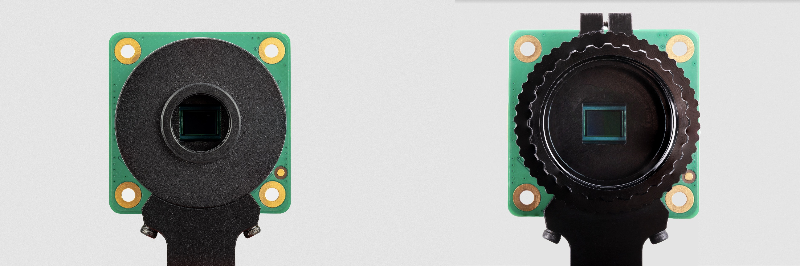
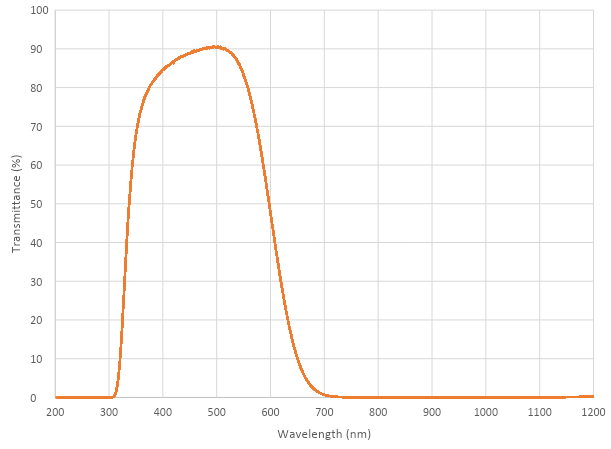
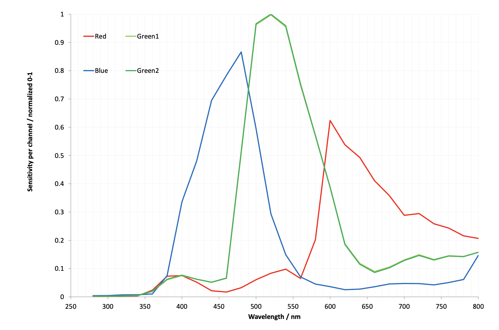
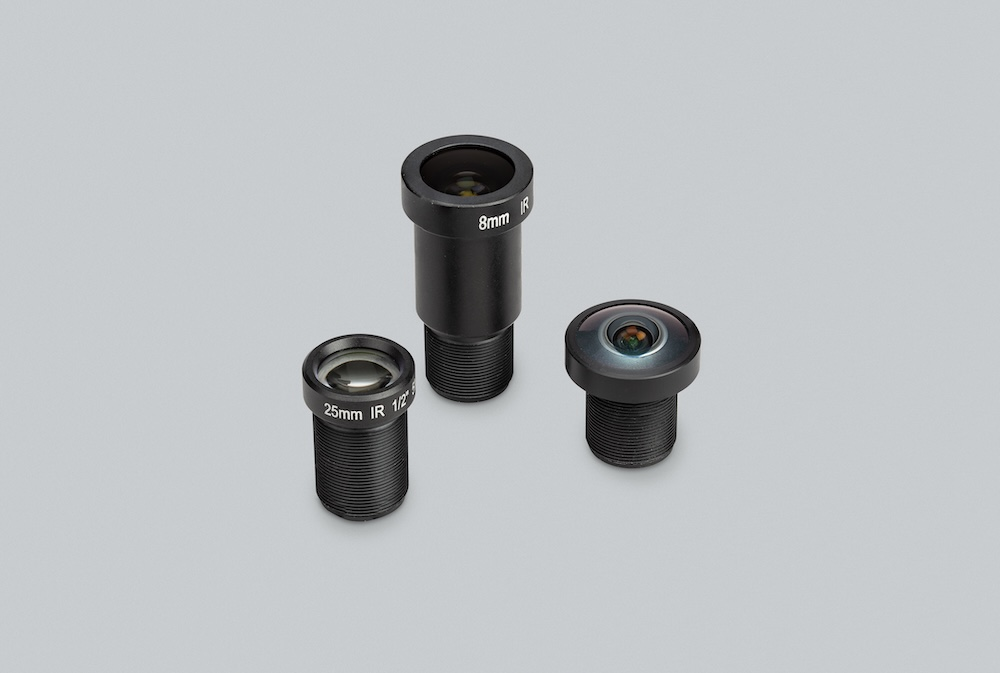

[[hq-camera]]
The 12-megapixel https://www.raspberrypi.com/products/raspberry-pi-high-quality-camera/[High Quality Camera] comes with either an M12 mount or a C/CS mount for compatibility with a broad variety of lenses. For more information, see xref:../accessories/high-quality-camera.adoc#hq-lenses[Lenses]. The camera is built around the Sony IMX477 sensor with a resolution of 4056 × 3040 pixels. It can record an exposure time of up to 670.74 seconds.

You can synchronise multiple High Quality Cameras using the XVS (vertical sync) pin. For more information, see xref:../accessories/high-quality-camera.adoc#synchronous-captures[Synchronous captures].

.High Quality Camera, M12 mount (left) and C/CS mount (right)

For detailed information about the hardware characteristics and capabilities of this camera, see the xref:../accessories/camera.adoc#hardware-specification[hardware specifications].

== Transmission characteristics

The High Quality Camera uses a Hoya CM500 infrared filter. Its transmission characteristics are as represented in the following graph.

If you want to enhance the High Quality Camera's sensitivity to infrared light, you can remove the infrared filter. This action is permanent and voids the warranty. For more information, see xref:../accessories/camera.adoc#ir-filter[IR filter].

Without its filter, the Raspberry Pi High Quality Camera has the following transmission characteristics:

[[hq-lenses]]
== Recommended lenses

The following lenses are recommended for use with our HQ Camera.

=== C/CS lenses

We recommend two lenses, a 6 mm wide-angle lens and a 16 mm telephoto lens manufactured by CGL Electronics Co. Ltd. These lenses are available from your nearest https://www.raspberrypi.com/products/raspberry-pi-high-quality-camera/[Authorised Reseller].

[cols="1,1,1,1"]
|===
2+| | 16 mm telephoto | 6 mm wide-angle

2+| Resolution | 10 MP | 3 MP
2+| Image format | 1" | 1/2"
2+| Aperture | F1.4 to F16 | F1.2
2+| Mount | C | CS
2+| HQ field of view H° × V° (D°) | 22.2° × 16.7° (27.8°)| 55° × 45° (71°)
2+| Back focal length | 17.53 mm | 7.53 mm
2+| Minimum object distance | 0.2 m | 0.2 m
2+| Dimensions | φ39 × 50 mm |	φ30 × 34 mm
|===

=== M12 lenses

We recommend three lenses manufactured by https://www.gaojiaoptotech.com/[Gaojia Optotech]. These lenses are available from your nearest https://www.raspberrypi.com/products/raspberry-pi-high-quality-camera/[Authorised Reseller].

[cols="1,1,1,1,1"]
|===
2+| | 8 mm | 25 mm | Fisheye

2+| Resolution | 12 MP | 5 MP | 15 MP
2+| Image format | 1/1.7" | 1/2" | 1/2.3"
2+| Aperture | F1.8 | F2.4 | F2.5
2+| Mount 3+| M12
2+| HQ field of view H° × V° (D°) | 49° × 36° (62°) | 14.4° × 10.9° (17.9°) | 140° × 102.6° (184.6°)
|===

[[synchronous-captures]]
== Synchronous captures

The High Quality (HQ) Camera supports synchronous captures.
One camera (the "source") can be configured to generate a pulse on its XVS (vertical sync) pin when a frame capture is initiated.
Other ("sink") cameras can listen for this pulse, and capture a frame at the same time as the source camera.

This method is largely superseded by xref:../accessories/camera-software.adoc#software-camera-synchronisation[software camera synchronisation], which can operate over long distances without additional wires and has sub-millisecond accuracy. But when cameras are physically close, you can use wired synchronisation.

NOTE: You can't synchronise a GS Camera and an HQ Camera. To synchronise GS Cameras, see xref:global-shutter-camera.adoc#synchronous-mode-xvs[Synchronous mode (XVS)].

=== Connecting the cameras

Solder a wire to the XVS test point of each camera, and connect them together.

Solder a wire to the GND test point of each camera, and connect them together.

NOTE: An earlier version of this document recommended an external pull-up for XVS. This is no longer recommended. Instead, ensure you have an up-to-date version of Raspberry Pi OS and set the `always-on` property for all connected cameras.

=== Driver configuration

Configure the camera drivers to keep their 1.8 V power supplies on when not streaming, and optionally to select the source and sink roles.

Edit `/boot/firmware/config.txt`. Change `camera_auto_detect=1` to `camera_auto_detect=0`.

Append this line for a source camera:
[source]
----
dtoverlay=imx477,always-on,sync-source
----

Or for a sink:
[source]
----
dtoverlay=imx477,always-on,sync-sink
----

When using the CAM0 port on a Raspberry Pi 5, Compute Module 4, or Compute Module 5, append `,cam0` to that line without a space. If two cameras are on the same Raspberry Pi, you need two `dtoverlay` lines, only one of them ending with `,cam0`.

Alternatively, if you want to swap the cameras' roles at runtime (and they aren't both connected to the same Raspberry Pi), omit `,sync-source` or `,sync-sink` above. Instead, you can set a module parameter before starting each camera:

For the Raspberry Pi with the source camera:
[source,console]
----
$ echo 1 | sudo tee /sys/module/imx477/parameters/trigger_mode
----

For the Raspberry Pi with the sink camera:
[source,console]
----
$ echo 2 | sudo tee /sys/module/imx477/parameters/trigger_mode
----
Do this every time the system is booted.

To configure libcamera and start the cameras, see xref:../accessories/camera-software.adoc#wired-synchronisation[Wired synchronisation].
