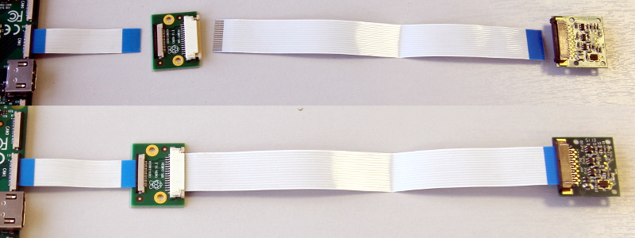
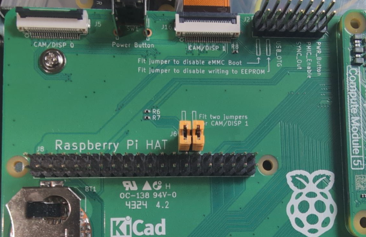
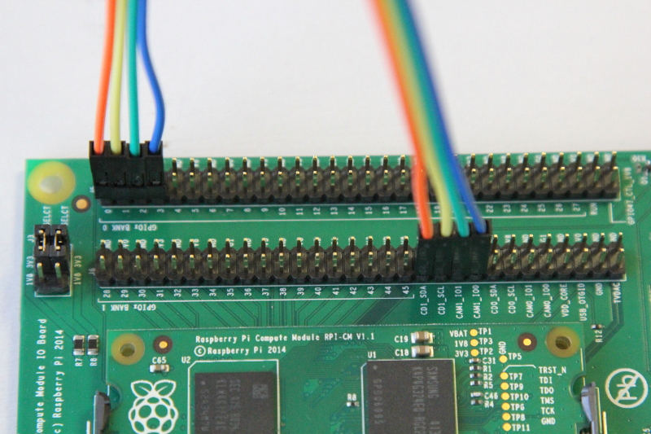
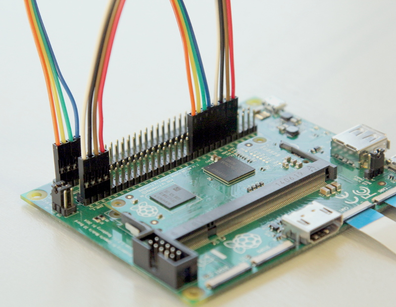
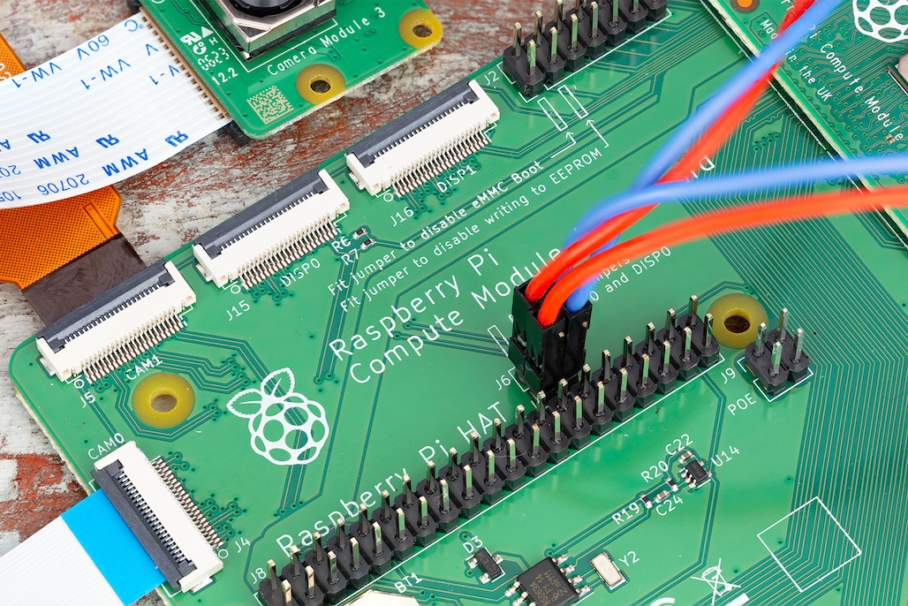

== Attach a Camera Module

The Compute Module has two camera interfaces that use the Camera Serial Interface 2 (CSI-2) standard: CAM1 and CAM0. This section explains how to connect one or two Raspberry Pi cameras to a Compute Module using the CAM1 and CAM0 interfaces.

On the Compute Module 5 IO board (CM5IO), the camera connectors are combined camera and display connectors, labelled **CAM/DISP1** and **CAM/DISP0**. On all other Compute Module IO boards, they're labelled **CAM1** and **CAM0**.

All Compute Module IO boards use the mini, 22-pin camera connector. To connect a camera to the connector, use one of the following:

* The https://www.raspberrypi.com/products/camera-cable/[Raspberry Pi Standard – Mini camera cable].
* A Compute Module Camera and Display Adaptor (CMCDA) board, which converts the mini, 22-pin connector on the IO board into a standard, 15-pin connector. Some Compute Module Development Kits include a CMCDA board. With a CMCDA board, use the Standard-Standard camera cable provided with your camera.

NOTE: Camera cables and display cables aren't interchangeable. Make sure you use a camera cable.

For instructions on handling the camera and seating the cable in the connector, see xref:../accessories/camera-software.adoc#install-a-raspberry-pi-camera[Install a Raspberry Pi camera].

=== Update your system

Before configuring a camera, xref:../computers/os.adoc#update-software[ensure that your software is up to date]:

[source,console]
----
$ sudo apt update
$ sudo apt full-upgrade
----

=== Connect one camera

To connect a single camera to a Compute Module, complete the following steps:

. Disconnect the Compute Module from power.
. Connect the camera to the **CAM1** port (**CAM/DISP1** on CM5IO) using the Standard-Mini camera cable or a CMCDA board.
+

. _(CM5 only)_: Fit two jumpers on **J6**, as indicated on the silkscreen of the IO board.
+

. _(CM1, CM3, CM3+, and CM4S only)_: Connect the following GPIO pins with jumper cables:
  * `0` to `CD1_SDA`
  * `1` to `CD1_SCL`
  * `2` to `CAM1_I01`
  * `3` to `CAM1_I00`
+

. Reconnect the Compute Module to power.

. Remove (or comment out with the prefix `#`) the following lines, if they exist, in `/boot/firmware/config.txt`:
+
[source,ini]
----
camera_auto_detect=1
----
+
[source,ini]
----
dtparam=i2c_arm=on
----

. _(CM1, CM3, CM3+, and CM4S only)_: Add the following directive to `/boot/firmware/config.txt` to accommodate the swapped GPIO pin assignment on the IO board:
+
[source,ini]
----
dtoverlay=cm-swap-i2c0
----

. _(CM1, CM3, CM3+, and CM4S only)_: Add the following directive to `/boot/firmware/config.txt` to assign GPIO 3 as the CAM1 regulator:
+
[source,ini]
----
dtparam=cam1_reg
----

. Add the appropriate directive to `/boot/firmware/config.txt` to manually configure the driver for your camera model:
+
[%header,cols="1,1"]
|===
| Camera model
| Directive

| Camera Module 1
| `dtoverlay=ov5647`

| Camera Module 2
| `dtoverlay=imx219`

| Camera Module 3
| `dtoverlay=imx708`

| High Quality Camera
| `dtoverlay=imx477`

| Global Shutter Camera
| `dtoverlay=imx296`

| AI Camera
| `dtoverlay=imx500`
|===
. Reboot your Compute Module with `sudo reboot`.

. Run the following command to check the list of detected cameras:
+
[source,console]
----
$ rpicam-hello --list-cameras
----
+
The output lists your camera model, referred to by the driver directive in the previous table.

=== Connect two cameras

To connect two cameras to a Compute Module, complete the following steps:

. Complete the steps in <<connect-one-camera,Connect one camera>>.
. Disconnect the Compute Module from power.
. Connect the second camera to the **CAM0** port (**CAM/DISP0** on CM5IO) using the Standard-Mini camera cable or a CMCDA board.
+

. _(CM1, CM3, CM3+, and CM4S only)_: Connect the following GPIO pins with jumper cables:
  * `28` to `CD0_SDA`
  * `29` to `CD0_SCL`
  * `30` to `CAM0_I01`
  * `31` to `CAM0_I00`
+

. _(CM4 only)_: To enable **CAM0**, connect the **J6** GPIO pins with two vertical-orientation jumpers.
+

. _(CM5 only)_: **CAM/DISP0** doesn't need jumpers.

. Reconnect the Compute Module to power.

. _(CM1, CM3, CM3+, and CM4S only)_: Add the following directive to `/boot/firmware/config.txt` to assign GPIO 31 as the CAM0 regulator:
+
[source,ini]
----
dtparam=cam0_reg
----

. Add the appropriate directive to `/boot/firmware/config.txt` to manually configure the driver for your camera model:
+
[%header,cols="1,1"]
|===
| Camera model
| Directive

| Camera Module 1
| `dtoverlay=ov5647,cam0`

| Camera Module 2
| `dtoverlay=imx219,cam0`

| Camera Module 3
| `dtoverlay=imx708,cam0`

| High Quality Camera
| `dtoverlay=imx477,cam0`

| Global Shutter Camera
| `dtoverlay=imx296,cam0`
|===

. Reboot your Compute Module with `sudo reboot`.

. Run the following command to check the list of detected cameras:
+
[source,console]
----
$ rpicam-hello --list-cameras
----
+
The output lists both camera models, referred to by the driver directives in the previous table.

=== Software

To take pictures and record video with your cameras, use the `rpicam-apps` camera applications. For more information, see xref:../accessories/camera-software.adoc#rpicam-apps[`rpicam-apps`].

==== Specify which camera to use

By default, `rpicam-apps` use the camera with index `0` in the list of detected cameras. To get the index value for each camera, run the following command:

[source,console]
----
$ rpicam-hello --list-cameras
Available cameras
-----------------
0 : imx477 [4056x3040] (/base/soc/i2c0mux/i2c@1/imx477@1a)
    Modes: 'SRGGB10_CSI2P' : 1332x990 [120.05 fps - (696, 528)/2664x1980 crop]
           'SRGGB12_CSI2P' : 2028x1080 [50.03 fps - (0, 440)/4056x2160 crop]
                             2028x1520 [40.01 fps - (0, 0)/4056x3040 crop]
                             4056x3040 [10.00 fps - (0, 0)/4056x3040 crop]

1 : imx708 [4608x2592] (/base/soc/i2c0mux/i2c@0/imx708@1a)
    Modes: 'SRGGB10_CSI2P' : 1536x864 [120.13 fps - (768, 432)/3072x1728 crop]
                             2304x1296 [56.03 fps - (0, 0)/4608x2592 crop]
                             4608x2592 [14.35 fps - (0, 0)/4608x2592 crop]
----

In this output:

* `imx477` refers to a High Quality Camera with an index of `0`.
* `imx708` refers to a Camera Module 3 with an index of `1`.

To use a specific camera, pass its index to the `--camera` option. For example, to use Camera Module 3, run the following command:

[source,console]
----
$ rpicam-hello --camera 1
----

For more information, see xref:../accessories/camera-software.adoc#use-multiple-cameras[Use multiple cameras].

=== I2C mapping of GPIO pins

Camera drivers get their configuration from the device tree. The camera overlays use the `i2c_csi_dsi0` and `i2c_csi_dsi1` nodes, and the device tree file for each board maps these nodes to the correct I2C controller:

* On CM1, CM3, CM3+, CM4S, and CM4, both camera connectors share one I2C controller, using different GPIO pins for each connector.
* On CM5, each **CAM/DISP** connector has its own I2C controller.

The following table lists the GPIO pins that each Compute Module IO board uses for camera I2C:

[%header,cols="2,2,2"]
|===
| IO board
| CAM1 (**CAM/DISP1** on CM5IO)
| CAM0 (**CAM/DISP0** on CM5IO)

| CM5IO
| GPIOs 0 and 1 (`i2c-0`), routed through **J6**
| GPIOs 38 and 39 (`i2c-10`)

| CM4IO
| GPIOs 44 and 45 (`i2c-10`)
| GPIOs 0 and 1 (`i2c-0`)

| CMIO and CMIO3 (CM1, CM3, CM3+, and CM4S)
| GPIOs 0 and 1 (`i2c-10`)
| GPIOs 28 and 29 (`i2c-0`)
|===

NOTE: On the CM4IO and CM5IO, GPIOs 0 and 1 are also routed to pins 27 and 28 of the GPIO header.

To connect a camera to the CMIO or CMIO3, add the following directive to `/boot/firmware/config.txt` to accommodate the swapped pin assignment:

[source,ini]
----
dtoverlay=cm-swap-i2c0
----

CM5 doesn't need this overlay, because each **CAM/DISP** connector has its own I2C controller.

Custom carrier boards for CM1, CM3, CM3+, CM4S, CM4, and CM5 might use other pin assignments. Check the documentation for your board and use the following overrides depending on your layout:

[%header,cols="1,1"]
|===
| Swap
| Override

| Use GPIOs 0 and 1 for `i2c0`
| `i2c0-gpio0`

| Use GPIOs 28 and 29 for `i2c0` (default)
| `i2c0-gpio28`

| Use GPIOs 44 and 45 for `i2c0`
| `i2c0-gpio44`

| Use GPIOs 0 and 1 for `i2c10` (default)
| `i2c10-gpio0`

| Use GPIOs 28 and 29 for `i2c10`
| `i2c10-gpio28`

| Use GPIOs 44 and 45 for `i2c10`
| `i2c10-gpio44`
|===

==== GPIO pins for shutdown

For camera shutdown, the device tree uses the pins assigned by the `cam1_reg` and `cam0_reg` overlays.

The CM4IO provides a single GPIO pin for both aliases, so both cameras share the same regulator.

On the CM5IO, GPIO 34 controls the **CAM/DISP0** regulator. The **CAM/DISP1** regulator is always on, because its GPIO pin is permanently tied high.

The CMIO and CMIO3 have no GPIO pins dedicated to the camera regulators, or to any other function. The wiring in the previous procedures uses GPIO 3 for `cam1_reg` and GPIO 31 for `cam0_reg`. When you enable the regulators, you can't use those GPIO pins for anything else. Because GPIO 3 is also used for `i2c-1`, the regulators are disabled by default. To enable them, add the following directives to `/boot/firmware/config.txt`:

* `dtparam=cam1_reg`
* `dtparam=cam0_reg`

To assign `cam1_reg` and `cam0_reg` to a specific pin on a custom board, use the following directives in `/boot/firmware/config.txt`:

* `dtparam=cam1_reg_gpio=<pin number>`
* `dtparam=cam0_reg_gpio=<pin number>`

For example, to use pin 42 as the regulator for CAM1, add the directive `dtparam=cam1_reg_gpio=42` to `/boot/firmware/config.txt`.

These directives work for GPIO pins connected directly to the system on chip (SoC), not for expander GPIO pins.