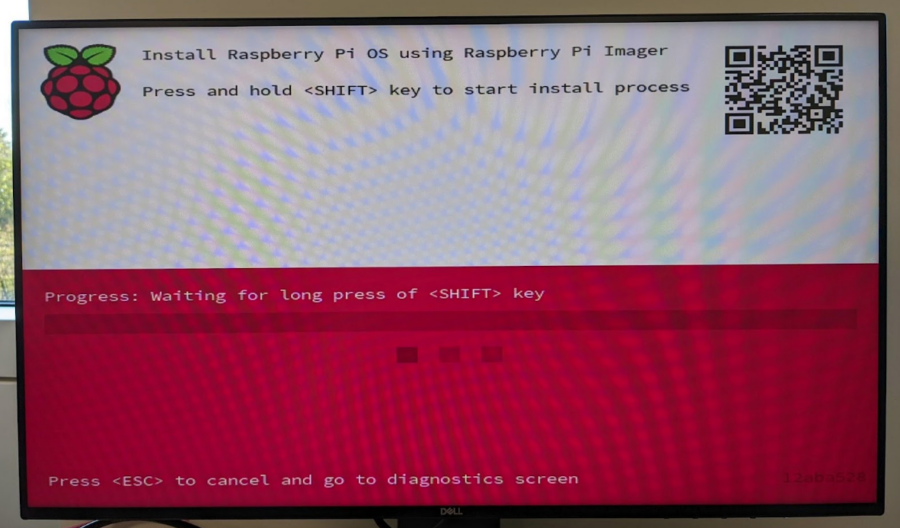
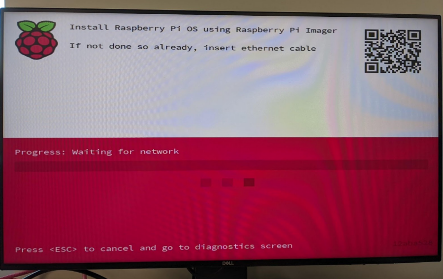
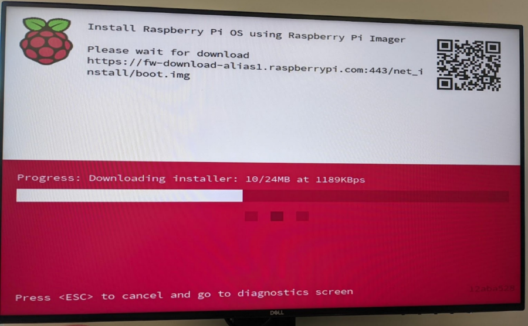
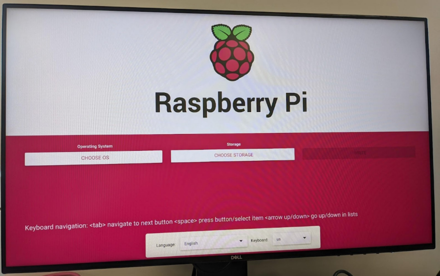

[[install]]
== Install an OS onto boot media

To use your Raspberry Pi, you must first install (flash) an *operating system (OS)* onto your storage device, making it a boot device. By default, Raspberry Pi devices check for an OS on any SD card inserted into the SD card slot. Some Raspberry Pi models allow you to boot an OS from other storage devices, such as USB drives, storage connected through a HAT, and network storage. The following instructions assume that you're using a microSD card.

We recommend installing an OS to your storage device using *Raspberry Pi Imager* on another computer. For instructions, see <<imager-install>>. If you don't have access to another computer for writing an OS image to the storage device, you might be able to install an operating system directly on your Raspberry Pi from the internet. For instructions, see <<network-install>>.

=== Exceptions
Raspberry Pi 500 and some Raspberry Pi desktop and personal computer kits come with a microSD card that's pre-installed with Raspberry Pi OS. Raspberry Pi 500+ also includes an SSD with Raspberry Pi OS pre-installed. In these cases, you don't have to follow the installation instructions on this page. However, we recommend that you update the pre-installed OS to the latest version. For instructions, see xref:../computers/os.adoc#update-software[Update your current Raspberry Pi software].

If you want to reconfigure your Raspberry Pi, you can do so from the menu at the top of the display attached to your Raspberry Pi. For example, you can set or change your wireless network from the Wi-Fi icon in the top-right corner. For instructions, see xref:../computers/configuration.adoc#connect-to-wireless[Connect to a wireless network] in the *Configuration* page.

=== Prerequisites
To install an OS on a storage device, you need:

* A blank storage device to be your boot media, typically a microSD card. For more information, see xref:../computers/getting-started.adoc#boot-media[Boot media].
* A computer you can use to write the OS image onto your storage device so that your Raspberry Pi can boot from it.
* A way to plug your storage device into that computer.

[[imager-install]]
=== Install using Imager

xref:imager.adoc[Raspberry Pi Imager] is a tool you use to download and write OS images for your Raspberry Pi on Windows, macOS, and Linux. During installation, you can also preconfigure credentials and remote access settings for your Raspberry Pi.

The following steps cover a typical installation. For full instructions, including screenshots and details of every option, see xref:imager.adoc[Raspberry Pi Imager].

////
TODO: Update this video for the new Imager look & flow (video::ntaXWS8Lk34[youtube,width=80%,height=400px])
////

. Install and launch Imager on your computer. For instructions, see xref:imager.adoc#install-imager[Install Imager].
. In the *Device* tab, select your Raspberry Pi model and then select *Next*.
. In the *OS* tab, choose an operating system and then select *Next*. The recommended OS for your Raspberry Pi model is at the top of the list.
. Connect your storage device to your computer. For example, plug a microSD card into your computer using an external or built-in SD card reader.
. In the *Storage* tab, select your storage device and then select *Next*.
+
WARNING: Take care to choose the correct storage device, because Imager erases all data on it. We strongly recommend that you keep *Exclude system drives* selected.

. In the *Customisation* tab, set your hostname, localisation, username and password, Wi-Fi, and remote access, selecting *Next* after each subtab. For details of each setting, see xref:imager.adoc#os-customisation[Customise your operating system].
+
We strongly recommend that you customise your OS now. If you're setting up a headless Raspberry Pi, you must configure Wi-Fi (or use Ethernet) and either SSH or Raspberry Pi Connect, so that you can connect to it after it boots. If you select *Skip customisation*, the OS asks you for the same information after first boot. For Raspberry Pi OS, this happens in the xref:getting-started.adoc#first-configuration[configuration wizard].
. In the *Writing* tab, review your choices and then select *Write*.
. To confirm that you want to erase your storage device, select *I understand, erase and write*.
. Wait while Imager writes and then verifies the image. We recommend that you let verification finish.
. When the *Done* tab appears, select *Finish*.

You can now follow the instructions for either the xref:getting-started.adoc#desktop-setup[Standard (desktop) setup] or the xref:getting-started.adoc#headless-setup[Headless (remote) setup] to get your Raspberry Pi started according to your needs.

[[network-install]]
=== Install over the network
You can install an OS onto a storage device using a version of Raspberry Pi Imager downloaded over the network. With *Network Install*, you don't need a separate SD card reader or computer other than your Raspberry Pi. You can run Network Install on any compatible storage device including SD cards and USB storage.

If your Raspberry Pi runs an older bootloader, you might need to update the bootloader to use Network Install. For instructions, see xref:../computers/configuration.adoc#update-bootloader-version[Update the bootloader] in the *Configuration* page.

////
TODO: Update this video for the new Imager look & flow video::b1SYVpM9lto[youtube,width=80%,height=400px]
////

==== Prerequisites
Network Install requires the following:

* A compatible Raspberry Pi model running firmware that supports *Network Install*. Network Install only runs on flagship models since Raspberry Pi 4B and Raspberry Pi keyboard computers (400, 500, and 500+).
* A monitor and keyboard physically connected to your Raspberry Pi device.
* A wired internet connection.
* A blank, compatible storage device, such as an SD card or USB drive, attached to your Raspberry Pi device. This is the destination that Network Install writes the OS image to. If the storage device already has an OS (or any bootable system) installed, and if you don't hold down the *Shift* key, your Raspberry Pi boots normally instead of entering into Network Install.

==== Launch Network Install

. Connect a monitor and keyboard to your Raspberry Pi device, then either:
.. Connect a blank (non-bootable) storage device, such as an SD card or USB drive, to your Raspberry Pi device,
+
or
+
.. Hold down the *Shift* key on the keyboard connected to your Raspberry Pi whilst powering on your Raspberry Pi.
+

. If not already connected, connect your Raspberry Pi to the internet using an Ethernet cable. When you're connected to the internet, Raspberry Pi downloads the Raspberry Pi installer. If the download fails, repeat the process from the previous step to try again.
+

. Wait for the installer to download.
+

. When Raspberry Pi installer finishes downloading, your Raspberry Pi automatically loads Raspberry Pi Imager. Follow the instructions in <<imager-install>>. For details of every option, see xref:imager.adoc[Raspberry Pi Imager].
+

For more information about Network Install configuration, see xref:raspberry-pi.adoc#http-boot[HTTP boot].
