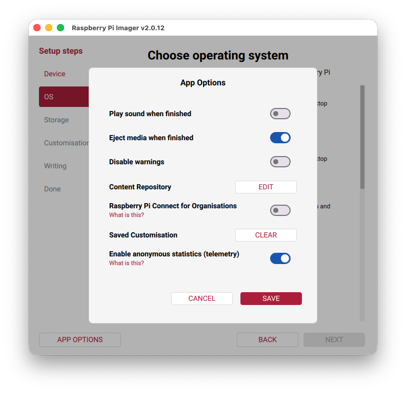

[[app-options]]
== App options

App options control how Imager behaves, and apply to every image you write.

To change them, select *App Options* in the bottom-left corner of Imager, change the options you want, and then select *Save*.

.The App Options dialog

Play sound when finished:: Plays an alert sound when the write finishes.

Eject media when finished:: Ejects the storage device automatically when the write finishes successfully.

Disable warnings:: Skips the confirmation prompts before Imager writes an image. Don't turn this on unless you write images often and you're confident you've selected the correct storage device. If you select a system drive, Imager still asks you to enter the drive's name before it writes to it.

Content Repository:: Changes where Imager gets its list of operating systems and devices. For more information, see <<custom-repositories>>.

Secure Boot RSA Key:: Sets the RSA 2048-bit private key, in PEM format, that Imager uses to sign boot partitions. For more information, see <<customisation-secure-boot>>.

Raspberry Pi Connect for Organisations:: Changes the *Raspberry Pi Connect* customisation subtab so that it registers each device you write with a Raspberry Pi Connect organisation. For more information, see <<customisation-connect>>.

Saved Customisation:: Select *Clear* to remove all saved customisation settings, such as the hostname, Wi-Fi credentials, and user credentials.

Enable anonymous statistics (telemetry):: Sends anonymous usage statistics to Raspberry Pi. For more information, see <<telemetry>>.

The *App Options* dialog also shows the version of Imager that you're running.