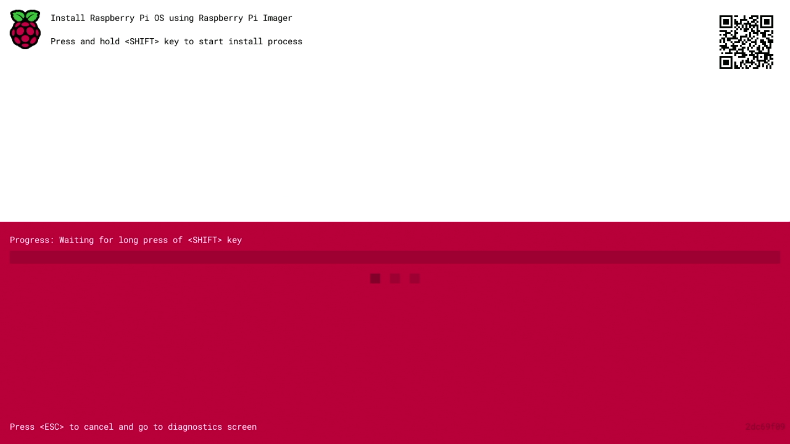
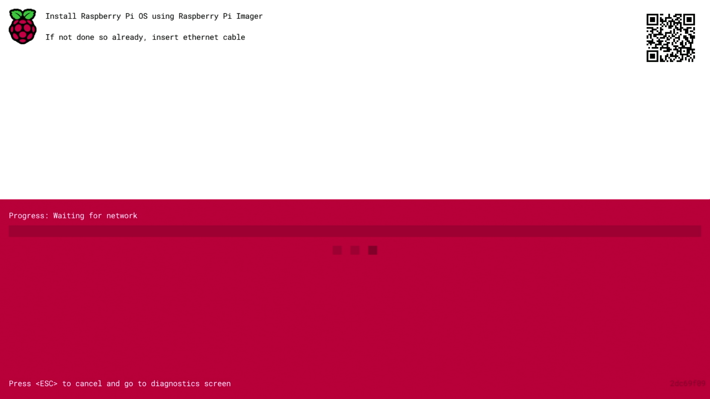
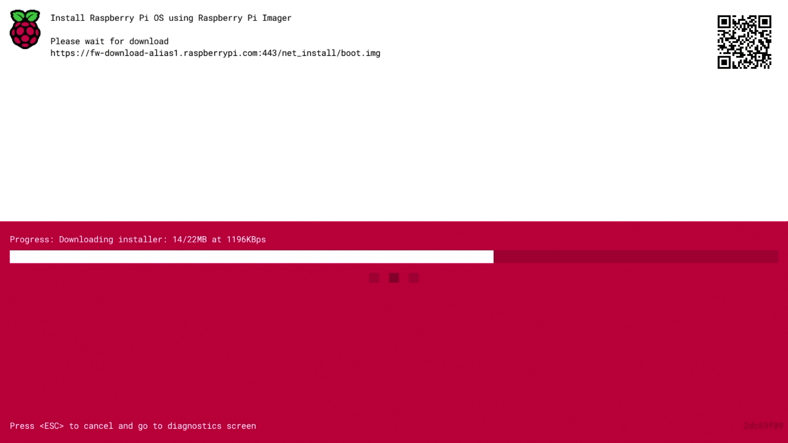

[[network-install]]
== Install over the network

With *Network Install*, your Raspberry Pi downloads Raspberry Pi Imager from the internet and runs it, so you can install an OS without another computer or an SD card reader.

Network Install can write an OS to any compatible storage device connected to your Raspberry Pi, including SD cards, USB drives, and SSDs.

You can also use Network Install to reinstall Raspberry Pi OS on the built-in SSD of a Raspberry Pi 500+ without another computer, for example to move from Bookworm to Trixie. For instructions, see <<network-install-new-version>>.

WARNING: Network Install erases all data on the storage device that you write to. Back up any files you want to keep before you start.

=== Prerequisites

To use Network Install, you need:

* One of the following Raspberry Pi models: Raspberry Pi 4B or later, or a Raspberry Pi 400 keyboard computer or later.
* A bootloader that supports Network Install. If your Raspberry Pi runs an older bootloader, update it first. For instructions, see xref:configuration.adoc#update-bootloader-version[Update the bootloader] in the *Configuration* page.
* A display connected to your Raspberry Pi.
* A keyboard connected to your Raspberry Pi. Keyboard computers use their built-in keyboard. A mouse is optional, but recommended.
* A wired internet connection through an Ethernet cable. Network Install doesn't support Wi-Fi.
* A storage device to install the OS onto, such as an SD card, USB drive, or SSD, connected to your Raspberry Pi. The storage device can be blank, or it can already contain an OS that you want to replace.

[[network-install-launch]]
=== Launch Network Install

To launch Network Install, do the following:

. Connect power, a display, a mouse and an Ethernet cable to your Raspberry Pi. If your Raspberry Pi isn't a keyboard computer, also connect a keyboard.
. Press and hold the *Shift* key, and then power on your Raspberry Pi. Keep holding *Shift* until Network Install starts.
+
The bootloader screen prompts you to press and hold *Shift*. Network Install starts after you've held *Shift* long enough.
+

. Wait while Network Install connects to the internet. If it doesn't connect, check that the Ethernet cable is connected to your Raspberry Pi and to your router.
+

. Wait while Network Install downloads Raspberry Pi Imager. If the download fails, power off your Raspberry Pi and start again.
+

. When the download finishes, Imager starts on your Raspberry Pi. Follow the instructions in <<write-an-image>>, starting from the *Device* tab.
+
In the *Storage* tab, select the storage device that you want to install the OS onto.
//+
// TODO: update this with new version when one can be captured
// image::images/network-install-4.png[alt="Raspberry Pi Imager running on Raspberry Pi after Network Install, with buttons for choosing the operating system and storage device.",width="80%"]
//
. When the *Done* tab appears, select *Reboot*. Your Raspberry Pi restarts and boots into the new OS.

[[network-install-new-version]]
=== Move to a new version of Raspberry Pi OS

Updating your software keeps your Raspberry Pi on the same major version of Raspberry Pi OS.

To move to a new major version, for example from Bookworm to Trixie, reinstall Raspberry Pi OS. On a Raspberry Pi 500+ that came with Bookworm on its built-in SSD, use Network Install to do this.

. Check which version of Raspberry Pi OS you're running. Open a terminal window and run the following command:
+
[source,console]
----
$ grep VERSION_CODENAME /etc/os-release
----
+
If the output is `VERSION_CODENAME=bookworm`, you're running Bookworm. If the output is `VERSION_CODENAME=trixie`, you're already running Trixie and don't need to reinstall.
. Back up the files that you want to keep, such as the files in your home folder, to a USB drive or another computer. Reinstalling erases everything on the storage device, including any software you've installed.
. Launch Network Install. For instructions, see <<network-install-launch>>. When Imager starts:
** In the *OS* tab, choose Raspberry Pi OS. The recommended version for your Raspberry Pi model is at the top of the list.
** In the *Storage* tab, select the storage device that your Raspberry Pi boots from. On Raspberry Pi 500+, this is the built-in SSD.
. After your Raspberry Pi boots into the new OS, copy your backed-up files back, and reinstall any software that you need.

For more information about Network Install configuration, see xref:raspberry-pi.adoc#http-boot[HTTP boot].
