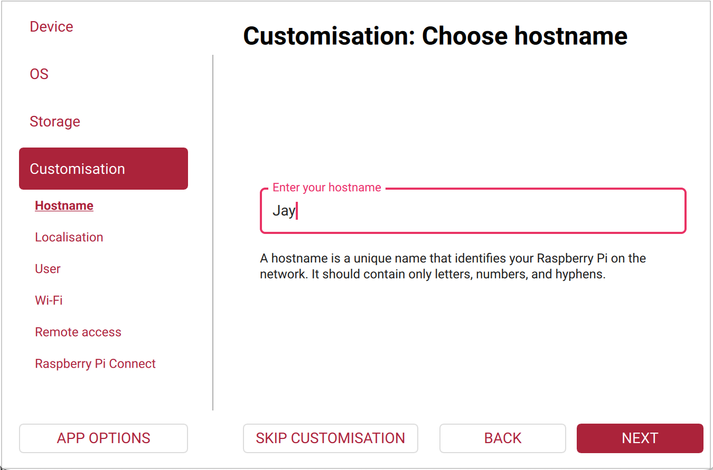
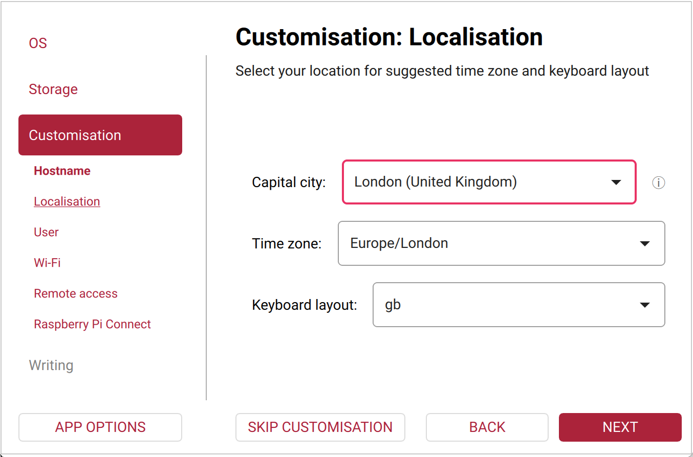
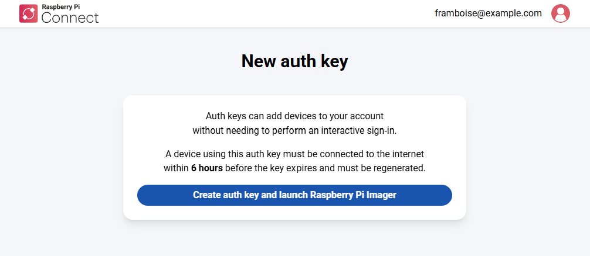
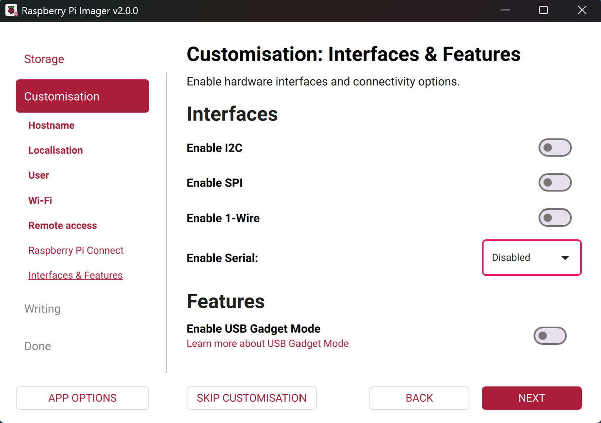

[[os-customisation]]
== Customise your operating system

Raspberry Pi OS and some third-party operating systems support customisation. Customisation lets you configure your Raspberry Pi in Imager so that it's ready to use from first boot. This is essential for a xref:getting-started.adoc#headless-setup[headless setup], because your Raspberry Pi needs network and remote access settings before you can connect to it.

If the OS you chose supports customisation, the *Customisation* tab opens after you select your storage device. You can preconfigure:

* The hostname
* The capital city, time zone, and keyboard layout
* A username and password
* Wi-Fi credentials
* SSH
* Secure boot signing, for operating systems that support it
* Raspberry Pi Connect

To skip customisation, select *Skip customisation*. If you skip customisation, the OS asks you for the same information after first boot. For Raspberry Pi OS, this happens in the xref:getting-started.adoc#first-configuration[configuration wizard].

Imager saves your customisation settings and fills them in the next time you write an image, so you don't have to enter them again. To remove saved settings, see <<app-options>>.

To customise your operating system, follow the instructions for each of the following subtabs and then select *Next*.

[[customisation-hostname]]
=== Hostname

In the *Hostname* subtab, enter a name for your Raspberry Pi. The hostname can contain letters, numbers, and hyphens, and no other characters.

Your Raspberry Pi broadcasts this hostname to the network using https://en.wikipedia.org/wiki/Multicast_DNS[mDNS]. When you connect your Raspberry Pi to your network, other devices on that network can communicate with your Raspberry Pi using `<hostname>.local` or `<hostname>.lan`.

[[customisation-localisation]]
=== Localisation

In the *Localisation* subtab, choose your capital city. Imager suggests the time zone and keyboard layout for that city. You can change these settings independently of one another.

Your selection also sets the Wi-Fi regulatory domain, which always corresponds to the selected capital city. For more information about the regulatory domain, see xref:configuration.adoc#wlan-country[Set the WLAN country].

[[customisation-user]]
=== User

In the *User* subtab, enter a username and password for the admin user of your Raspberry Pi.

The username must be lowercase. It can contain letters, numbers, underscores, and hyphens, and no other characters.

image::images/imager/user-subtab.png[alt="Imager OS Customisation User tab.",width="80%"]

* For a headless setup, these are the credentials you use to connect to your Raspberry Pi over the network.
* Creating a username and password at this stage doesn't require you to enter these credentials whenever you boot your Raspberry Pi. To require a password on boot, turn off Auto Login. For instructions, see xref:configuration.adoc#auto-login[Require a password from startup].
* The password you set here is required when running commands as a superuser (`sudo` commands). If you prefer not to enter a password for these commands, you can turn off this requirement later. For instructions, see xref:configuration.adoc#disable-sudo-password[Turn off password for superuser commands].

[[customisation-wifi]]
=== Wi-Fi

In the *Wi-Fi* subtab, select whether to connect to a *secure network* or an *open network*. On a Mac, Imager might first ask whether you'd like to pre-fill the Wi-Fi password from the system keychain. Confirm whether you want to do this and enter your Mac credentials.

On first use, Imager typically pre-fills the SSID (name) and password of the Wi-Fi network you're currently connected to. If there's no pre-filled information, or if you want to change it, enter the SSID of the wireless network. For secure networks, enter and confirm the password for the network. If your network doesn't broadcast its SSID, select *Hidden SSID* so that your OS can find it.

If you're setting up a headless Raspberry Pi, set up your Wi-Fi connection now, because your Raspberry Pi needs to know how to get online the moment it boots.

image::images/imager/wifi-subtab.png[alt="Imager OS Customisation Wi-Fi tab.",width="80%"]

[[customisation-remote-access]]
=== Remote access

In the *Remote Access* subtab, configure SSH.

image::images/imager/ssh-subtab.png[alt="Imager OS Customisation Remote Access tab.",width="80%"]

To use your Raspberry Pi remotely over your network, turn on *Enable SSH*. If you plan to run a headless Raspberry Pi, turn on SSH, configure <<customisation-connect>>, or both.

If you enable SSH, choose one of the following authentication methods:

* *Use password authentication*: Sign in to your Raspberry Pi over the network using the username and password you entered in the *User* subtab.
* *Use public key authentication*: Sign in using SSH key-based authentication. If you already have an SSH public key on your computer, Imager uses it to pre-fill the key list. To add a key, do one of the following:
** Paste a public key into the key field, or select *Browse* to choose a public key file, and then select *Add*.
** Select *Import from GitHub*, enter a GitHub username, and then select *Add* to add the public SSH keys published by that GitHub account.

For more information about SSH keys, see xref:remote-access.adoc#ssh[SSH].

[[customisation-secure-boot]]
=== Secure boot

Imager can sign the boot partition of an operating system with your private key, for use with Raspberry Pi secure boot. When you turn on secure boot signing, Imager creates the `boot.img` and `boot.sig` files on the boot partition.

The *Secure Boot* subtab appears when the OS you chose declares that it supports secure boot. To show the subtab for any OS, launch Imager with the `--enable-secure-boot` option (see <<command-line>>), or turn on *Force Secure Boot Available* in <<debug-options>>.

To sign the boot partition:

. In the *Secure Boot* subtab, select an RSA 2048-bit private key in PEM format. If you've already set a key in <<app-options>>, Imager uses that key.
. Turn on *Enable Secure Boot Signing*. Imager shows the fingerprint of the public key that corresponds to your private key.

WARNING: A Raspberry Pi with secure boot enabled doesn't boot an image unless it's signed with the matching key. Keep your private key secure, and make sure you're using the correct key before you write the image.

For more information about secure boot, see the https://github.com/raspberrypi/usbboot/blob/master/secure-boot-recovery/README.md[secure boot documentation in the `usbboot` repository].

[[customisation-connect]]
=== Raspberry Pi Connect

Some operating systems also show the *Raspberry Pi Connect* subtab. To link your device to your xref:../services/connect.adoc[Raspberry Pi Connect] account, complete the following steps:

. Turn on *Enable Raspberry Pi Connect*.
+
image::images/imager/connect-subtab.png[alt="Imager OS Customisation Raspberry Pi Connect tab.",width="60%"]
. Select *Open Raspberry Pi Connect*. This opens Raspberry Pi Connect in your default web browser.
+
image::images/imager/os-customisation-site.png[alt="Raspberry Pi Connect page.",width="60%"]
. Sign in to your Raspberry Pi ID account or, if you don't have an account yet, sign up.
. In the *New auth key* page, create your auth key. This is a single-use, temporary token. Personal auth keys expire six hours after creation, and organisation auth keys expire between 1 and 90 days after creation (1 day by default). To use the token, boot your Raspberry Pi and connect it to the internet before the expiry time.
+

+
If you're a member of one or more organisations, select the organisation or account to associate the key with. Then select *Create auth key and launch Raspberry Pi Imager*.
. Your browser might ask whether you want to allow the site to open Raspberry Pi Imager. Confirm that you want to open Raspberry Pi Imager.
** Imager opens at the *Raspberry Pi Connect* subtab, which shows a message to confirm that Imager received the authentication token from the browser, and a field containing the token.
** If the token isn't copied across, you can copy it into Imager manually. Open the *Having trouble?* section of the Raspberry Pi Connect web page, copy the token, and paste it into the token field in Imager.

If you provision devices for a Raspberry Pi Connect organisation, you can turn on *Raspberry Pi Connect for Organisations* in <<app-options>>. In this mode, the *Raspberry Pi Connect* subtab asks for an organisation API key instead, and registers each device you write with your organisation. For more information, see xref:../services/connect-for-organisations.adoc[Raspberry Pi Connect for Organisations].

////
TODO: The Interfaces & Features subtab is still hidden in Getting started. Uncomment when ready to document it.

[[customisation-interfaces]]
=== Interfaces and features

Some device and operating system combinations show the *Interfaces & Features* subtab. On this subtab, you can enable the following:

* Hardware interfaces needed to use your Raspberry Pi with certain peripherals, such as sensors, displays, network controllers, or embedded systems: I2C, SPI, 1-Wire, and serial.
* USB Gadget Mode. For more information, see https://github.com/raspberrypi/rpi-usb-gadget?tab=readme-ov-file[Raspberry Pi USB Gadget].

////
