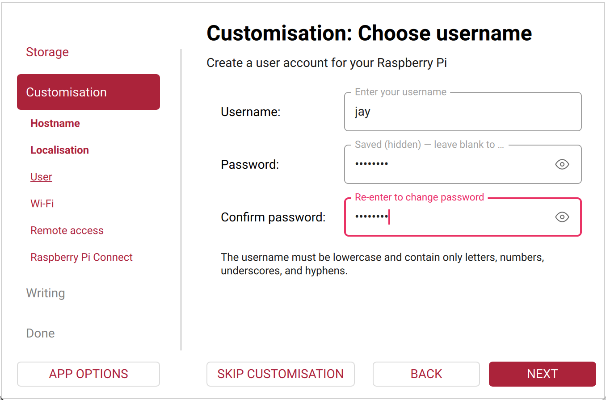
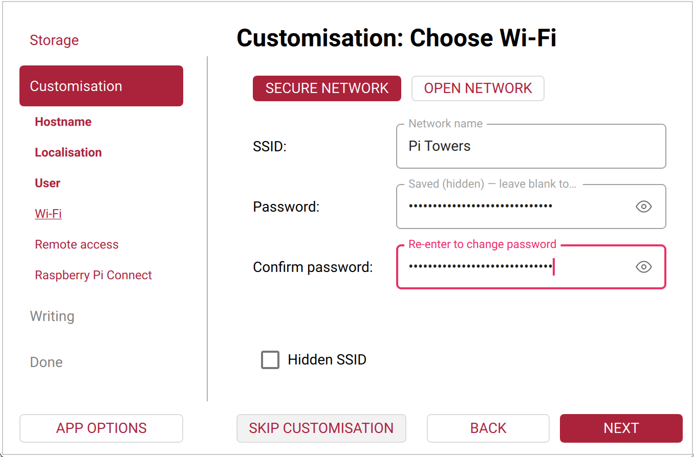
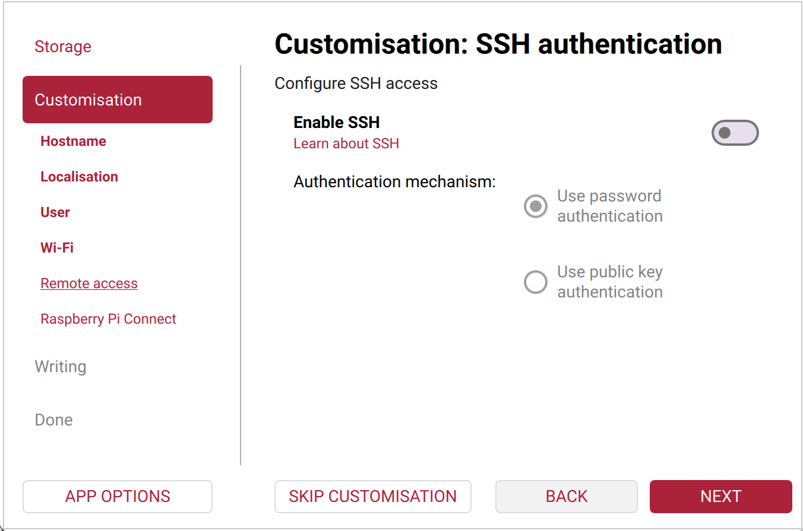
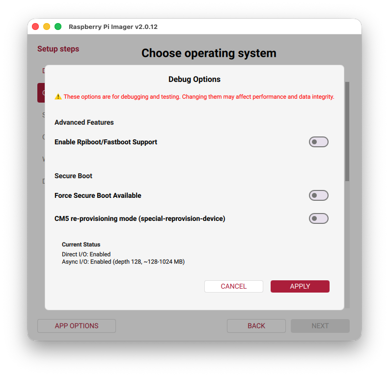
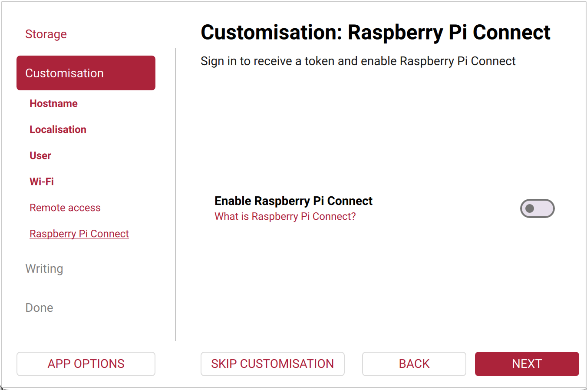
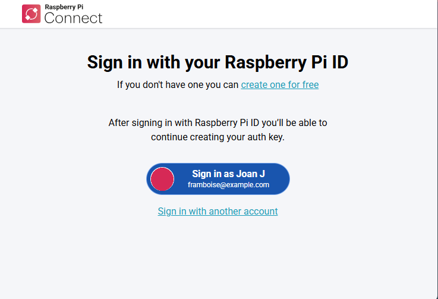

[[os-customisation]]
== Customise your operating system

Raspberry Pi OS and some third-party operating systems support customisation.

Customisation lets you configure your Raspberry Pi's OS using Imager so that it's ready to use from first boot. This is essential for a xref:getting-started.adoc#headless-setup[headless setup], because your Raspberry Pi needs network and remote access settings before you can connect to it.

If the OS you chose supports customisation, the *Customisation* tab opens after you select your storage device. You can preconfigure:

* The hostname
* The capital city, time zone, and keyboard layout.
* A username and password.
* Wi-Fi credentials.
* SSH.
* Secure boot signing, for operating systems that support it.
* Raspberry Pi Connect.

To skip customisation, select *Skip customisation*. If you skip customisation, Raspberry Pi OS asks you for the same information during first boot in the xref:getting-started.adoc#first-configuration[configuration wizard].

Imager saves your customisation settings and fills them in the next time you write an image, so you don't have to enter them again. To remove saved settings, see <<app-options>>.

To customise your operating system, follow the instructions for each of the following subtabs and then select *Next*.

[[customisation-hostname]]
=== Hostname

In the *Hostname* subtab, enter a name for your Raspberry Pi. The hostname can contain letters, numbers, and hyphens, but no other characters.

Whether other devices can find your Raspberry Pi by this hostname depends on the OS. Raspberry Pi OS broadcasts the hostname to the network using https://en.wikipedia.org/wiki/Multicast_DNS[mDNS], and sends it to your router when it requests an IP address. When you connect your Raspberry Pi to your network, other devices on that network can communicate with your Raspberry Pi using `<hostname>.local`, or `<hostname>.lan` if your router supports it.

.The Hostname subtab
image::images/imager/hostname-subtab.png[alt="The Hostname subtab in Imager, with a field for entering the hostname.",width="80%"]

[[customisation-localisation]]
=== Localisation

In the *Localisation* subtab, choose your capital city. To find your city, open the list and enter the first few letters of its name. Imager filters the list as you enter each letter.

Imager suggests the time zone and keyboard layout for that city. You can change these settings independently of one another.

Your selection also sets the Wi-Fi regulatory domain, which always corresponds to the selected capital city. For more information about the regulatory domain, see xref:configuration.adoc#wlan-country[Set the WLAN country].

.The Localisation subtab
image::images/imager/localisation-subtab.png[alt="The Localisation subtab in Imager, with lists for choosing the capital city, time zone, and keyboard layout.",width="80%"]

[[customisation-user]]
=== User

In the *User* subtab, enter a username and password for the admin user of your Raspberry Pi.

The username must be lowercase. It can contain letters, numbers, underscores, and hyphens, and no other characters.

.The User subtab

IMPORTANT: Choose a strong password that you'll remember. You need it to run commands as a superuser (`sudo` commands), and to sign in if you turn off auto login. For advice, see the UK National Cyber Security Centre's guidance on https://www.ncsc.gov.uk/collection/top-tips-for-staying-secure-online/three-random-words[using three random words].

* For a headless setup, these are the credentials you use to connect to your Raspberry Pi over the network.
* By default, Raspberry Pi OS with desktop signs in to the desktop automatically when it starts up, so you don't need to enter these credentials then. If other people might have access to your Raspberry Pi, turn off auto login. For instructions, see xref:configuration.adoc#auto-login[Require a password from startup].
* Raspberry Pi OS asks for the password you set here when you run commands as a superuser. We don't recommend turning off this requirement. For more information, see xref:configuration.adoc#disable-sudo-password[Turn off password for superuser commands] in the *Configuration* page.

[[customisation-wifi]]
=== Wi-Fi

In the *Wi-Fi* subtab, select whether to connect to a *secure network* or an *open network*.

If you're running Imager on macOS, it might first ask whether you'd like to pre-fill the Wi-Fi password from the macOS keychain. If you do, select the option to use the keychain, and then enter the user name and password of an administrator account on your Mac.

On first use, Imager typically pre-fills the SSID (name) and password of the Wi-Fi network you're currently connected to. If there's no pre-filled information, or if you want to change it, enter the SSID of the wireless network.

For secure networks, enter and confirm the password for the network.

If your network doesn't broadcast its SSID, select *Hidden SSID* so that your OS can find it.

If you're setting up a headless Raspberry Pi that isn't connected to Ethernet, set up your Wi-Fi connection now, because your Raspberry Pi needs to know how to get online the moment it boots.

.The Wi-Fi subtab

[[customisation-remote-access]]
=== Remote access

In the *Remote access* subtab, configure SSH.

.The Remote access subtab

To use your Raspberry Pi remotely over your network, turn on *Enable SSH*.

If you plan to run a headless Raspberry Pi, configure <<customisation-connect>>, turn on SSH, or both. We recommend Raspberry Pi Connect for new users.

If you enable SSH, choose one of the following authentication methods:

* *Use password authentication*: Sign in to your Raspberry Pi over the network using the username and password you entered in the *User* subtab.
* *Use public key authentication*: Sign in using SSH key-based authentication. If you already have an SSH public key on your computer, Imager uses it to pre-fill the key list. To add a key, do one of the following:
** Paste a public key into the key field, or select *Browse* to choose a public key file, and then select *Add*.
** Select *Import from GitHub*, enter a GitHub username, and then select *Add* to add the public SSH keys published by that GitHub account.

For more information about SSH keys, see xref:remote-access.adoc#ssh[SSH].

[[customisation-secure-boot]]
=== Secure boot

Imager can sign the boot partition of an operating system with your private key, for use with Raspberry Pi secure boot.

When you turn on secure boot signing, Imager creates the `boot.img` and `boot.sig` files on the boot partition.

The *Secure Boot* subtab appears when the OS you chose declares that it supports secure boot. To show the subtab for any OS, launch Imager with the `--enable-secure-boot` option (see <<command-line>>), or turn on *Force Secure Boot Available* in <<debug-options>>.

.The Secure Boot option in the Debug Options subtab

To sign the boot partition:

. In the *Secure Boot* subtab, select an RSA 2048-bit private key in PEM format. If you've already set a key in <<app-options>>, Imager uses that key.
. Turn on *Enable Secure Boot Signing*. Imager shows the fingerprint of the public key that corresponds to your private key.

WARNING: A Raspberry Pi with secure boot enabled doesn't boot an image unless it's signed with the matching key. Keep your private key secure, and make sure you're using the correct key before you write the image.

For more information about secure boot, see the https://github.com/raspberrypi/usbboot/blob/master/secure-boot-recovery/README.md[secure boot documentation in the `usbboot` repository].

[[customisation-connect]]
=== Raspberry Pi Connect

Some operating systems also show the *Raspberry Pi Connect* subtab.

To link your device to your xref:../services/connect.adoc[Raspberry Pi Connect] account, complete the following steps:

. Turn on *Enable Raspberry Pi Connect*.
+

. Select *Open Raspberry Pi Connect*. This opens the Raspberry Pi Connect webpage in your default browser.
+

. Sign in to your Raspberry Pi ID account or, if you don't have an account yet, sign up.
. In the *New auth key* page, create your auth key. This is a single-use, temporary token. Personal auth keys expire six hours after creation, and organisation auth keys expire between 1 and 90 days after creation (1 day by default).
+
image::images/imager/connect-auth-key.png[alt="The New auth key page in Raspberry Pi Connect, with a Create auth key and launch Raspberry Pi Imager button.",width="60%"]
+
If you're a member of one or more organisations, select the organisation or account to associate the key with. Then select *Create auth key and launch Raspberry Pi Imager*.
. Your browser might ask whether you want to allow the site to open Raspberry Pi Imager. Confirm that you want to open Raspberry Pi Imager.
** Imager opens at the *Raspberry Pi Connect* subtab, which shows a message to confirm that Imager received the authentication token from the browser, and a field containing the token.
** If the token isn't copied across, you can copy it into Imager manually. Open the *Having trouble?* section of the Raspberry Pi Connect web page, copy the token, and paste it into the token field in Imager.

After you've written the image, boot your Raspberry Pi and connect it to the internet before the auth key expires.

If you provision devices for a Raspberry Pi Connect organisation, you can turn on *Raspberry Pi Connect for Organisations* in <<app-options>>.

In this mode, the *Raspberry Pi Connect* subtab asks for an organisation API key instead of an auth key. Imager uses the API key to create a single-use auth key and writes it into the image. Your Raspberry Pi then joins your organisation when it first boots. If you write to a Compute Module or another device over USB (see <<enable-rpiboot>>), Imager registers the device with your organisation directly. For more information, see xref:../services/connect-for-organisations.adoc[Raspberry Pi Connect for Organisations].

[[customisation-interfaces]]
=== Interfaces and features

Some device and operating system combinations show the *Interfaces & Features* tab. On this tab, you can enable the following:

* Hardware interfaces needed to use your Raspberry Pi with certain peripherals, such as sensors, displays, network controllers, or embedded systems: I2C, SPI, 1-Wire, and serial.
* USB Gadget Mode. For more information, see https://github.com/raspberrypi/rpi-usb-gadget?tab=readme-ov-file[Raspberry Pi USB Gadget].

To show this subtab for an OS in a custom list, see <<custom-repository-interfaces>>.

.The Interfaces & Features subtab
image::images/imager/os-customisation-interfaces.png[alt="The Interfaces & Features subtab in Imager, with switches for I2C, SPI, 1-Wire, and USB Gadget Mode, and a list for serial.",width="80%"]