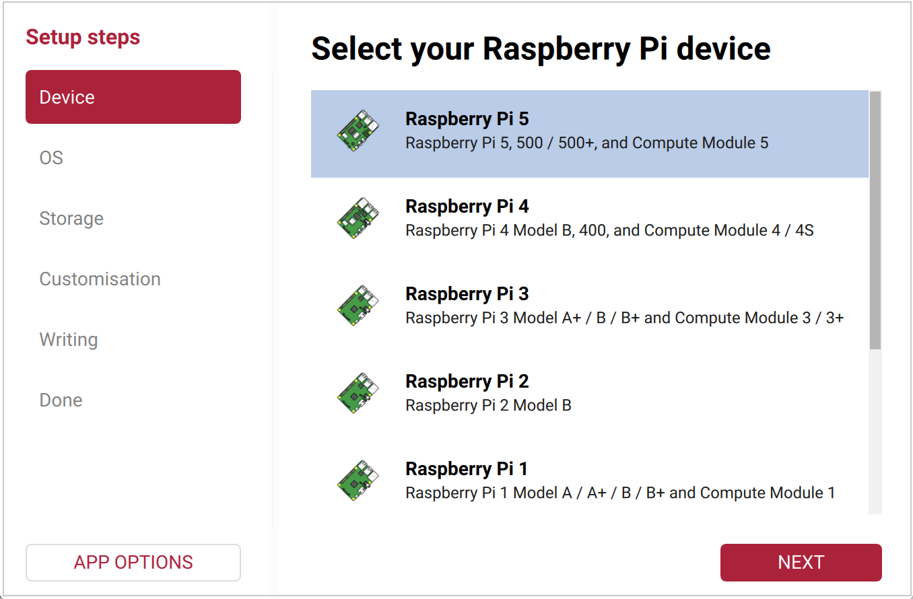
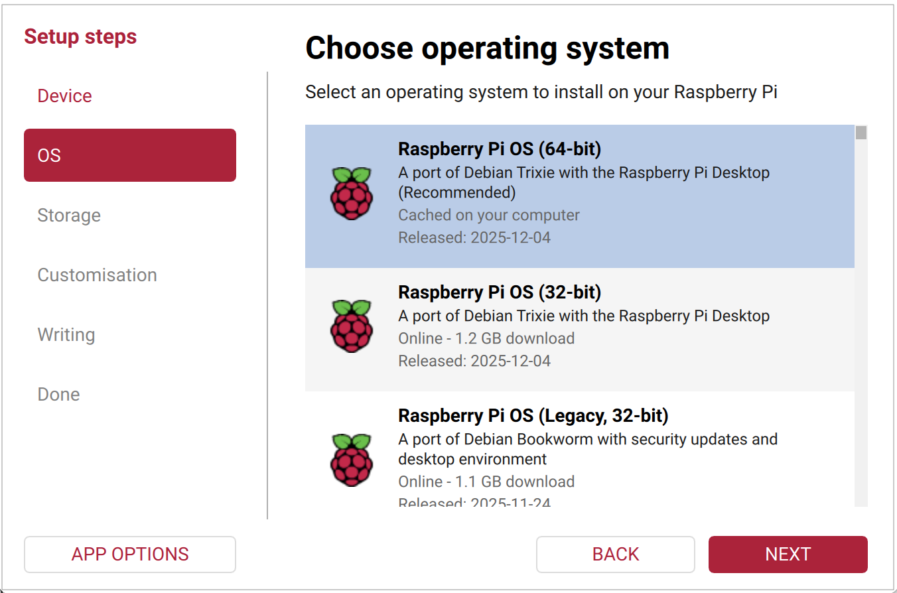
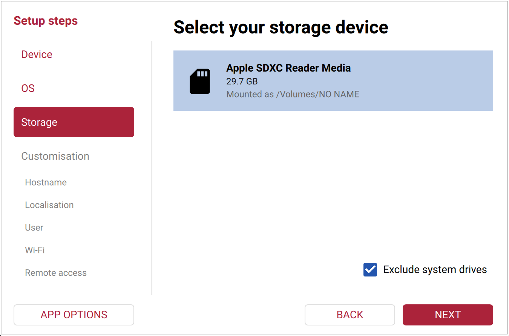
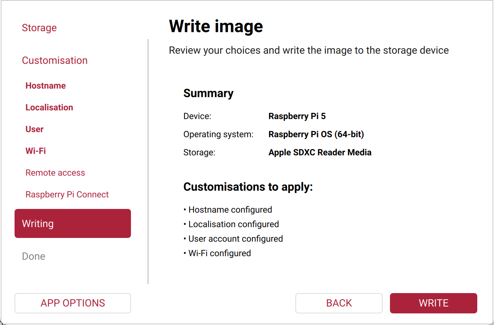
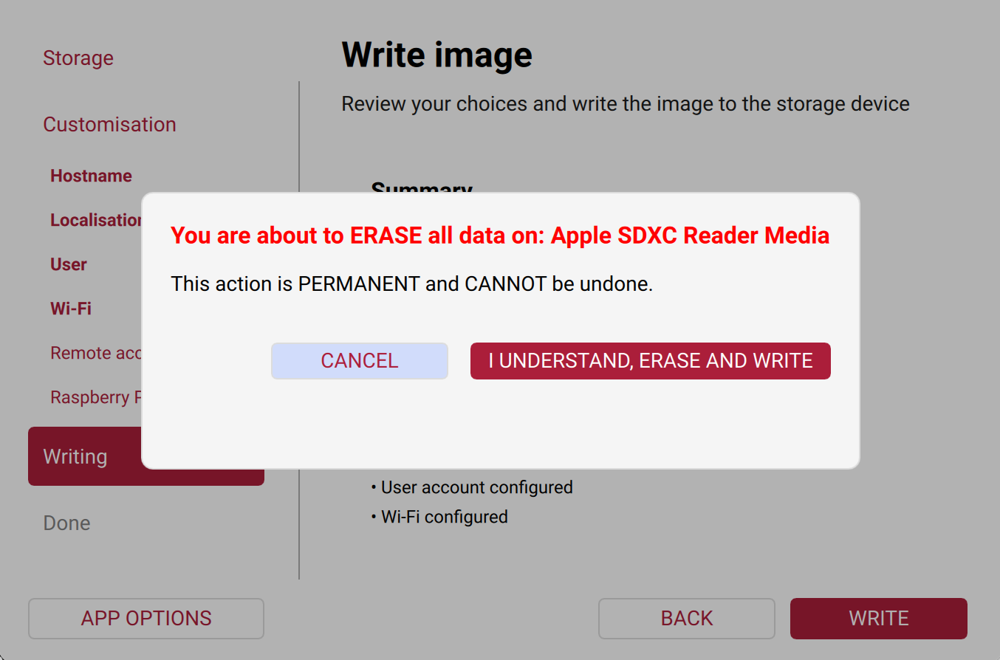

[[write-an-image]]
== Write an image

Imager guides you through a series of tabs: *Device*, *OS*, *Storage*, *Customisation* (for operating systems that support it), and *Writing*.

To write an OS image to a storage device:

. Launch Imager. For instructions, see <<install-imager>>.
. In the *Device* tab, select your Raspberry Pi model and then select *Next*.
+
Imager uses your selection to filter the *OS* list so that it shows the operating systems that are compatible with your Raspberry Pi model.
+

. In the *OS* tab, choose an operating system and then select *Next*.
+
The recommended OS for your Raspberry Pi model is at the top of the list. Some entries are categories; select a category to see the operating systems in it. To install an image file that's stored on your computer, select *Use custom*. For more information, see <<write-custom-image>>.
+

. Connect your storage device to your computer. For example, plug a microSD card into your computer using an external or built-in SD card reader.
. In the *Storage* tab, select your storage device and then select *Next*.
+
If you have more than one storage device connected to your computer, take care to choose the correct one. You can often identify the correct storage device by its size. If you're unsure, disconnect the other devices until you've identified the device that you want to write to.
+

+
WARNING: We strongly recommend that you keep *Exclude system drives* selected. This hides the drives that your computer uses, including the one it runs from, so that you can't accidentally erase your data and make your computer unusable.

. If the OS you chose supports customisation, the *Customisation* tab is displayed. Configure your Raspberry Pi as described in <<os-customisation>>, or select *Skip customisation*.
. In the *Writing* tab, review the *Summary* of your choices and then select *Write*.
+

. Imager warns you that it's about to erase all data on your storage device. To continue, select *I understand, erase and write*. If your computer asks for permission for Imager to write to your storage device, grant it.
+

. Wait while Imager writes the image to your storage device and then verifies it. Each stage can take several minutes, depending on the size of the image and the speed of your storage device.
+
We recommend that you let verification finish, because it checks that the image on your storage device matches the original. If you want to skip it, select *Skip verification*.
. When the *Done* tab appears, select *Finish*.

If you turned on *Eject media when finished* in <<app-options>>, Imager ejects the storage device for you. Otherwise, eject it safely using your computer's file manager before you remove it.

[[write-custom-image]]
=== Write an image file from your computer

You can use Imager to write an OS image that you've downloaded yourself, for example from the https://www.raspberrypi.com/software/operating-systems/[Raspberry Pi OS downloads page] or from a third-party vendor such as https://ubuntu.com/download/raspberry-pi[Ubuntu].

. In the *OS* tab, go to the bottom of the list and select *Use custom*.
. Browse to the image file on your computer and select it. Imager accepts uncompressed images (`.img` and `.wic`) and compressed images (`.zip`, `.gz`, `.xz`, and `.zst`).
. Continue from the *Storage* tab as described in <<write-an-image>>.

Imager can't customise an image unless it declares support for customisation. If you write an image from your computer, Imager might not show the *Customisation* tab. To customise an image that you've downloaded, create a local manifest that describes it. For instructions, see https://github.com/raspberrypi/rpi-imager/tree/main/doc/local_json[Generate a local manifest file] in the rpi-imager repository.

[[erase-storage]]
=== Erase a storage device

To erase a storage device and format it with a single FAT32 partition, select *Erase* at the bottom of the *OS* tab, and then continue from the *Storage* tab as described in <<write-an-image>>.

[[utility-images]]
=== Write a utility image

The *OS* tab also includes utility images that don't install an operating system. For example, the bootloader images under *Misc utility images > Bootloader* restore or reconfigure the bootloader of a Raspberry Pi. For instructions, see xref:raspberry-pi.adoc#bootloader_reflash[Reflash the bootloader].