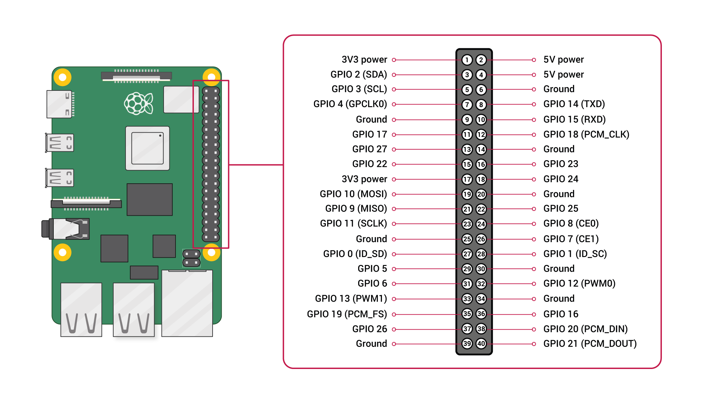
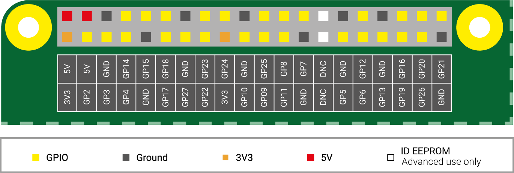

[[gpio]]
== 40-pin GPIO header

All current xref:../computers/sbcs.adoc[classic single-board computers (SBCs)], xref:../computers/zero.adoc[Zero models], and xref:../computers/keyboard-computers.adoc[keyboard computers] include a 40-pin general-purpose input/output (GPIO) header, distributed across two rows of 20 pins, with standard 2.54 mm pin pitch. On some Zero models, the GPIO header doesn't come with pins attached. For more information about these variants, see xref:../computers/zero.adoc[Zero models].

NOTE: Earlier models of classic Raspberry Pi SBCs that are no longer in production had a 26-pin GPIO header.

The GPIO header is the primary hardware bridge between your Raspberry Pi's processor and external electronic components. Programs running on your Raspberry Pi use these pins to perform two core actions:

* *Receive input.* Read digital states from connected sensors, switches, and buttons.
* *Send output.* Transmit electrical signals to control external hardware like LEDs, motors, and displays.

=== Pin layout

The 40-pin GPIO header is located along the top edge of standard circuit boards (classic SBCs and Zero models) and on the rear of keyboard-integrated models (keyboard computers).

The following figure shows the standard Raspberry Pi pin layout for Raspberry Pi B+ and later, and for all Zero models. On *classic SBCs* and *Zero* models, Pin 1 is located in the lower-left corner of the header; pin 40 is located at the diagonally opposite, upper-right corner of the header.

The GPIO header on *keyboard computers* has an inverted orientation; the header is rotated 180 degrees compared to a standard board layout, but pins 1 and 40 are labelled to help reduce confusion.

WARNING: When connecting external hardware to the GPIO header, check the orientation and alignment of the GPIO header before applying power. Incorrect wiring can result in circuit failure, erratic behaviour, permanent thermal or overcurrent damage to connected peripherals, and irreversible electrical damage to your Raspberry Pi device's SoC.

.Raspberry Pi pinout diagram

==== GPIO pin labels and positions

Physical pin numbers (1 to 40) don't match the logical GPIO identifiers used in code. For example, `GP17` is physically located at pin 11 on a Raspberry Pi board.

The pin labels in the following figure correspond to the logical GPIO identifiers used in code rather than their sequential physical position on the board. This means that the GPIO pin numbering scheme, represented in yellow, isn't in numerical order.

.The pin labelling for a Raspberry Pi GPIO header

==== GPIO pinout map

Raspberry Pi OS includes the https://gpiozero.readthedocs.io/[GPIO Zero Python library], which allows you to display a map of the GPIO pins on your Raspberry Pi from the Terminal with the following command:

[source,console]
----
$ pinout
----

This command displays a pinout map showing the physical pin positions, logical GPIO identifiers, and pin functions.

=== Pin types

Each pin is mapped to a specific function categorised into four primary types, summarised in the following table.

[[pins]]
.Pin types, quantity, and purpose
[cols="1,^1,1,1,2", options="header"]
|===
| Pin type | Quantity | Labelling | Voltage | Primary purpose

| Power
| 4
| `3V3` (2) +
`5V` (2)
| 3.3 V DC +
5.0 V DC
| Provide power to compatible, low-current peripherals

| Ground
| 8
| `GND`
| 0 V
| Provide a ground connection (0 volts), used to complete electrical circuits across the header.

| GPIO
| 26
| `GPXX`, where `XX` is a number from 2 to 27 (`GP2` to `GP27`)
| 3.3 V logic
| General-purpose digital input and output pins, customisable through software; supports <<protocols, communication protocols>> (SPI, I2C, UART, PWM, and PCM).

| ID EEPROM
| 2
| `GP0` and `GP1`
| 3.3 V logic
| Reserved for use with Hardware Attached on Top (HAT) boards.
|===

NOTE: GPIO pins 0 and 1, sometimes named `GPIO 0 (ID_SD)` and `GPIO 1 (ID_SC)`, respectively, are reserved for special-purpose use. Physically, these pins correspond with pins 27 and 28 on a Raspberry Pi board.

=== GPIO pin inputs, outputs, and communication protocols

GPIO pins can operate in two modes: <<inputs, inputs>> and <<outputs, outputs>>. Some GPIO pins can also control connected components using specific <<protocols, communication protocols>>, including *SPI*, *I2C*, *UART*, *PWM*, and *PCM*.

[[inputs]]
==== Inputs

A GPIO pin designated as an input is read as high when connected to 3.3 V, and low when connected to 0 V. Internal pull-up or pull-down resistors help establish a defined input state when no external signal is being applied.

WARNING: Raspberry Pi GPIO pins operate at 3.3 V and aren't 5 V tolerant. Only the 5 V power pins are designed to supply 5 V power. Never apply 5 V directly to a GPIO pin because this can cause permanent damage to your Raspberry Pi's SoC.

`GP2` (SDA) and `GP3` (SCL) have fixed 1.8 kΩ resistors. You can control pull-up or pull-down configuration for other pins through software.

[[outputs]]
==== Outputs

A GPIO pin designated as an output can be set to high (3.3 V) or low (0 V) to control connected electronic components.

An individual GPIO pin can supply up to 16 mA to an attached device, and all GPIO pins combined can supply a maximum total current of 50 mA.

WARNING: While connecting simple components to GPIO pins is generally safe when wired correctly, take care when connecting electronic components to your Raspberry Pi. For LEDs, use a suitable current-limiting resistor. For motors, use a suitable motor driver, such as an H-bridge or motor controller board; never connect motors directly to GPIO pins.

[[protocols]]
==== Communication protocols (alternative functions)

Some GPIO pins can control connected components using specific communication protocols, including the following:

* *SPI (Serial Peripheral Interface)*, used to communicate with external SPI devices, such as sensors, displays, and other peripherals.
* *UART (Universal Asynchronous Receiver/Transmitter)*, used to send and receive serial data with devices such as microcontrollers.
* *PWM (Pulse Width Modulation)*, used to control the amount of power delivered to devices such as motors and LEDs.
* *PCM (Pulse Code Modulation)*, used for digital audio input and output.
* *I2C (Inter-Integrated Circuit)*, used to communicate with external I2C devices, such as sensors, displays, and other peripherals.

=== Pin functions

The following table summarises the typical functions of each of the pins. Some functions are available on all pins; other functions are available on specific pins.

Most of the GPIO pins in this table have multiple alternative functions. GPIO pins with alternative functions allow peripheral hardware within the SoC to connect to selected GPIO pins instead of using them as general-purpose inputs or outputs. For example, I2C signals can be assigned to different supported GPIO pin locations.

* For more detailed information about the functions available on the Raspberry Pi 5 family of devices, see *Alternative function assignments* in the https://pip.raspberrypi.com/documents/RP-008180-DS[Compute Module 5 datasheet].
* For more detailed information about the functions available on the Raspberry Pi 4 family of devices, see *Alternative function assignments* in the https://pip.raspberrypi.com/documents/RP-008168-DS[Compute Module 4 datasheet].
* For more detailed information about the functions available on earlier Raspberry Pi families of devices and Raspberry Pi Zero models, see *Alternative Function Assignments* in the https://pip.raspberrypi.com/documents/RP-008249-DS[BCM2835 peripherals datasheet].

NOTE: Pad control settings, such as output drive strength and Schmitt-trigger filtering, still apply when a pin is configured for an alternative function.

.Pin names, types, and typical functions
[cols="1,1,2,6", options="header"]
|===
| Pin | Name | Type | Typical function

| 1
| `3V3`
| Power
| Transmits power as output to attached peripherals at 3.3 V

| 2
| `5V`
| Power
| Provides 5 V power output to peripherals, or accepts 5 V power input to power a Raspberry Pi (for example, through a PoE+ HAT or third-party HAT)

| 3
| `GP2`
| GPIO
| Serial Data Line (SDA); transmits data to and from an *I2C* device; this pin has a 1.8 kΩ on-board pull-up resistor to 3.3 V

| 4
| `5V`
| Power
| Provides 5 V power output to peripherals, or accepts 5 V power input to power a Raspberry Pi (for example, through a PoE+ HAT or third-party HAT)

| 5
| `GP3`
| GPIO
| Serial Clock Line (SCL); provides a clock signal that synchronises communication between your Raspberry Pi and an *I2C* device; this pin has a 1.8 kΩ on-board pull-up resistor to 3.3 V

| 6
| `GND`
| Ground
| Completes an electrical circuit connected to power

| 7
| `GP4`
| GPIO
| `GPCLK0`; clock output

| 8
| `GP14`
| GPIO
| Transmit Data (TXD); sends serial (*UART*) data to a connected device

| 9
| `GND`
| Ground
| Completes an electrical circuit connected to power

| 10
| `GP15`
| GPIO
| Receive Data (RXD); receives serial (*UART*) data from a connected device

| 11
| `GP17`
| GPIO
| *SPI* chip enable (`CE1`)

| 12
| `GP18`
| GPIO
| *PCM* clock or *SPI* chip enable (CE0)

| 13
| `GP27`
| GPIO
|

| 14
| `GND`
| Ground
| Completes an electrical circuit connected to power

| 15
| `GP22`
| GPIO
|

| 16
| `GP23`
| GPIO
|

| 17
| `3V3`
| Power
| Transmits power as output to attached peripherals at 3.3 V

| 18
| `GP24`
| GPIO
|

| 19
| `GP10`
| GPIO
| MOSI; sends data from your Raspberry Pi to a *SPI* device

| 20
| `GND`
| Ground
| Completes an electrical circuit connected to power

| 21
| `GP9`
| GPIO
| MISO; receives data from a *SPI* device

| 22
| `GP25`
| GPIO
|

| 23
| `GP11`
| GPIO
| Serial clock (`SCLK`); provides a clock signal for *SPI*

| 24
| `GP8`
| GPIO
| *SPI* chip enable (`CE0`)

| 25
| `GND`
| Ground
| Completes an electrical circuit connected to power

| 26
| `GP7`
| GPIO
| *SPI* chip enable (`CE1`)

| 27
| `GP0`
| GPIO
| *I2C* (`ID_SD`); used to identify a HAT

| 28
| `GP1`
| GPIO
| *I2C* (`ID_SC`); used to identify a HAT

| 29
| `GP5`
| GPIO
|

| 30
| `GND`
| Ground
| Completes an electrical circuit connected to power

| 31
| `GP6`
| GPIO
|

| 32
| `GP12`
|  GPIO
| Pulse Width Modulation (`PWM0`) output

| 33
| `GP13`
| GPIO
| Pulse Width Modulation (`PWM1`) output

| 34
| `GND`
| Ground
| Completes an electrical circuit connected to power

| 35
| `GP19`
| GPIO
| *PCM* frame sync (`PCM_FS`) or MISO (receives data from a *SPI* device)

| 36
| `GP16`
| GPIO
| *SPI* chip enable (`CE2`)

| 37
| `GP26`
| GPIO
|

| 38
| `GP20`
| GPIO
| *PCM* (`PCM_DIN`); audio data in

| 39
| `GND`
| Ground
| Completes an electrical circuit connected to power

| 40
| `GP21`
| GPIO
| *PCM* (`PCM_DOUT`); audio data out
|===

=== GPIO configuration

This section covers the underlying architecture and low-level configuration of the GPIO hardware.

==== GPIO permissions

To access GPIO ports, a user must be a member of the appropriate `gpio` group. The primary user account on a Raspberry Pi OS is a member of the `gpio` group by default. Other users of your Raspberry Pi must be added manually using the following command, replacing `<username>` with the actual username of the user:

[source,console]
----
$ sudo usermod -a -G gpio <username>
----

==== GPIO pads

The external GPIO connections on the SoC are sometimes referred to as 'pads' in the https://pip.raspberrypi.com/documents/RP-008249-DS[BCM2835 peripherals datasheet]. In semiconductor terminology, pads are the chip's electrical connection points to the outside world.

The GPIO pads include configurable CMOS push-pull output drivers and input buffers. Register-based settings can control the following:

* Internal pull-up and pull-down resistors (enable or disable).
* Output xref:raspberry-pi.adoc#gpio-pads-control[drive strength].
* Input Schmitt-trigger filtering.

==== Power-on states

Following a power-on reset, GPIO pins are generally configured as inputs. The default pull states are also applied, which are detailed in the *Alternative Function Assignments* table in the https://pip.raspberrypi.com/documents/RP-008249-DS[BCM2835 peripherals datasheet]. Most GPIOs have a default pull applied.

==== Interrupts

Each GPIO pin configured as a general-purpose input can be configured as an interrupt source for the Arm processor. The following interrupt-generation modes are available:

* *Level-sensitive interrupts*, initiated when the input signal is high or low. These interrupts maintain the interrupted state until the level has been cleared by system software, for example, by servicing the attached peripheral generating the interrupt.
* *Edge-sensitive interrupts*, initiated with rising or falling signal transitions. Rising and falling edge detection has some synchronisation built into the detection. At the system clock frequency, the input is sampled, and an interrupt is generated when the transition meets the detection criteria within a three-cycle window. For example, `1, 0, 0` (high, low, low) and `0, 1, 1` (low, high, high) represent qualifying transitions.
* *Asynchronous edge detection*, which bypasses the synchronisation involved in edge-sensitive interrupts, allowing the hardware to detect narrower input events.

=== Voltage specifications

There are two 5 V pins and two 3.3 V pins in the 40-pin GPIO header, as well as a number of ground (`GND`) pins. These pins can't be reconfigured. The remaining pins are general-purpose 3.3 V pins, high outputs are set to 3.3 V and inputs are 3.3 V-tolerant.

==== BCM2835, BCM2836, BCM2837, and RP3A0

The following table gives the voltage specifications for the GPIO pins for BCM2835, BCM2836, BCM2837, and RP3A0 products (for example, Raspberry Pi Zero or Raspberry Pi 3B+). For information about Compute Modules, see the xref:compute-module.adoc#specifications[relevant Compute Module datasheets].

.Voltage specifications for GPIO pins on BCM2835, BCM2836, BCM2837, and RP3A0 products
|===
| Symbol | Parameter | Conditions| Min | Typical | Max | Unit

| V~IL~
| Input low voltage
| -
| -
| -
| 0.9
| V

| V~IH~
| Input high voltage^a^
| -
| 1.6
| -
| -
| V

| I~IL~
| Input leakage current
| TA = +85◦C
| -
| -
| 5
| µA

| C~IN~
| Input capacitance
| -
| -
| 5
| -
| pF

| V~OL~
| Output low voltage^b^
| IOL = -2 mA
| -
| -
| 0.14
| V

| V~OH~
| Output high voltage^b^
| IOH = 2 mA
| 3.0
| -
| -
| V

| I~OL~
| Output low current^c^
| VO = 0.4 V
| 18
| -
| -
| mA

| I~OH~
| Output high current^c^
| VO = 2.3 V
| 17
| -
| -
| mA

| R~PU~
| Pullup resistor
| -
| 50
| -
| 65
| kΩ

| R~PD~
| Pulldown resistor
| -
| 50
| -
| 65
| kΩ
|===

^a^ Hysteresis enabled +
^b^ Default drive strength (8 mA) +
^c^ Maximum drive strength (16 mA)

==== BCM2711 products

The following table gives the voltage specifications for the GPIO pins on BCM2711 products (Raspberry Pi 4 and 400). For information about Compute Module 4, see the xref:compute-module.adoc#specifications[relevant Compute Module datasheet].

.Voltage specifications for GPIO pins on BCM2711 products
|===
| Symbol | Parameter | Conditions| Min | Typical | Max | Unit

| V~IL~
| Input low voltage
| -
| -
| -
| 0.8
| V

| V~IH~
| Input high voltage^a^
| -
| 2.0
| -
| -
| V

| I~IL~
| Input leakage current
| TA = +85◦C
| -
| -
| 10
| µA

| V~OL~
| Output low voltage^b^
| IOL = -4 mA
| -
| -
| 0.4
| V

| V~OH~
| Output high voltage^b^
| IOH = 4 mA
| 2.6
| -
| -
| V

| I~OL~
| Output low current^c^
| VO = 0.4 V
| 7
| -
| -
| mA

| I~OH~
| Output high current^c^
| VO = 2.6 V
| 7
| -
| -
| mA

| R~PU~
| Pullup resistor
| -
| 33
| -
| 73
| kΩ

| R~PD~
| Pulldown resistor
| -
| 33
| -
| 73
| kΩ
|===

^a^ Hysteresis enabled +
^b^ Default drive strength (4 mA) +
^c^ Maximum drive strength (8 mA)

==== RP1 products

The following table gives the voltage specifications for the GPIO pins on RP1-based products (Raspberry Pi 5, 500, and 500+). For information about Compute Module 5, see the xref:compute-module.adoc#specifications[relevant Compute Module datasheet].

.Voltage specifications for GPIO pins on RP1 products
|===
| Symbol | Parameter | Conditions| Min | Typical | Max | Unit

| V~IL~
| Input low voltage
| -
| 0
| -
| 0.8
| V

| V~IH~
| Input high voltage
| -
| 2.0
| -
| 3.3
| V

| I~IL~
| Input leakage current
| -
| -
| -
| 3
| µA

| V~OL~
| Output low voltage
| -
| -
| -
| 0.4
| V

| V~OH~
| Output high voltage
| -
| 2.9
| -
| -
| V

| I~OL~
| Output current
| Drive strength = 2 mA
| 6.1
| 9.6
| 13.5
| mA

| I~OL~
| Output current
| Drive strength = 4 mA
| 9.2
| 14.3
| 20.2
| mA

| I~OL~
| Output current
| Drive strength = 8 mA
| 15.3
| 23.9
| 33.7
| mA

| I~OL~
| Output current
| Drive strength = 12 mA
| 18.4
| 28.7
| 40.5
| mA

| I~OH~
| Output current
| Drive strength = 2 mA
| 4.5
| 6.3
| 8.4
| mA

| I~OH~
| Output current
| Drive strength = 4 mA
| 6.8
| 9.5
| 12.6
| mA

| I~OH~
| Output current
| Drive strength = 8 mA
| 11.4
| 15.8
| 21
| mA

| I~OH~
| Output current
| Drive strength = 12 mA
| 13.6
| 19
| 25.2
| mA

| R~PU~
| Pull-up resistor
| -
| 37
| 55
| 86
| kΩ

| R~PD~
| Pulldown resistor
| -
| 35
| 55
| 98
| kΩ
|===