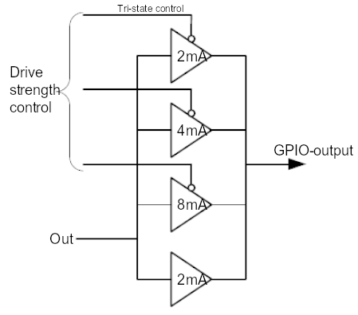

== GPIO pads control

GPIO drive strengths don't indicate a maximum current, but a maximum current under which the pad still meets the specification. Set the GPIO drive strengths to match the device you're attaching so that the device works correctly.

=== Control drive strength

Inside the pad are a number of drivers in parallel. If the drive strength is set low (`0b000`), most of these are tri-stated so they don't add anything to the output current. If the drive strength is increased, more and more drivers are put in parallel. The diagram shows that behaviour for BCM2835, BCM2836, BCM2837, and RP3A0 products.

.GPIO drive strength for BCM2835, BCM2836, BCM2837, and RP3A0 products

The drive strength settings available, and the current at each setting, depend on the product:

.Drive strength settings by product
[cols="2,3"]
|===
| Products | Drive strength settings

| BCM2835, BCM2836, BCM2837, and RP3A0 products (for example, Raspberry Pi Zero and Raspberry Pi 3B+)
| 2 mA to 16 mA, in 2 mA steps, as shown in the diagram.

| BCM2711 products (Raspberry Pi 4, 400, and Compute Module 4)
| 1 mA to 8 mA, in 1 mA steps. The pads use the same settings as BCM2835 products, but the current at each setting is half the value shown in the diagram.

| RP1 products (Raspberry Pi 5, 500, 500+, and Compute Module 5)
| 2 mA, 4 mA, 8 mA, or 12 mA. For the output current at each setting, see the xref:raspberry-pi.adoc#voltage-specifications[voltage specifications] for RP1 products.
|===

=== Current value

The current value specifies the maximum current under which the pad still meets the specification.

Current value is _not_ the current that the pad delivers, and is _not_ a current limit.

The pad output is a voltage source:

* If set high, the pad tries to drive the output to the rail voltage (3.3 V).
* If set low, the pad tries to drive the output to ground (0 V).

The pad tries to drive the output high or low. Success depends on the requirements of what's connected. If the pad is shorted to ground, it can't drive high. It tries to deliver as much current as it can, and the current is limited only by the internal resistance.

If the pad is driven high when it's shorted to ground, it might eventually be damaged.

Meeting the specification is determined by the guaranteed voltage levels. Because the pads are digital, there are two voltage levels, high and low. The I/O ports have two parameters that deal with the output level. For example, on BCM2835, BCM2836, BCM2837, and RP3A0 products:

* V~OL~, the maximum low-level voltage (0.14 V at 3.3 V VDD IO)
* V~OH~, the minimum high-level voltage (3.0 V at 3.3 V VDD IO)

V~OL~ = 0.14 V means that if the output is low, it's ≤ 0.14 V.
V~OH~ = 3.0 V means that if the output is high, it's ≥ 3.0 V.

For the values on other products, see the xref:raspberry-pi.adoc#voltage-specifications[voltage specifications].

For example, a drive strength of 16 mA means that if you set the pad high, you can draw up to 16 mA, and the output voltage is guaranteed to be ≥ V~OH~. This also means that if you set a drive strength of 2 mA and you draw 16 mA, the voltage is _not_ V~OH~ but lower. In fact, it might not be high enough for an external device to detect it as high.

For more information, see the xref:raspberry-pi.adoc#gpio[physical characteristics] of the GPIO pins.

NOTE: On Compute Module devices, you can change the VDD IO from the standard 3.3 V. In this case, V~OL~ and V~OH~ change according to the table in the xref:raspberry-pi.adoc#gpio[GPIO] section.

The Raspberry Pi 3.3 V supply was designed with a maximum current of approximately 3 mA per GPIO pin. If you load each pin with 16 mA, the total current is 272 mA. The 3.3 V supply collapses under that level of load. Large current spikes occur, especially if you have a capacitive load. Spikes affect all the other pins near them. This is likely to cause interference with the SD card, or even the SDRAM behaviour.

=== Safe current

The safe current is the maximum current you can draw from (source) or sink into a GPIO pin without damaging the device, regardless of the drive strength setting. There's also a limit on the total current across all GPIO pins combined. Stay within both limits.

.Safe current limits for GPIO pins
[cols="2,1,1"]
|===
| Products | Maximum per pin | Maximum total (all GPIO pins)

| BCM2835, BCM2836, BCM2837, and RP3A0 products (for example, Raspberry Pi Zero and Raspberry Pi 3B+)
| 16 mA
| 50 mA

| BCM2711 products (Raspberry Pi 4, 400, and Compute Module 4)
| Not specified
| 50 mA

| RP1 products (Raspberry Pi 5, 500, 500+, and Compute Module 5)
| Not specified
| 50 mA
|===

On BCM2835, BCM2836, BCM2837, and RP3A0 products, all the electronics of the pads are designed for 16 mA. Even if you set the drive strength to 2 mA and then load it so that 16 mA comes out, this doesn't damage the device. Other than that, there's no guaranteed maximum safe current.

On RP1 products, the actual output current at a given drive strength setting can be several times the nominal value. For example, the 12 mA setting can sink up to 40.5 mA. Choose the lowest drive strength and slew rate that your application needs; this also reduces electromagnetic compatibility (EMC) issues.

=== GPIO addresses

NOTE: The registers in this section apply to BCM2835, BCM2836, BCM2837, RP3A0, and BCM2711 products. On RP1 products, the pad controls are part of RP1. For more information, see the https://pip.raspberrypi.com/documents/RP-008370-DS[RP1 peripherals datasheet].

* `0x7e10002c` PADS (GPIO 0-27)
* `0x7e100030` PADS (GPIO 28-45)
* `0x7e100034` PADS (GPIO 46-53)

|===
| Bits | Field name | Description | Type | Reset

| 31:24
| PASSWRD
| Must be `0x5A` when writing; accidental write protect password
| W
| 0

| 23:5
|
| *Reserved*: write as 0, read as don't care
|
|

| 4
| SLEW
| Slew rate; 0 = slew rate limited; 1 = slew rate not limited
| RW
| 0x1

| 3
| HYST
| Enable input hysteresis; 0 = disabled; 1 = enabled
| RW
| 0x1

| 2:0
| DRIVE
| Drive strength; see xref:raspberry-pi.adoc#drive-strength-list[Drive strength list]
| RW
| 0x3
|===

Be aware of simultaneous switching output (SSO) limitations. These depend on the device, the quality and layout of the PCB, the amount and quality of the decoupling capacitors, the type of load on the pads (resistance and capacitance), and other factors beyond the control of Raspberry Pi.

[[drive-strength-list]]
=== Drive strength list

.DRIVE field values
[cols="1,2,2"]
|===
| DRIVE | BCM2835, BCM2836, BCM2837, and RP3A0 | BCM2711

| 0 | 2 mA | 1 mA
| 1 | 4 mA | 2 mA
| 2 | 6 mA | 3 mA
| 3 | 8 mA | 4 mA
| 4 | 10 mA | 5 mA
| 5 | 12 mA | 6 mA
| 6 | 14 mA | 7 mA
| 7 | 16 mA | 8 mA
|===