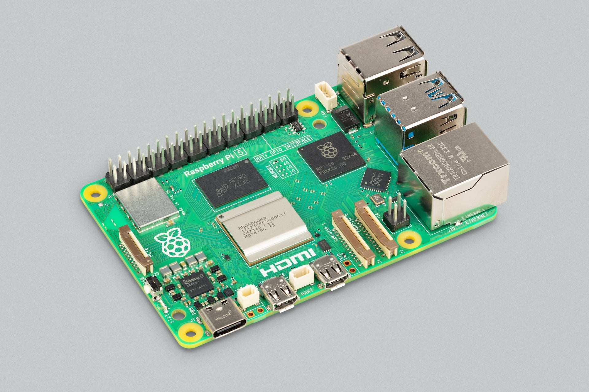
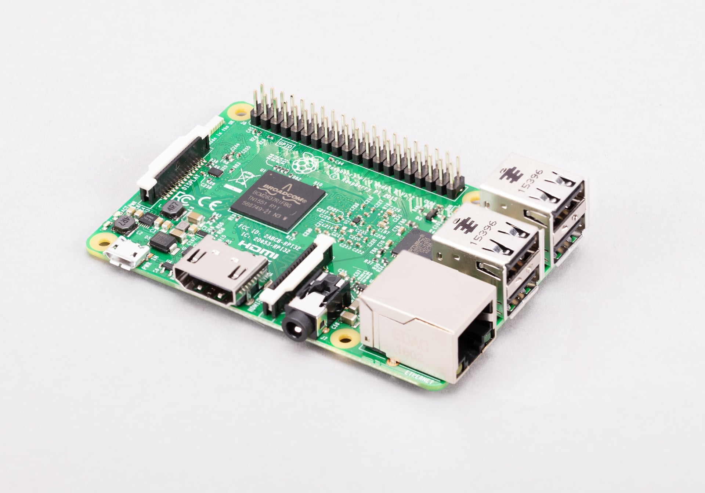
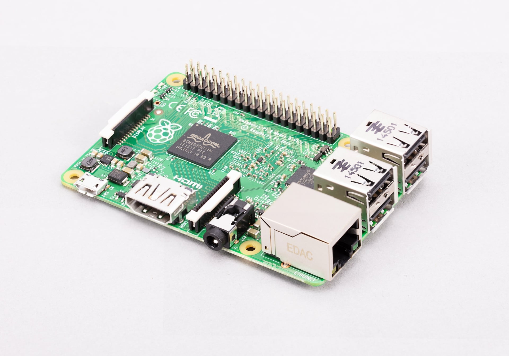

[[rpi5]]
== Raspberry Pi 5

.Raspberry Pi 5

https://www.raspberrypi.com/products/raspberry-pi-5/[Raspberry Pi 5] is the fifth-generation classic SBC from Raspberry Pi. It delivers improvements in CPU performance, graphics capability, memory bandwidth, I/O throughput, and power management compared to previous models. The board introduces a new architecture that separates I/O management from the main processor, enabling faster peripheral connectivity and improved overall system performance, listed below.

The dimensions of a Raspberry Pi 5 are approximately 85 mm × 56 mm. For more detailed measurements, see the https://pip.raspberrypi.com/documents/RP-008347-DS[mechanical drawing for Raspberry Pi 5].

=== Feature changes from Raspberry Pi 4

Raspberry Pi 5 features a fundamental shift in architecture and user experience from Raspberry Pi 4:

* *Faster SoC.* The SoC for Raspberry Pi 5 is a Broadcom *BCM2712*, which includes:
** Four 64-bit Arm Cortex-A76 CPU cores; each CPU core runs at 2.4 GHz.
** An 800 MHz Broadcom VideoCore VII GPU for video and 3D rendering tasks.
* *Faster RAM.* Upgraded to LPDDR4X running at 4267 MHz.
* *Option for more RAM.* There are five RAM options, up to 16 GB of RAM.
* *RP1 I/O controller.* The RP1 component acts as an intermediary between the SoC and the board's peripheral interfaces, decoupling the SoC from direct management of low-level I/O tasks. RP1 manages most of the board's port connectivity, allowing the SoC to focus on processing tasks. For more information about this component, see xref:../computers/io-controllers.adoc[I/O controllers].
* *Simultaneous USB 3.0 bandwidth.* Due to the RP1 component, Raspberry Pi 5 can run both USB 3.0 ports at full speed simultaneously.
* *PCIe 2.0 support.* Provides high-bandwidth communication through a dedicated https://pip.raspberrypi.com/documents/RP-008298-DS[FFC connector], allowing direct connection with external peripherals like NVMe drives or AI accelerators, increasing data read/write speeds compared to microSD cards.
* *Interchangeable, higher-bandwidth MIPI ports.* Instead of one CSI port and one DSI port, Raspberry Pi 5 has two interchangeable CSI/DSI ports, which allow you to plug in two cameras, two displays, or one of each. Each connector supports 4 MIPI data lanes for high-performance cameras and displays.
* *Enhanced dual 4K display support.* You can connect two 4K displays at 60 Hz simultaneously.
* *Dedicated power button.* Instead of requiring you to plug and unplug your Raspberry Pi from power to turn it on and off, the power button provides a more PC-like experience for power management.
* *Higher power profile.* The PMIC supports a 5 V at 5 A (25 W) profile to accommodate USB devices that use more power.
* *Thermal management.* A dedicated fan header allows you to attach one of the following to manage its temperature through Pulse Width Modulation (PWM):
** A https://www.raspberrypi.com/products/active-cooler/[Raspberry Pi Active Cooler], which combines an aluminium heatsink with a temperature-controlled blower fan.
** A https://www.raspberrypi.com/products/raspberry-pi-5-case/[Raspberry Pi 5 Case], which comes with an integrated temperature-controlled cooling fan.
* *Real-time clock (RTC).* You can attach a battery to keep system time even when your Raspberry Pi 5 is unplugged.
* *Dedicated UART debug port.* A header (https://pip.raspberrypi.com/documents/RP-008189-DS[3-pin debug connector]) that provides debug access to the CPU without needing to occupy GPIO pins.
* *PoE header relocation.* The four-pin PoE header moved from beside the GPIO header at the top of the board to between the Ethernet and CSI/DSI ports at the bottom of the board.

The following sections describe these changes alongside:

* Other internal components soldered onto a Raspberry Pi 5.
* The physical sockets and headers that allow you to connect external hardware to these components.

=== Raspberry Pi 5 components

A Raspberry Pi 5 includes the following on-board components:

.List of Raspberry Pi 5 components
[cols="1,3"]
|===
| Component | Description

| *SoC*
| *Broadcom BCM2712*, which includes a 2.4 GHz quad-core 64-bit Arm Cortex-A76 (CPU) and 800 MHz VideoCore VII (GPU).

| *RP1 (I/O management)*
| The I/O controller that manages peripherals to offload I/O tasks from the main CPU, including GPIO, USB, Ethernet, and MIPI. For more information, see xref:../computers/io-controllers.adoc[I/O controllers].

| *Memory*
| *LPDDR4X* (enhanced low-power double data rate 4) RAM that runs at 4267 MHz; a fixed choice of 1, 2, 4, 8, or 16 GB of RAM.

| *Wireless module*
| A radio module that acts as two components: a *Wi-Fi* radio for connecting to computer networks for dual-band (either 2.4 GHz or 5 GHz) 802.11ac Wi-Fi; and a *Bluetooth* radio for connecting to peripherals, delivering Bluetooth 5.0 and Bluetooth Low Energy (BLE).

| *Ethernet PHY*
| A dedicated physical-layer transceiver (PHY) that transfers data between the RP1 I/O controller and the RJ45 (Gigabit Ethernet) port.

| *Real-time clock (RTC)*
| An RTC module that keeps track of the current date and time even when your Raspberry Pi 5 is powered off.

| *Power button*
| A physical push button located at the edge of the board that allows for soft-shutdowns, wake-ups, and hard power-downs without needing to unplug the USB-C cable.
|===

=== Raspberry Pi 5 ports

A Raspberry Pi 5 includes the following ports:

.Table 4. List of Raspberry Pi 5 ports
[cols="1,3"]
|===
| Port type | Description

| *USB 3.0 ports*
| Two USB 3.0 ports (blue) supporting simultaneous 5 Gb/s operation (due to RP1). These USB ports allow you to connect high-speed storage and peripherals to your Raspberry Pi 5.

| *USB 2.0 ports*
| Two USB 2.0 ports (black) supporting keyboards, mice, and other slower peripherals that don't require high bandwidth.

| *Gigabit Ethernet port*
| A high-speed RJ45 port for connecting to a wired computer network. The port includes two LEDs at the bottom that indicate connectivity and activity. The port also supports PoE when used with a PoE+ HAT, which extracts power from the Ethernet cable if the other end is connected to a PoE-enabled network switch, router, or injector.

| *PoE header*
| A four-pin header located between the CSI/DSI ports and the Ethernet port. When a PoE+ HAT is attached, these pins allow your Raspberry Pi 5 to draw power from an Ethernet cable instead of a USB-C cable.

| *Micro-HDMI ports*
| Two micro-HDMI ports, labelled `HDMI0` and `HDMI1`, supporting up to two 4K displays at 60 Hz simultaneously.

| *Dual CSI/DSI ports*
| Two interchangeable 4-lane MIPI connectors, labelled `CAM/DISP 0` and `CAM/DISP 1`, implemented as two mini 22-pin, 0.5 mm-pitch, 11.5 mm-wide combined CSI/DSI ports that support two cameras, two displays, or one of each.

| *PCIe 2.0 interface*
| A single-lane PCIe 2.0 interface, exposed through a 16-pin, 0.5 mm-pitch FFC connector, which allows you to connect high-speed peripherals like NVMe SSDs (through an M.2 HAT) and AI accelerators (through an AI HAT).

| *USB Type-C power port*
| A USB-C port for connecting your Raspberry Pi to a power source, supporting the 5 V at 5 A (25 W) required to power the board and attached peripherals, or 5 V at 3 A (15 W), in which case the USB peripheral current limit is 600 mA.

| *GPIO header*
| A standardised interface consisting of 40 metal pins, arranged into two rows of 20. These pins allow your Raspberry Pi to talk to additional hardware (like LEDs, buttons, sensors, and so on).

| *Fan header*
| A dedicated four-pin JST connector (JST-SH 1.25 mm) for a fan, which uses PWM to adjust fan speed based on CPU temperature, keeping cool when under load.

| *RTC battery header*
| A two-pin JST connector, labelled `BAT` and located to the right of the USB-C power port. Used to connect a https://www.raspberrypi.com/products/rtc-battery/[lithium battery] to power the on-board real-time clock (RTC) when main power is disconnected.

| *MicroSD card slot*
| Located on the underside of the board, a slot for a high-speed microSD card for loading an operating system.

| *UART debug port*
| A dedicated 3-pin JST header located between the two micro-HDMI ports, providing debug access to the CPU for troubleshooting.
|===

[[rpi4b]]
== Raspberry Pi 4 Model B

.Raspberry Pi 4B
image::images/rpi4b.jpg[width="80%"]

https://www.raspberrypi.com/products/raspberry-pi-4-model-b/[Raspberry Pi 4B] is the fourth-generation classic SBC from Raspberry Pi. It delivers improvements in processor performance, memory capacity, networking, and multimedia capabilities compared to previous models. The board features a more powerful quad-core processor, support for dual-display output at up to 4K resolution, and faster connectivity through Gigabit Ethernet, USB 3.0, and dual-band wireless networking, listed below.

The dimensions of Raspberry Pi 4B are approximately 85 mm × 56 mm. For more detailed measurements, see the mechanical drawings:

* https://pip.raspberrypi.com/documents/RP-008343-DS[PDF mechanical drawing for Raspberry Pi 4B]
* https://pip.raspberrypi.com/documents/RP-008342-DS[DXF mechanical drawing for Raspberry Pi 4B]

For an engineering diagram of the power-supply circuits and port connections, see the https://pip.raspberrypi.com/documents/RP-008345-DS[schematic drawings for Raspberry Pi 4B].

=== Feature changes from Raspberry Pi 3A+ and 3B+

Raspberry Pi 4B features a shift in architecture from Raspberry Pi 3A+ and 3B+:

* *Faster SoC.* The SoC for Raspberry Pi 4B is a Broadcom *BCM2711*, which includes:
** Four 64-bit Arm Cortex-A72 CPU cores; each CPU core runs at 1.8 GHz.
** A 500 MHz Broadcom VideoCore VI GPU for video and 3D rendering tasks.
* *Faster RAM.* Upgraded to LPDDR4 running at 3200 MHz.
* *RAM options.* There are five RAM options, up to 8 GB of RAM.
* *USB 3.0 ports.* As well as two USB 2.0 ports (black), Raspberry Pi 4B includes two USB 3.0 ports (blue), which are faster and deliver more power than USB 2.0 ports.
* *True Gigabit Ethernet.* Rather than routing Ethernet throughput through the USB controller (as on a Raspberry Pi 3B+), Raspberry Pi 4B features full, unrestricted Gigabit Ethernet capable of reaching line speeds up to 1 Gb/s.
* *Support for dual 4K monitors.* Two micro-HDMI ports replace the single full-sized HDMI port, allowing for two 4K displays at 30 Hz or one 4K display at 60 Hz.
* *Upgraded Bluetooth.* Wireless connectivity is upgraded to Bluetooth 5.0, which offers twice the speed and four times the range of Bluetooth 4.2.
* *USB-C power input.* A USB-C power input replaces the micro USB power input.
* *Dedicated USB controller.* Instead of a single Ethernet and USB controller, Raspberry Pi 4B has a separate component for USB control; the Ethernet controller is contained within the SoC.

The following sections describe these changes alongside:

* Other internal components soldered onto a Raspberry Pi 5.
* The physical sockets and headers that allow you to connect external hardware to these components.

=== Raspberry Pi 4B components

A Raspberry Pi 4B includes the following on-board components:

.List of Raspberry Pi 4B components
[cols="1,3"]
|===
| Component | Description

| *SoC*
| *Broadcom BCM2711*, which includes a 1.8 GHz quad-core 64-bit Arm Cortex-A72 (CPU) and 500 MHz VideoCore VI (GPU).

| *Memory*
| *LPDDR4* (low-power double data rate 4) RAM that runs at 3200 MHz; a choice of 1, 2, 3, 4, or 8 GB of RAM.

| *Wireless module*
| A radio module that acts as two components: a *Wi-Fi* radio for connecting to computer networks delivering dual-band (either 2.4 GHz or 5 GHz) 802.11ac Wi-Fi; and a *Bluetooth* radio for connecting to peripherals, delivering Bluetooth 5.0 and Bluetooth Low Energy (BLE).

| *USB controller*
| A small black component (VL805) behind the USB ports that controls them.

| *Ethernet PHY*
| A dedicated physical-layer transceiver (PHY) that connects the Gigabit Ethernet interface in the SoC to the RJ45 (Gigabit Ethernet) port.
|===

=== Raspberry Pi 4B ports

A Raspberry Pi 4B includes the following ports:

.List of Raspberry Pi 4B ports
[cols="1,3"]
|===
| Port type | Description

| *USB 3.0 ports*
| Two USB 3.0 ports (blue) supporting high-speed operation. These USB ports allow you to connect high-speed storage and peripherals to your Raspberry Pi 4B.

| *USB 2.0 ports*
| Two USB 2.0 ports (black) supporting keyboards, mice, and other slower peripherals that don't require high bandwidth.

| *Gigabit Ethernet port*
| A high-speed RJ45 port for connecting to a wired computer network. The port includes two LEDs at the bottom that indicate connectivity and activity. The port also supports PoE when used with a PoE+ HAT, which extracts power from the Ethernet cable if the other end is connected to a PoE-enabled network switch, router, or injector.

| *PoE header*
| A four-pin header located near the GPIO header. When a PoE+ HAT is attached, these pins allow your Raspberry Pi 4B to draw power from an Ethernet cable instead of a USB-C cable.

| *AV jack*
| A 3.5 mm, 4-pole stereo audio and composite video port (AV jack) that can connect to TVs, projectors, and other displays that support a composite video signal using a TRRS cable.

| *Micro-HDMI ports*
| Two micro-HDMI ports, labelled `HDMI0` and `HDMI1`, supporting up to two 4K displays at 30 Hz or one 4K display at 60 Hz.

| *CSI (camera) port*
| A 2-lane MIPI Camera Serial Interface (CSI) port, labelled `CAMERA`, that allows you to connect to a camera. Implemented as a standard 15-pin, 1 mm-pitch, 16 mm-wide CSI port.

| *DSI (display) port*
| A 2-lane MIPI Display Serial Interface (DSI) port, labelled `DISPLAY`, that allows you to connect to a display. Implemented as a standard 15-pin, 1 mm-pitch, 16 mm-wide DSI port.

| *USB Type-C power port*
| A USB-C power port for connecting your Raspberry Pi to a power source, supporting the 5 V at 3 A (15 W) required to power the board and attached peripherals.

| *GPIO header*
| A standardised interface consisting of 40 metal pins, arranged into two rows of 20. These pins allow your Raspberry Pi to talk to additional hardware (like LEDs, buttons, sensors, and so on).

| *MicroSD card slot*
| Located on the underside of the board, a slot for a high-speed microSD card for loading an operating system.
|===

[[rpi3aplus-3bplus]]
== Raspberry Pi 3 Models A+ and B+

.Raspberry Pi 3A+ (left) and 3B+ (right)
image::images/rpi3aplusand3bplus.jpg[width="100%"]

Both Raspberry Pi 3A+ and 3B+ offer a hardware upgrade over the original Raspberry Pi 3B, with a faster SoC, an integrated metal heat spreader for improved thermal performance, and upgraded wireless connectivity.

https://www.raspberrypi.com/products/raspberry-pi-3-model-b-plus/[Raspberry Pi 3B+] is the enhanced third-generation (Raspberry Pi 3B) classic SBC. It provides additional hardware features compared to Raspberry Pi 3A+, including an Ethernet port and additional USB ports. Its dimensions are approximately 85 mm × 56 mm. For more detailed measurements, see the mechanical drawings:

* https://pip.raspberrypi.com/documents/RP-008337-DS[PDF mechanical drawing for Raspberry Pi 3B+]
* https://pip.raspberrypi.com/documents/RP-008336-DS[DXF mechanical drawing for Raspberry Pi 3B+]

For an engineering diagram of the power-supply circuits and port connections, see the https://pip.raspberrypi.com/documents/RP-008339-DS[schematic drawings for Raspberry Pi 3B+].

https://www.raspberrypi.com/products/raspberry-pi-3-model-a-plus/[Raspberry Pi 3A+] shares the same core processor and wireless capabilities as Raspberry Pi 3B+, but has a smaller form factor, with reduced memory and fewer ports. Its dimensions are approximately 65 mm × 56 mm. For more detailed measurements, see the https://pip.raspberrypi.com/documents/RP-008330-DS[mechanical drawing for Raspberry Pi 3A+]. For an engineering diagram of the power-supply circuits and port connections, see the https://pip.raspberrypi.com/documents/RP-008332-DS[schematic drawings for Raspberry Pi 3A+].

There are also mechanical drawings for the Raspberry Pi 3A+ case and 3B+ case:

* https://pip.raspberrypi.com/documents/RP-008329-DS[PDF mechanical drawing for the Raspberry Pi 3A+ case]
* https://pip.raspberrypi.com/documents/RP-008160-DS[PDF mechanical drawing for the Raspberry Pi 3B+ case]

=== Feature changes from Raspberry Pi 3B

Raspberry Pi 3A+ and 3B+ feature upgraded wireless networking:

* Dual-band (2.4 GHz and 5 GHz) Wi-Fi with modular compliance certification.
* Bluetooth 4.2 (upgraded from 4.1) and Bluetooth Low Energy (BLE).

Raspberry Pi 3B+ additionally features the following changes from Raspberry Pi 3B:

* *Faster Ethernet.* Gigabit Ethernet over USB 2.0 on the Raspberry Pi 3B+, increasing throughput from about 100 Mb/s up to about 300 Mb/s.
* *Support for PoE.* With a PoE+ HAT, a four-pin PoE header on Raspberry Pi 3B+ allows the SBC to be powered through an Ethernet cable.

The following sections describe these changes alongside:

* Other internal components soldered onto a Raspberry Pi 3A+ or 3B+.
* The physical sockets and headers that allow you to connect external hardware to these components.

=== Raspberry Pi 3A+ and 3B+ components

Raspberry Pi 3A+ and 3B+ boards include the following on-board components:

.List of Raspberry Pi 3A+ and 3B+ components
[cols="1,2,2"]
|===
| Component | Raspberry Pi 3A+ | Raspberry Pi 3B+

| *SoC*
2+| *Broadcom BCM2837B0*, which includes a 1.4 GHz quad-core 64-bit Arm Cortex-A53 (CPU) and 400 MHz VideoCore IV (GPU).

| *Memory*
| 512 MB of *LPDDR2* (low-power double data rate 2) RAM that runs at 900 MHz.
| 1 GB of *LPDDR2* (low-power double data rate 2) RAM that runs at 900 MHz.

| *Wireless module*
2+| A radio module that acts as two components: a *Wi-Fi* radio for connecting to computer networks, delivering dual-band (either 2.4 GHz or 5 GHz) 802.11b/g/n Wi-Fi; and a *Bluetooth* radio for connecting to peripherals, delivering Bluetooth 4.2 and Bluetooth Low Energy (BLE).

| *I/O management*
| The single USB 2.0 port is connected directly to the Broadcom SoC.
| The network and USB controller (LAN7515), a small black component behind the USB ports that controls the USB ports and the Ethernet.
|===

=== Raspberry Pi 3A+ and 3B+ ports

Raspberry Pi 3A+ and 3B+ include the following ports:

.List of Raspberry Pi 3A+ and 3B+ ports
[cols="3,4,6"]
|===
| Port type | Raspberry Pi 3A+ | Raspberry Pi 3B+

| *USB 2.0 ports*
| A single USB 2.0 port supporting a keyboard, mouse, and other slower peripherals that don't require high bandwidth.
| Four USB 2.0 ports supporting keyboards, mice, and other slower peripherals that don't require high bandwidth.

| *Gigabit Ethernet port (through USB 2.0)*
| None. Requires a USB-to-Ethernet adapter if a wired connection is needed.
| An RJ45 network port connected internally through the USB 2.0 bus. Although this is a Gigabit Ethernet port, the throughput is limited to a practical network throughput of 300 Mb/s over USB 2.0. The port includes two LEDs at the bottom that indicate connectivity and activity. The port also supports PoE when used with a PoE+ HAT, which extracts power from the Ethernet cable if the other end is connected to a PoE-enabled network switch, router, or injector.

| *PoE header*
| None.
| A four-pin header located near the GPIO header. When a PoE+ HAT is attached, these pins allow your Raspberry Pi to draw power from an Ethernet cable, allowing you to run your Raspberry Pi without a micro USB cable.

| *AV jack*
2+| A 3.5 mm, 4-pole stereo audio and composite video port (AV jack) that can connect to TVs, projectors, and other displays that support a composite video signal using a TRRS cable.

| *HDMI port*
2+| A full-size HDMI (Type-A) port supporting video and audio output to a monitor or TV at resolutions up to 1080p at 60 Hz.

| *CSI (camera) port*
2+| A 2-lane MIPI Camera Serial Interface (CSI) port, labelled `CAMERA`, that allows you to connect to a camera. Implemented as a standard 15-pin, 1 mm-pitch, 16 mm-wide CSI port.

| *DSI (display) port*
2+| A 2-lane MIPI Display Serial Interface (DSI) port, labelled `DISPLAY`, that allows you to connect to a display. Implemented as a standard 15-pin, 1 mm-pitch, 16 mm-wide DSI port.

| *Micro USB power port*
2+| A micro USB power port for connecting your Raspberry Pi to a power source, supporting the 5 V at 2.5 A (12.5 W) required to power the board and attached peripherals.

| *GPIO header*
2+| A standardised interface consisting of 40 metal pins, arranged into two rows of 20. These pins allow your Raspberry Pi to talk to additional hardware (like LEDs, buttons, sensors, and so on).

| *MicroSD card slot*
2+| Located on the underside of the board, a slot for a high-speed microSD card for loading an operating system.
|===

[[rpi3b]]
== Raspberry Pi 3 Model B

.Raspberry Pi 3B

https://www.raspberrypi.com/products/raspberry-pi-3-model-b/[Raspberry Pi 3B] is the third-generation classic SBC from Raspberry Pi. It introduces a performance upgrade, increase in memory, and built-in wireless connectivity. It's also the first Raspberry Pi model to feature a 64-bit CPU, based on the quad-core Arm Cortex-A53 processor. Its dimensions are approximately 85 mm × 56 mm. For more detailed measurements, see the mechanical drawings:

* https://pip.raspberrypi.com/documents/RP-008335-DS[PDF mechanical drawing for Raspberry Pi 3B]
* https://pip.raspberrypi.com/documents/RP-008334-DS[DXF mechanical drawing for Raspberry Pi 3B]

For an engineering diagram of the electrical circuits, components, and pin connections, see the https://pip.raspberrypi.com/documents/RP-008340-DS[schematic drawings for Raspberry Pi 3B].

NOTE: Revision 1.1 of Raspberry Pi 3B, which used *BCM2837*, has reached end of life and is no longer available to buy.

=== Feature changes from Raspberry Pi 2B

Raspberry Pi 3B features a shift in performance and connectivity from Raspberry Pi 2B:

* *Faster SoC.* The SoC for the most recent revision of Raspberry Pi 3B is a Broadcom *BCM2837B0*, which includes four 64-bit Arm Cortex-A53 CPU cores; each CPU core runs at 1.2 GHz.
* *Improved thermal management.* The SoC for the most recent revision of Raspberry Pi 3B includes a metal heat spreader (packaging) to improve heat dissipation.
* *Wireless networking.* Adds wireless connectivity including:
** Single-band (2.4 GHz) 802.11b/g/n Wi-Fi.
** Bluetooth 4.1 and Bluetooth Low Energy (BLE).

The following sections describe these changes alongside:

* Other internal components soldered onto a Raspberry Pi 3B.
* The physical sockets and headers that allow you to connect external hardware to these components.

=== Raspberry Pi 3B components

A Raspberry Pi 3B includes the following on-board components:

.List of Raspberry Pi 3B components
[cols="1,3"]
|===
| Component | Description

| *SoC*
| On the most recent revision of Raspberry Pi 3B, *Broadcom BCM2837B0*, which includes a 1.2 GHz quad-core 64-bit Cortex-A53 (CPU) and 400 MHz VideoCore IV (GPU).

| *Memory*
| 1 GB of *LPDDR2* (low-power double data rate 2) RAM that runs at 900 MHz.

| *Wireless module*
| A radio module that acts as two components: a *Wi-Fi* radio for connecting to computer networks, delivering single-band (2.4 GHz) 802.11b/g/n Wi-Fi; and a *Bluetooth* radio for connecting to peripherals, delivering Bluetooth 4.1 and Bluetooth Low Energy (BLE).

| *I/O management*
| The *network and USB controller* (LAN9514), a small black component behind the USB ports that controls the USB ports and the Ethernet.
|===

=== Raspberry Pi 3B ports

A Raspberry Pi 3B includes the following ports:

.List of Raspberry Pi 3B ports
[cols="1,3"]
|===
| Port type | Description

| *USB 2.0 ports*
| Four USB 2.0 ports supporting keyboards, mice, and other slower peripherals that don't require high bandwidth.

| *100BASE-T Ethernet port*
| An RJ45 network port for connecting to a wired computer network at 100 Mb/s. The Ethernet port includes two LEDs at the bottom that indicate connectivity and activity.

| *AV jack*
| A 3.5 mm, 4-pole stereo audio and composite video port (AV jack) that can connect to TVs, projectors, and other displays that support a composite video signal using a TRRS cable.

| *HDMI port*
| A full-size HDMI (Type-A) port supporting video and audio output to a monitor or TV at resolutions up to 1080p at 60 Hz.

| *CSI (camera) port*
| A 2-lane MIPI Camera Serial Interface (CSI) port, labelled `CAMERA`, that allows you to connect to a camera. Implemented as a standard 15-pin, 1 mm-pitch, 16 mm-wide CSI port.

| *DSI (display) port*
| A 2-lane MIPI Display Serial Interface (DSI) port, labelled `DISPLAY`, that allows you to connect to a display. Implemented as a standard 15-pin, 1 mm-pitch, 16 mm-wide DSI port.

| *Micro USB power port*
| A micro USB power port for connecting your Raspberry Pi to a power source, supporting the 5 V at 2.5 A (12.5 W) required to power the board and attached peripherals.

| *GPIO header*
| A standardised interface consisting of 40 metal pins, arranged into two rows of 20. These pins allow your Raspberry Pi to talk to additional hardware (like LEDs, buttons, sensors, and so on).

| *MicroSD card slot*
| Located on the underside of the board, a slot for a high-speed microSD card for loading an operating system.
|===

[[rpi2b]]
== Raspberry Pi 2 Model B

.Raspberry Pi 2B

https://www.raspberrypi.com/products/raspberry-pi-2-model-b/[Raspberry Pi 2B] is the second-generation classic SBC from Raspberry Pi. It introduces a performance upgrade and increase in memory, shifting from a single-core processor to a quad-core processor and 1 GB of RAM while retaining the same form factor and connectivity options as Raspberry Pi B+. Its dimensions are 85 mm × 56 mm. For an engineering diagram of the electrical circuits, components, and pin connections, see the https://pip.raspberrypi.com/documents/RP-008327-DS[schematic drawings for Raspberry Pi 2B].

IMPORTANT: Revisions 1.1 and 1.2 of Raspberry Pi 2B, which used *BCM2836* and *BCM2837*, respectively, have reached end of life and are no longer available to buy. The official EoL date was 16 October 2025 due to the discontinuation of the core SoC used in these products. Raspberry Pi 2 Model B revision 1.3 offers the same mechanical footprint and a *BCM2837B0* processor, and so is recommended for existing designs. For more information, see the official https://pip.raspberrypi.com/documents/RP-009284-PC[Obsolescence Notice].

=== Feature changes from Raspberry Pi A+ and B+

Raspberry Pi 2B features a shift in performance and architecture from Raspberry Pi 1A+ and 1B+:

* *Multi-core architecture.* The SoC for Raspberry Pi 2B moved on from the single-core 32-bit architecture of the first Raspberry Pi series to a quad-core Arm-based processor. The SoC for the most recent revision of Raspberry Pi 2B is a Broadcom *BCM2837B0*, which includes:
** Four 64-bit Arm Cortex-A53 CPU cores; each CPU core runs at 900 MHz.
** A 250 MHz Broadcom VideoCore IV GPU for video and 3D rendering tasks.
* *Increased RAM.* Offers 1 GB of RAM.

The following sections describe these changes alongside:

* Other internal components soldered onto a Raspberry Pi 2B.
* The physical sockets and headers that allow you to connect external hardware to these components.

=== Raspberry Pi 2B components

A Raspberry Pi 2B includes the following on-board components:

.List of Raspberry Pi 2B components
[cols="1,3"]
|===
| Component | Description

| *SoC*
| On the most recent revision of Raspberry Pi 2B, *Broadcom BCM2837B0*, which includes a 900 MHz quad-core 64-bit Cortex-A53 (CPU) and a 250 MHz VideoCore IV (GPU).

| *Memory*
| 1 GB of *LPDDR2* (low-power double data rate 2) RAM that runs at 450 MHz.

| *I/O management*
| The *network and USB controller* (LAN9514), a small black component behind the USB ports that controls the USB ports and the Ethernet.
|===

=== Raspberry Pi 2B ports

A Raspberry Pi 2B includes the following ports:

.List of Raspberry Pi 2B ports
[cols="1,3"]
|===
| Port type | Description

| *USB 2.0 ports*
| Four USB 2.0 ports supporting keyboards, mice, and other slower peripherals that don't require high bandwidth.

| *100BASE-T Ethernet port*
| An RJ45 port for connecting to a wired computer network at 100 Mb/s. The Ethernet port includes two LEDs at the bottom that indicate connectivity and activity.

| *AV jack*
| A 3.5 mm, 4-pole stereo audio and composite video port (AV jack) that can connect to TVs, projectors, and other displays that support a composite video signal using a TRRS cable.

| *HDMI port*
| A full-size HDMI (Type-A) port supporting video and audio output to a monitor or TV at resolutions up to 1080p at 60 Hz.

| *CSI (camera) port*
| A 2-lane MIPI Camera Serial Interface (CSI) port, labelled `CAMERA`, that allows you to connect to a camera. Implemented as a standard 15-pin, 1 mm-pitch, 16 mm-wide CSI port.

| *DSI (display) port*
| A 2-lane MIPI Display Serial Interface (DSI) port, labelled `DISPLAY`, that allows you to connect to a display. Implemented as a standard 15-pin, 1 mm-pitch, 16 mm-wide DSI port.

| *Micro USB power port*
| A micro USB power port for connecting your Raspberry Pi to a power source, supporting the 5 V at 2.5 A (12.5 W) required to power the board and attached peripherals.

| *GPIO header*
| A standardised interface consisting of 40 metal pins, arranged into two rows of 20. These pins allow your Raspberry Pi to talk to additional hardware (like LEDs, buttons, sensors, and so on).

| *MicroSD card slot*
| Located on the underside of the board, a slot for a high-speed microSD card for loading an operating system.
|===

[[rpia-plus-b-plus]]
== Raspberry Pi Model A+ and B+

.Raspberry Pi A+ (left) and B+ (right)
image::images/rpiaplusandbplus.jpg[width="100%"]

NOTE: Raspberry Pi A+ and B+ are sometimes referred to as Raspberry Pi 1 A+ and 1 B+ when distinguishing them from later, numbered Raspberry Pi SBCs.

Both https://www.raspberrypi.com/products/raspberry-pi-1-model-a-plus/[Raspberry Pi A+] and B+ offer a hardware upgrade over the original Raspberry Pi A and B, with lower power consumption, better audio, more GPIO pins, and a microSD card slot. Both Raspberry Pi A+ and B+ are also designed to have a neater form factor, described in more detail, below.

https://www.raspberrypi.com/products/raspberry-pi-1-model-b-plus/[Raspberry Pi B+] additionally offers two more USB 2.0 ports than Raspberry Pi B (and three more than Raspberry Pi A+). Its dimensions are 85 mm × 56 mm. For more detailed measurements, see the mechanical drawings:

* https://pip.raspberrypi.com/documents/RP-008351-DS[PDF mechanical drawing for Raspberry Pi B+]
* https://pip.raspberrypi.com/documents/RP-008352-DS[DXF mechanical drawing for Raspberry Pi B+]

The dimensions of Raspberry Pi A+ are 65 mm × 56 mm. Mechanical drawings for Raspberry Pi 3A+ are also applicable to Raspberry Pi A+.

For an engineering mapping of the electrical circuits, components, and pin connections, see the schematic drawings for Raspberry Pi A+ and B+:

* https://pip.raspberrypi.com/documents/RP-008350-DS[Schematic drawings for Raspberry Pi A+]
* https://pip.raspberrypi.com/documents/RP-008353-DS[Schematic drawings for Raspberry Pi B+]

=== Feature changes from Raspberry Pi A and B

Raspberry Pi A+ and B+ offer an incremental hardware upgrade of Raspberry Pi A and B to include some enhanced capabilities:

* *More GPIO pins.* The number of GPIO pins is increased from 26 pins to 40 pins; the GPIO pinout for the first 26 pins is the same as models A and B.
* *Compact storage.* Replaces the full-size SD card slot with a microSD slot.
* *Lower power consumption.* Replaces linear regulators with switching regulators to reduce power consumption by between 0.5 W and 1 W.
* *Dual audio and video output in one port.* Replaces the RCA video connector and audio jack with a combined 3.5 mm AV jack, which carries both stereo audio and composite video simultaneously.
* *Neater form factor.*
** USB ports aligned with the board edge create a straighter credit card shape.
** The microSD card replaces the full-size SD card that protruded from the board edge.
** Composite video integrated into the 3.5 mm AV jack saves space.
** Rounded corners improve handling and reduce the risk of snagging.
* *Mounting holes.* Four mounting holes allow for secure installation in cases and for HATs to be mounted using standoffs.

Raspberry Pi B+ additionally features the following changes from Raspberry Pi B:

* *More USB 2.0 ports.* Four USB 2.0 ports.
* *Improved USB reliability.* Enhanced hotplug support and overcurrent protection for USB devices.

The following sections describe these changes alongside:

* Other internal components soldered onto a Raspberry Pi A+ and B+.
* The physical sockets and headers that allow you to connect external hardware to these components.

=== Raspberry Pi A+ and B+ components

Raspberry Pi A+ and B+ include the following on-board components:

.List of Raspberry Pi A+ and B+ components
[cols="1,2,2"]
|===
| Component | Raspberry Pi A+ | Raspberry Pi B+

| *SoC*
2+| *Broadcom BCM2835*, which includes a 700 MHz single-core 32-bit ARM11 (CPU) and 250 MHz VideoCore IV (GPU).

| *Memory*
| 512 MB (previously 256 MB) of *LPDDR2* (low-power double data rate 2) RAM that runs at 400 MHz.
| 512 MB of *LPDDR2* (low-power double data rate 2) RAM that runs at 400 MHz.

| *I/O management*
| The single USB 2.0 port is connected directly to the Broadcom SoC.
| The *network and USB controller* (LAN9514), a small black component behind the USB ports that controls the USB ports and the Ethernet.
|===

=== Raspberry Pi Models A+ and B+ ports

A Raspberry Pi A+ and B+ include the following ports:

.List of Raspberry Pi A+ and B+ ports
[cols="1,2,2"]
|===
| Port type | Raspberry Pi A+ | Raspberry Pi B+

| *USB 2.0 ports*
| A single USB 2.0 port supporting a keyboard, mouse, and other slower peripherals that don't require high bandwidth.
| Four USB 2.0 ports supporting keyboards, mice, and other slower peripherals that don't require high bandwidth.

| *100BASE-T Ethernet port*
| None. Requires a USB-to-Ethernet adapter if a wired connection is needed.
| An RJ45 port for connecting to a wired computer network at 100 Mb/s. The Ethernet port includes two LEDs at the bottom that indicate connectivity and activity.

| *AV jack*
2+| A 3.5 mm, 4-pole stereo audio and composite video port (AV jack) that can connect to TVs, projectors, and other displays that support a composite video signal using a TRRS cable.

| *HDMI port*
2+| A full-size HDMI (Type-A) port supporting video and audio output to a monitor or TV at resolutions up to 1080p at 60 Hz.

| *CSI (camera) port*
2+| A 2-lane MIPI Camera Serial Interface (CSI) port, labelled `CAMERA`, that allows you to connect to a camera. Implemented as a standard 15-pin, 1 mm-pitch, 16 mm-wide CSI port.

| *DSI (display) port*
2+| A 2-lane MIPI Display Serial Interface (DSI) port, labelled DISPLAY, that allows you to connect to a display. Implemented as a standard 15-pin, 1 mm-pitch, 16 mm-wide DSI port.

| *Micro USB power port*
2+| A micro USB power port for connecting your Raspberry Pi to a power source, supporting the 5 V at 700 mA required to power the board and attached peripherals.

| *GPIO header*
2+| A standardised interface consisting of 40 metal pins, arranged into two rows of 20. These pins allow your Raspberry Pi to talk to additional hardware (like LEDs, buttons, sensors, and so on).

| *MicroSD card slot*
2+| Located on the underside of the board, a slot for a high-speed microSD card for loading an operating system.
|===

[[rpia-b]]
== Raspberry Pi Model A and B

.Raspberry Pi A (left) and B (right)
image::images/rpiaandb.jpg[width="100%"]

NOTE: Raspberry Pi A and B are sometimes referred to as Raspberry Pi 1A and 1B when distinguishing them from later, numbered Raspberry Pi SBCs.

Raspberry Pi B, replaced by https://www.raspberrypi.com/products/raspberry-pi-1-model-b-plus/[Raspberry Pi B+], is the first generation of classic Raspberry Pi SBCs.

 Raspberry Pi A, replaced by https://www.raspberrypi.com/products/raspberry-pi-1-model-a-plus/[Raspberry Pi A+], is the first A-series Raspberry Pi model. It shares the same core processor capabilities as Raspberry Pi B, but has less memory and fewer ports.

 The dimensions for both boards are 85 mm × 56 mm, with ports protruding over the edges. Later Raspberry Pi SBCs streamline this form factor.

=== Raspberry Pi A and B components

A Raspberry Pi A and B include the following on-board components:

.List of Raspberry Pi A and B components
[cols="1,2,2"]
|===
| Component | Raspberry Pi A | Raspberry Pi B

| *SoC*
2+| *Broadcom BCM2835*, which includes a 700 MHz single-core 32-bit ARM11 (CPU) and 250 MHz VideoCore IV (GPU).

| *Memory*
| 256 MB of *LPDDR2* (low-power double data rate 2) RAM that runs at 400 MHz.
| 512 MB (previously 256 MB) of *LPDDR2* (low-power double data rate 2) RAM that runs at 400 MHz.

| *I/O management*
| The single USB 2.0 port is connected directly to the Broadcom SoC.
| The *network and USB controller* (LAN9512), a small black component behind the USB ports that controls the USB ports and the Ethernet.
|===

=== Raspberry Pi A and B ports

A Raspberry Pi A and B include the following ports:

.List of Raspberry Pi A and B ports
[cols="1,2,2"]
|===
| Port type | Raspberry Pi A | Raspberry Pi B

| *USB 2.0 port*
| A single USB 2.0 port supporting a keyboard, mouse, and other slower peripherals that don't require high bandwidth.
| Two USB 2.0 ports supporting keyboards, mice, and other slower peripherals that don't require high bandwidth.

| *100BASE-T Ethernet port*
| None. Requires a USB-to-Ethernet adapter if a wired connection is needed.
| An RJ45 port for connecting to a wired computer network at 100 Mb/s.

| *Audio jack*
2+| A 3.5 mm, 3-pole stereo audio port.

| *RCA composite video port*
2+| An analogue connector used to transmit standard-definition video signals to a display.

| *HDMI port*
2+| A full-size HDMI (Type-A) port supporting video and audio output to a monitor or TV at resolutions up to 1080p at 60 Hz.

| *CSI (camera) port*
2+| A 2-lane MIPI Camera Serial Interface (CSI) port, labelled `CAMERA`, that allows you to connect to a camera. Implemented as a standard 15-pin, 1 mm-pitch, 16 mm-wide CSI port.

| *DSI (display) port*
2+| A 2-lane MIPI Display Serial Interface (DSI) port, labelled `DISPLAY`, that allows you to connect to a display. Implemented as a standard 15-pin, 1 mm-pitch, 16 mm-wide DSI port.

| *Micro USB power port*
| A micro USB power port for connecting your Raspberry Pi to a power source, supporting the 5 V at 700 mA required to power the board and attached peripherals.
| A micro USB power port for connecting your Raspberry Pi to a power source, supporting the 5 V at 1.2 A required to power the board and attached peripherals.

| *GPIO header*
2+| An interface consisting of 26 metal pins, arranged into two rows of 13. These pins allow your Raspberry Pi to talk to additional hardware (like LEDs, buttons, sensors, and so on).

| *SD card slot*
2+| Located on the underside of the board, a slot for an SD card for loading an operating system.
|===
