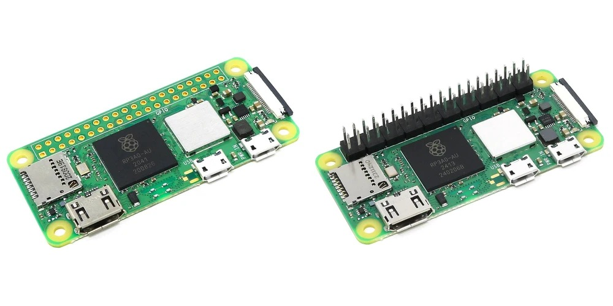
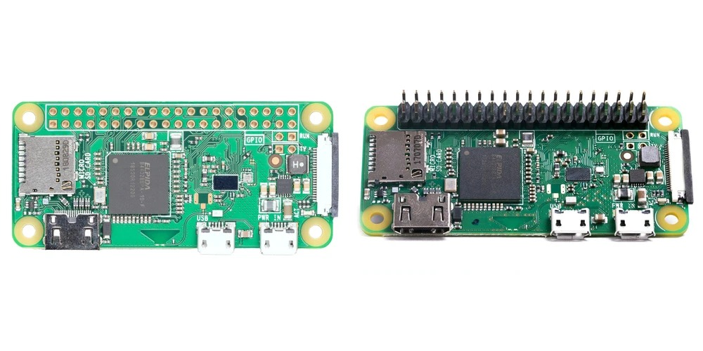
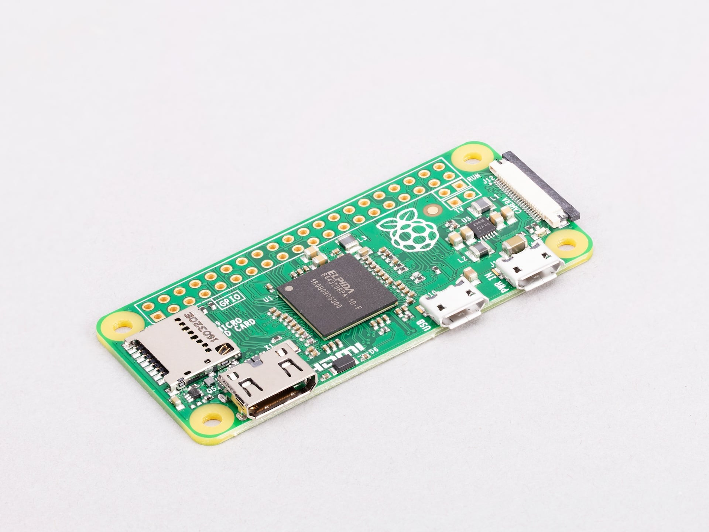

[[zero2w]]
== Raspberry Pi Zero 2 W (with and without headers)

.Raspberry Pi Zero 2 W without headers (left) and with headers (right)

https://www.raspberrypi.com/products/raspberry-pi-zero-2-w/[Raspberry Pi Zero 2 W] comes with an unpopulated GPIO header; Raspberry Pi Zero 2 W with headers comes with a pre-soldered GPIO header. Like <<zerow-wh>>, both models allow you to connect to a network over Wi-Fi.

The dimensions of a Raspberry Pi Zero 2 W (with and without headers) are approximately 65 mm × 30 mm. For more detailed measurements, see the https://pip.raspberrypi.com/documents/RP-008358-DS[mechanical drawing for Raspberry Pi Zero 2 W]. For an engineering diagram of the electrical circuits, components, and pin connections, see the https://pip.raspberrypi.com/documents/RP-008360-DS[schematic drawings for Raspberry Pi Zero 2 W].

=== Feature changes from Raspberry Pi Zero W and WH

Raspberry Pi Zero 2 W (with and without headers) comes in the same form factor, with the same connectors and mounting holes, as Raspberry Pi Zero W and WH, but also introduces the following performance and connectivity improvements:

* *System-in-Package (SiP).* The SoC and RAM are integrated into a single SiP, the *RP3A0*, which consists of:
** A Broadcom BCM2710A1 SoC, with four 64-bit Arm Cortex-A53 CPU cores; each CPU core runs at 1 GHz.
** A 400 MHz Broadcom VideoCore IV GPU for video and 3D rendering tasks.
** 512 MB of LPDDR2 RAM running at 450 MHz.
* *Faster processor.* Replaces the single-core ARM11 processor on Raspberry Pi Zero with the quad-core 64-bit Cortex-A53 processor.
* *Upgraded Bluetooth.* Upgrades wireless connectivity from Bluetooth 4.0 to Bluetooth 4.2.

The following sections describe these changes alongside:

* Other internal components soldered onto a Raspberry Pi Zero 2 W.
* The physical sockets and headers that allow you to connect external hardware to these components.

=== Raspberry Pi Zero 2 W (with and without headers) components

A Raspberry Pi Zero 2 W (with and without headers) includes the following on-board components:

.List of Raspberry Pi Zero 2 W components
[cols="1,3"]
|===
| Component | Description

| *SiP*
| The SoC and RAM are included within the same component (SiP). The SiP is *RP3A0*, consisting of a Broadcom BCM2710A1 SoC, which includes a 1 GHz quad-core 64-bit Cortex-A53 (CPU) and 400 MHz VideoCore IV (GPU), along with 512 MB of LPDDR2 (enhanced low-power double data rate 2) RAM that runs at 450 MHz.

| *Wireless module*
| A radio module that acts as two components: a *Wi-Fi* radio for connecting to computer networks delivering single-band (2.4 GHz) 802.11b/g/n Wi-Fi; and a *Bluetooth* radio for connecting to peripherals, delivering Bluetooth 4.2 and Bluetooth Low Energy (BLE).
|===

=== Raspberry Pi Zero 2 W (with and without headers) ports

A Raspberry Pi Zero 2 W (with and without headers) includes the following ports:

.List of Raspberry Pi Zero 2 W ports
[cols="1,2,2"]
|===
| Port type | Raspberry Pi Zero 2 W | Raspberry Pi Zero 2 W with headers

| *Micro USB ports*
2+| Two micro USB ports, one port for input power, and one for USB On-The-Go (OTG), compatible with OTG adapters to connect keyboards, mice, USB hubs, and other external devices.

| *Mini-HDMI port*
2+| A mini-HDMI port, supporting a single display for video and audio output at up to 1080p at 60 Hz.

| *CSI (camera) port*
2+| A 2-lane MIPI Camera Serial Interface (CSI) port that allows you to connect to a camera. Implemented as a mini 22-pin, 0.5 mm (fine)-pitch, 11.5 mm-wide CSI port.

| *GPIO header (unpopulated or populated)*
| A standard 40-pin GPIO interface, arranged into two rows of 20. The GPIO header is unpopulated; after soldering on a 2 × 20, 2.54 mm pin header, its pins allow your Raspberry Pi Zero 2 W to talk to additional hardware (like LEDs, buttons, sensors, and so on).
| A standard 40-pin GPIO interface, arranged into two rows of 20, with a pre-soldered 2 x 20, 2.54 mm pin header. Its pins allow your Raspberry Pi Zero 2 W with headers to talk to additional hardware (like LEDs, buttons, sensors, and so on).

| *MicroSD card slot*
2+| A slot for a microSD card for loading an operating system and storing data.
|===

=== Test pad locations

image::images/zero2-pad-diagram.png[width="70%"]

Raspberry Pi Zero 2 W (with and without headers) has a number of test pad locations used during production of the board, listed in the following table.

.Test pad labels and functions for Raspberry Pi Zero 2 W
[cols="1,3,1,1"]
|===
| Label | Function | X (mm from origin) | Y (mm from origin)

| `STATUS_LED`	| Power state of LED (LOW = ON)	| 5.15	| 8.8
| `CORE`	| Processor power	| 6.3	| 18.98
| `RUN`	| Connect to `GND` to reset	| 8.37	| 22.69
| `5V`	| 5 V input	| 8.75	| 11.05
| `5V`	| 5 V input	| 11.21	| 6.3
| `GND`	| Ground pin	| 10.9	| 3.69
| `GND`	| Ground pin	| 17.29	| 2.41
| `USB_DP`	| USB port	| 22.55	| 1.92
| `USB_DM` |	USB port	| 24.68	| 1.92
| `OTG`	| On-the-go ID pin	| 39.9	| 7.42
| `1V8`	| 1.8 V analog supply	| 42.03	| 8.42
| `TV`	| Composite TV out	| 45.58	| 3.17
| `GND`	| Ground pin	| 49.38	| 3.05
| `GND`	| Ground pin	| 55.99	| 22.87
| `3V3`	| 3.3 V I/O supply	| 48.55	| 22.44
| `SD_CLK`	| SD card clock pin	| 60.95	| 18.45
| `SD_CMD`	| SD card command pin	| 58.2	| 16.42
| `SD_DAT0`	| SD data pin	| 58.13	| 20.42
| `SD_DAT1`	| SD data pin	| 60.65	| 21.1
| `SD_DAT2`	| SD data pin	| 57.78	| 13.57
| `SD_DAT3`	| SD data pin	| 60.8	| 15.22
| `BT_ON`	| Bluetooth power status	| 25.13	| 19.55
| `WL_ON`	| Wireless LAN power status	| 27.7	| 19.2

|===

[[zerow-wh]]
== Raspberry Pi Zero W and WH

.Raspberry Pi Zero W (left) and WH (right)

https://www.raspberrypi.com/products/raspberry-pi-zero-w/[Raspberry Pi Zero W] comes with an unpopulated GPIO header; Raspberry Pi Zero WH comes with a pre-soldered GPIO header. Neither model includes a wired Ethernet port, but you can still connect it to a network over Wi-Fi.

The dimensions of a Raspberry Pi Zero W and WH are approximately 65 mm × 30 mm. For more detailed measurements, see the https://pip.raspberrypi.com/documents/RP-008367-DS[mechanical drawing for Raspberry Pi Zero W]. For an engineering diagram of the electrical circuits, components, and pin connections, see the https://pip.raspberrypi.com/documents/RP-008368-DS[schematic drawings for Raspberry Pi Zero W].

=== Feature changes from Raspberry Pi Zero

Raspberry Pi Zero W and WH come in the same form factor, with the same components, connectors, and mounting holes as Raspberry Pi Zero, but also includes *wireless networking*:

* Single-band (2.4 GHz) 802.11b/g/n Wi-Fi.
* Bluetooth 4.0 and Bluetooth Low Energy (BLE).

Additionally, Raspberry Pi Zero WH is the first zero model to offer *pre-soldered GPIO headers*.

The following sections describe these changes alongside:

* Other internal components soldered onto a Raspberry Pi Zero W.
* The physical sockets and headers that allow you to connect external hardware to these components.

=== Raspberry Pi Zero W and WH components

A Raspberry Pi Zero W and WH include the following on-board components:

.List of Raspberry Pi Zero W and WH components
[cols="1,3"]
|===
| Component | Description

| *SiP*
| *Broadcom BCM2835*, which includes a 1 GHz single-core 32-bit ARM11 (CPU) and 400 MHz VideoCore IV (GPU).

| *Memory*
| 512 MB of *LPDDR2* (low-power double data rate 2) RAM that runs at 450 MHz.

| *Wireless module*
| A radio module that acts as two components: a *Wi-Fi* radio for connecting to computer networks delivering single-band (2.4 GHz) 802.11b/g/n Wi-Fi; and a *Bluetooth* radio for connecting to peripherals, delivering Bluetooth 4.0 and Bluetooth Low Energy (BLE).

|===

=== Raspberry Pi Zero W ports

A Raspberry Pi Zero W and WH includes the following ports:

.List of Raspberry Pi Zero W and WH ports
[cols="1,2,2"]
|===
| Port type | Raspberry Pi Zero W | Raspberry Pi Zero WH

| *Micro USB ports*
2+| Two micro USB ports, one port for input power, and one for USB on-the-go (OTG) port compatible with OTG adapters to connect keyboards, mice, USB hubs, and other external devices.

| *Mini-HDMI port*
2+| A mini-HDMI port, supporting a single display for video and audio output at up to 1080p at 60 Hz.

| *CSI (camera) port*
2+| A 2-lane MIPI Camera Serial Interface (CSI) port that allows you to connect to a camera. Implemented as a mini 22-pin, 0.5 (fine) mm-pitch, 11.5 mm-wide CSI port.

| *GPIO header (unpopulated or populated)*
| A standard 40-pin GPIO interface, arranged into two rows of 20. The GPIO header is unpopulated; after soldering on a 2 × 20, 2.54 mm pin header, its pins allow your Raspberry Pi Zero 2 W to talk to additional hardware (like LEDs, buttons, sensors, and so on).
| A standard 40-pin GPIO interface, arranged into two rows of 20, with a pre-soldered 2 x 20, 2.54 mm pin header. Its pins allow your Raspberry Pi Zero WH to talk to additional hardware (like LEDs, buttons, sensors, and so on).

| *MicroSD card slot*
2+| A slot for a microSD card for loading an operating system and storing data.
|===

[[zero]]
== Raspberry Pi Zero

Raspberry Pi Zero is a more compact version of classic Raspberry Pi models, with fewer connectors and an unpopulated GPIO header.

.Raspberry Pi Zero

The dimensions of a Raspberry Pi Zero are approximately 65 mm × 30 mm. For more detailed measurements, see the https://pip.raspberrypi.com/documents/RP-008366-DS[mechanical drawing for Raspberry Pi Zero]. For an engineering diagram of the electrical circuits, components, and pin connections, see the https://pip.raspberrypi.com/documents/RP-008365-DS[schematc drawings for Raspberry Pi Zero].

There are also a mechanical drawings for Raspberry Pi Zero cases:

* https://pip.raspberrypi.com/documents/RP-008362-DS[PDF mechanical drawing for the Raspberry Pi Zero case]
* https://pip.raspberrypi.com/documents/RP-008364-DS[PDF mechanical drawing for the Raspberry Pi Zero case with GPIO lid]
* https://pip.raspberrypi.com/documents/RP-008363-DS[PDF mechanical drawing for the Raspberry Pi Zero case with camera lid]

=== Raspberry Pi Zero components
A Raspberry Pi Zero includes the following on-board components:

.List of Raspberry Pi Zero components
[cols="1,3"]
|===
| Component | Description

| *SoC*
| *Broadcom BCM2835*, which includes a 1 GHz single-core 32-bit ARM11 (CPU) and 400 MHz VideoCore IV (GPU).

| *Memory*
| 512 MB of *LPDDR2* (low-power double data rate 2) RAM that runs at 450 MHz.

|===

=== Raspberry Pi Zero ports

A Raspberry Pi Zero includes the following ports:

.List of Raspberry Pi Zero ports
[cols="1,2,2"]
|===
| Port type | Raspberry Pi Zero W | Raspberry Pi Zero WH

| *Micro USB ports*
2+| Two micro USB ports, one port for input power, and one for USB on-the-go (OTG) port compatible with OTG adapters to connect keyboards, mice, USB hubs, and other external devices.

| *Mini-HDMI port*
2+| A mini-HDMI port, supporting a single display for video and audio output at up to 1080p at 60 Hz.

| *CSI (camera) port*
2+| A 2-lane MIPI Camera Serial Interface (CSI) port that allows you to connect to a camera. Implemented as a mini 22-pin, 0.5 (fine) mm-pitch, 11.5 mm-wide CSI port.

| *GPIO header (unpopulated or populated)*
| A standard 40-pin GPIO interface, arranged into two rows of 20. The GPIO header is unpopulated; after soldering on a 2 × 20, 2.54 mm pin header, its pins allow your Raspberry Pi Zero to talk to additional hardware (like LEDs, buttons, sensors, and so on).
| A standard 40-pin GPIO interface, arranged into two rows of 20, with a pre-soldered 2 x 20, 2.54 mm pin header. Its pins allow your Raspberry Pi Zero to talk to additional hardware (like LEDs, buttons, sensors, and so on).

| *MicroSD card slot*
2+| A slot for a microSD card for loading an operating system and storing data.
|===

