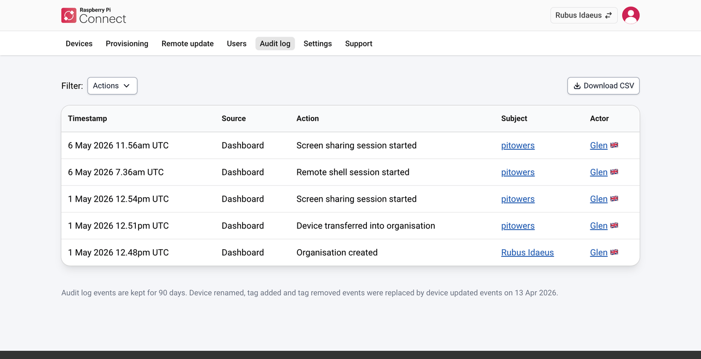

[[audit-log]]
== View the audit log

The audit log lists all activity in your organisation from the past 90 days, most recent first. Events include changes to devices, organisation members, and API access tokens, and the start of remote access sessions. Connect deletes events after 90 days.

You must be an administrator to view the audit log.

To view the audit log, select the **Audit log** tab.

Each event includes:

* **Timestamp.** When the event happened.
* **Source.** Whether the event happened on the Connect website or through the API.
* **Action.** What happened (for example, **API access token created**), with details.
* **Subject.** What the action affected, such as a device, the organisation, or an access token.
* **Actor.** The user who performed the action, and the country they performed it from.

To filter events by type of action (for example, **Remote shell session started**), select the **Actions** dropdown menu next to **Filters**, above the list.

To download the list as a CSV file, select **Download CSV**, above the list.
