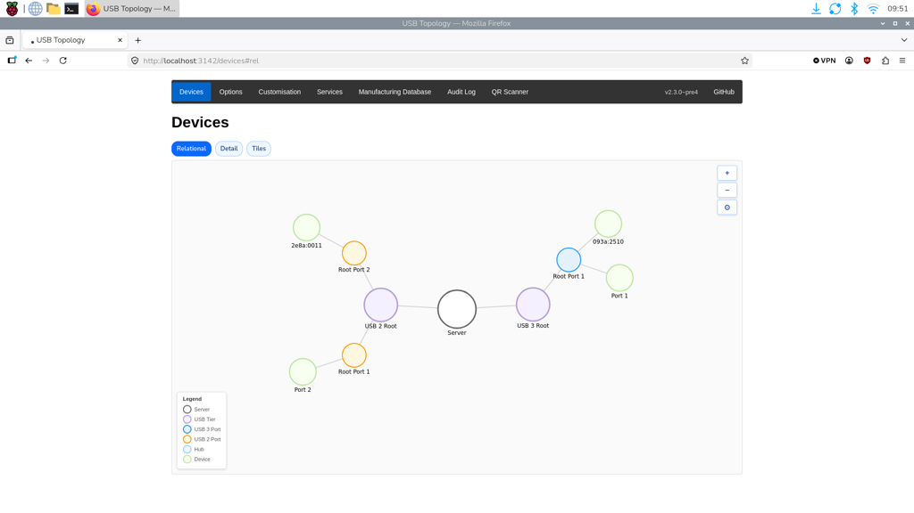
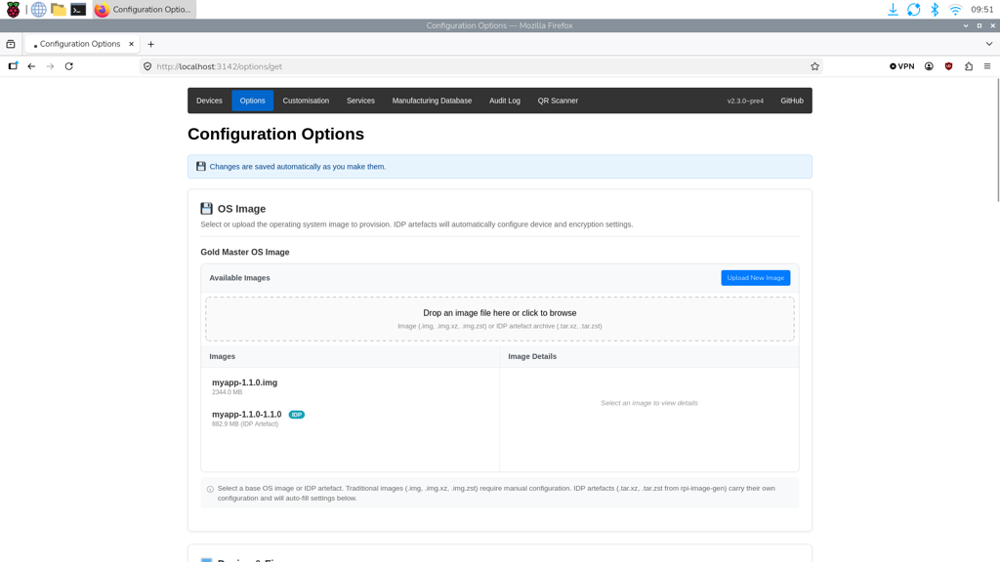
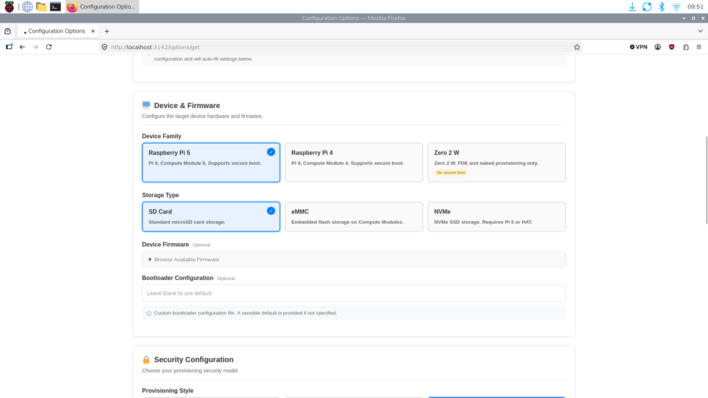
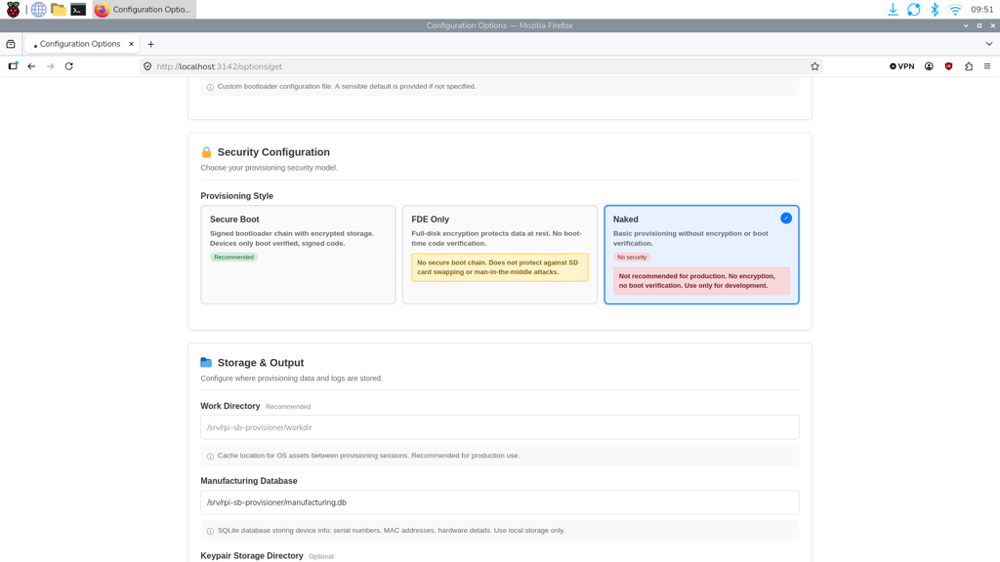
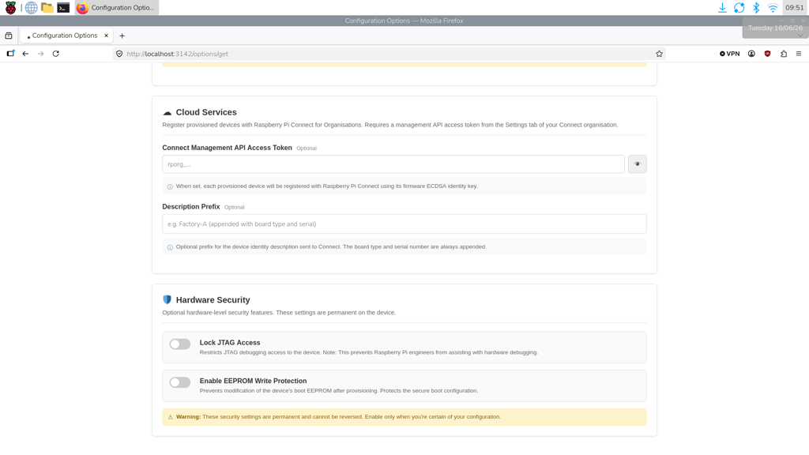

[[bulk-provisioning]]
== Bulk provisioning

You can provision Raspberry Pi 5 family devices (Raspberry Pi 5, Raspberry Pi 500, and Raspberry Pi 500+) one after another, by setting up a single Raspberry Pi 5 family device as a provisioning host. The host writes an operating system image to each recipient device, and registers a <<device-identities,device identity>> for it with your organisation, so that the device links to your organisation automatically when it first boots.

[[bulk-provisioning-requirements]]
=== Requirements

* Two Raspberry Pi 5 family devices: one to act as the host, and one recipient.
* A Connect organisation account, and administrator access to it.
* An Ethernet cable, or wireless networking credentials to add to the image in <<bulk-provisioning-step-4,Step 4>>.
* A short, high-quality USB-A to USB-C cable to carry power and data during provisioning. Don't use a flimsy, charge-only, or long cable, because these can cause provisioning to fail.
* For the recipient device: a microSD card of 32 GB or larger, to boot from.
* For the host device: a microSD card of 32 GB or larger. For faster provisioning, use an SSD of 32 GB or larger instead.

[[bulk-provisioning-step-1]]
=== Step 1: Prepare the devices

Disconnect any USB devices and HATs from both the host and the recipient device. These draw extra power, which can interfere with provisioning.

For more information on rpi-sb-provisioner, see xref:../security/secure-boot-provisioner.adoc#secure-boot-provisioning[Secure Boot Provisioning].

[[bulk-provisioning-step-2]]
=== Step 2: Install rpi-sb-provisioner on the host device

TIP: Building images uses a lot of disk space (several gigabytes for each build), and is noticeably faster on an SSD than on a microSD card. A Raspberry Pi 500+, or a Raspberry Pi 5 with an M.2 HAT+, makes a good host.

. Update the software and firmware on the host device:
+
[source,console]
----
$ sudo apt update
$ sudo apt upgrade
----
. Install Raspberry Pi Secure Boot Provisioner (`rpi-sb-provisioner`) on the host device:
+
[source,console]
----
$ sudo apt update
$ sudo apt install rpi-sb-provisioner
----
+
. On the host device, open the provisioner's web interface in a browser at http://localhost:3142.
+
If the web interface opens, `rpi-sb-provisioner` is installed correctly.
+
.The provisioner's web interface.

[[bulk-provisioning-step-3]]
=== Step 3: Install rpi-image-gen

`rpi-image-gen` builds the operating system image that the host writes to each recipient device.

. On the host device, clone the `rpi-image-gen` repository from GitHub:
+
[source,console]
----
$ git clone https://github.com/raspberrypi/rpi-image-gen.git
----
. Go to the cloned directory and install the dependencies:
+
[source,console]
----
$ cd rpi-image-gen
$ sudo ./install_deps.sh
----

[[bulk-provisioning-step-4]]
=== Step 4: Configure and build the image

TIP: `rpi-image-gen` includes an example application, with layers and configuration, that builds an image compatible with remote updates. For more information, see xref:../services/connect.adoc#remoteupdate-ab[Set up A/B boot updates].

. Go to the `rpi-image-gen` directory.
. Define any additional packages to install at build time. For more information, see https://raspberrypi.github.io/rpi-image-gen/config/index.html#_packages[Packages].
. Add wireless networking credentials. For more information, see https://github.com/raspberrypi/rpi-image-gen/tree/master/examples/ota[Wireless Networking].
. Build the image, setting a user account and password for the recipient devices. Replace `admin` and the example password with your own:
+
[source,console]
----
$ ./rpi-image-gen build -S ./examples/ota/ -c ota.yaml -- \
  IGconf_device_user1=admin \
  IGconf_device_user1pass='R@spb3rry*pi'
----
+
`rpi-image-gen` saves a `.tar.zst` image file in the `rpi-image-gen/work/deploy` directory.

[[bulk-provisioning-step-5]]
=== Step 5: Import the image and configure the provisioner

. On the host device, open the provisioner web interface at http://localhost:3142/options/get, or select **Options** from the tabs at the top of the interface.
+
. In the **OS Image** box, select **Upload New Image**, then drag the `.tar.zst` file you built in Step 4 into the box. For example, `rpi-image-gen/work/deploy-1.0.0/myapp-1.0.0.tar.zst`.
+
The image appears in the **Available Images** table.
+
.The Available Images table, showing the uploaded image.

+
. Select the image in the **Available Images** table.
. In the **Device & Firmware** table, select the following:
** **Device Family**: **Raspberry Pi 5**
** **Storage Type**: **SD Card**
** **Device Firmware**: **2026-05-26**
+
.The Device & Firmware table, where you set the recipient device type, storage, and firmware.

+
. In the **Security Configuration** table, select **Naked**. This provisions the device without encryption.
+
.The Naked security configuration.

The provisioner saves your changes automatically.

[[bulk-provisioning-step-6]]
=== Step 6: Add a management API access token

The provisioner uses a management API access token to register a device identity for each recipient device with your organisation.

. <<management-api-access-tokens,Create a management API access token>> in your organisation, and copy it.
+
WARNING: Keep the access token on the host device only. Never include it in the image you write to recipient devices.
. Open the provisioner web interface at http://localhost:3142/options/get.
. In the **Cloud Services** section, paste the access token into the **Connect Management API Access Token** field.
+
.The Cloud Services section, where you enter the access token.

[[bulk-provisioning-step-7]]
=== Step 7: Connect the recipient device to the host device

Next, put the recipient device into USB boot mode, so that the host device can provision it.

. Plug the USB-A end of the cable into the host device.
. Hold down the power button on the recipient device while you plug in the USB-C end of the cable. Release the power button when the recipient device powers on.
+
The recipient device appears in the provisioner web interface, and provisioning starts automatically.

[[bulk-provisioning-step-8]]
=== Step 8: Boot the recipient device

When provisioning is complete:

. Unplug the recipient device from the host device.
. Connect the recipient device to its own power supply.
. Connect an Ethernet cable to the recipient device.
. Turn on the recipient device.

When the recipient device has booted, it appears in your organisation's **Devices** tab in Connect.

To provision more devices, repeat Steps 7 and 8 for each one.

// TODO: Confirm that Steps 7 and 8 are all that's needed for each additional device.
