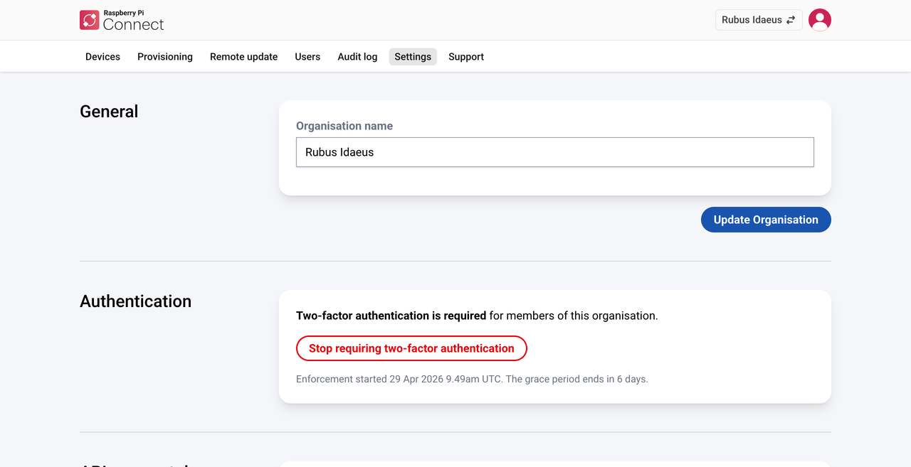
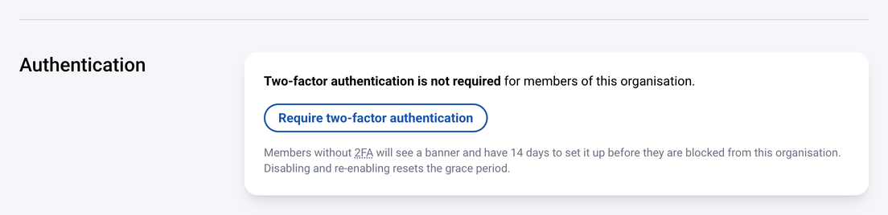

[[change-organisation-settings]]
== Change organisation settings

Administrators can change the following settings from the **Settings** tab.

.The Settings tab of an organisation.

[[rename-the-organisation]]
=== Rename the organisation

Enter a new name in the **General** section. Renaming the organisation doesn't affect its devices or members.

[[require-two-factor-authentication]]
=== Require two-factor authentication

You can require all members of your organisation to turn on two-factor authentication (2FA) for their Raspberry Pi ID. This helps stop a compromised member account from being used to access your organisation's devices.

To require 2FA:

. Select the **Settings** tab, then select **Require two-factor authentication**.
+
A notice confirms that the settings were updated.
+

This starts a 14-day grace period, during which members who haven't set up 2FA see a banner asking them to. When the grace period ends, members who still haven't set up 2FA can't access your organisation's devices or other resources until they turn on 2FA for their Raspberry Pi ID.

.The Two-factor authentication required page.

To stop requiring 2FA:

. Select the **Settings** tab, then select **Stop requiring two-factor authentication**.
+
A notice confirms that the settings were updated.

NOTE: If you stop requiring 2FA and then require it again, the 14-day grace period starts again.

[[management-api-access-tokens]]
=== Create management API access tokens

A management API access token lets you use the <<organisations-management-api,management API>> to manage your organisation automatically, for example to create auth keys and device identities, manage devices, and deploy updates.

WARNING: A management API access token is equivalent to an administrator's username and password for your organisation. It can manage every device, auth key, and device identity in the organisation. Keep it on the computer that calls the management API, such as a provisioning workstation or CI system. Never include it in a Raspberry Pi OS image or copy it onto a device. To authenticate devices themselves, use device-specific credentials, such as <<organisation-auth-keys,auth keys>> or <<device-identities,device identities>>, which you manage on the **Provisioning** tab.

. In the **API access tokens** section, select **New**.
. Enter a description for the access token, then select **Create Access token**.
. Select the clipboard icon next to the new access token to copy it.
+
IMPORTANT: Connect only shows the access token once. Copy it now, because you can't view it again later.
