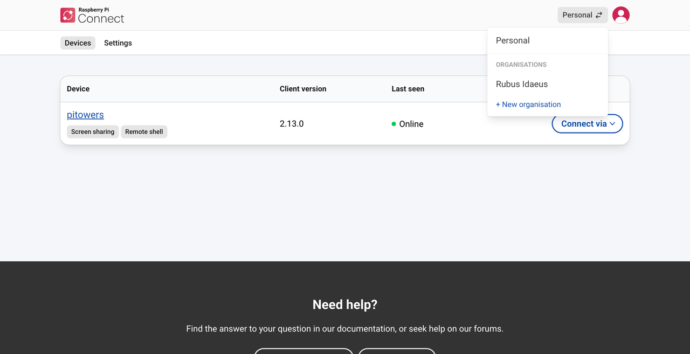
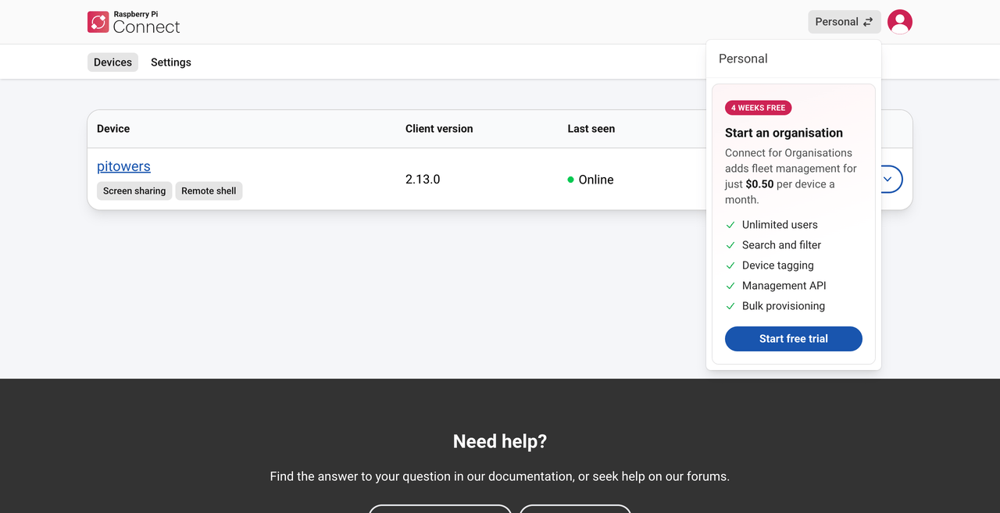
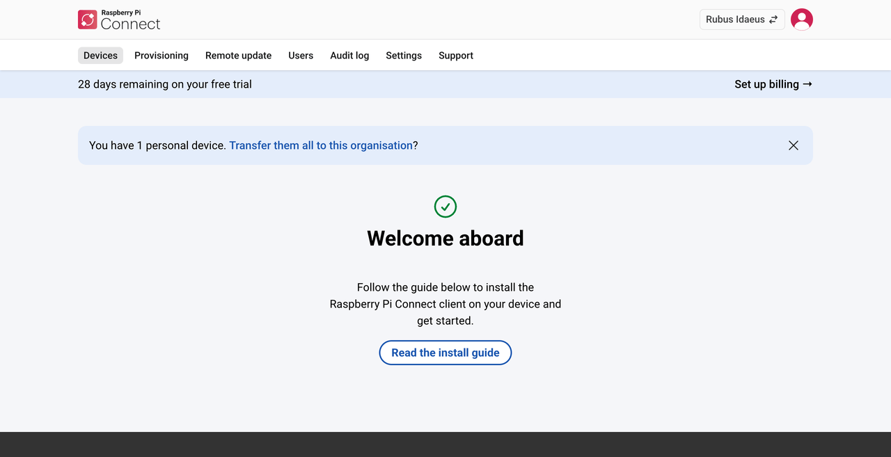
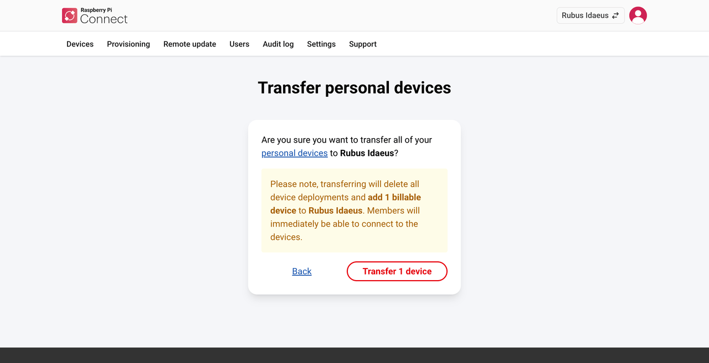
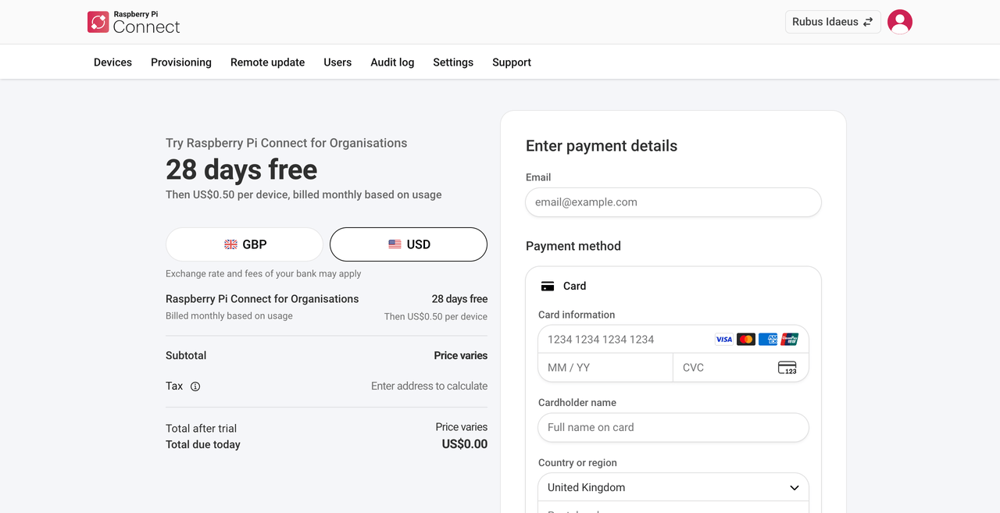
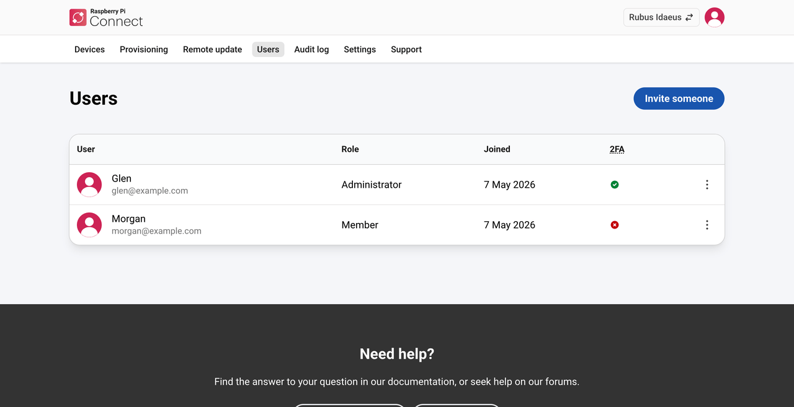
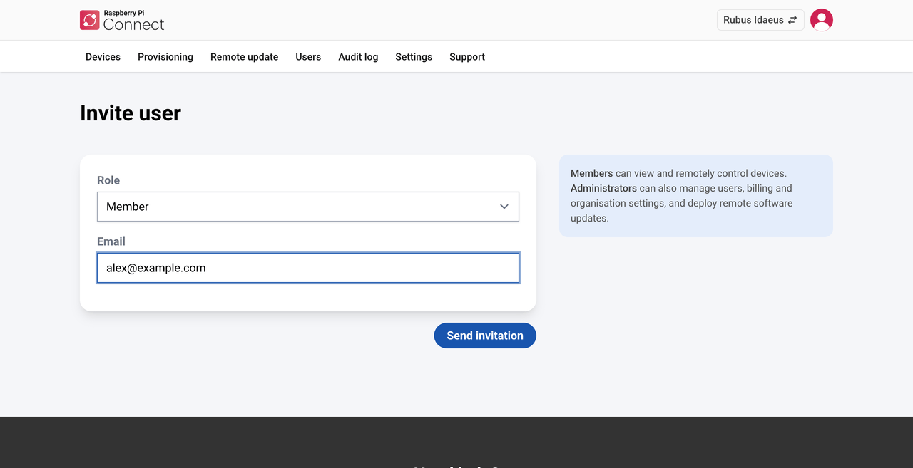
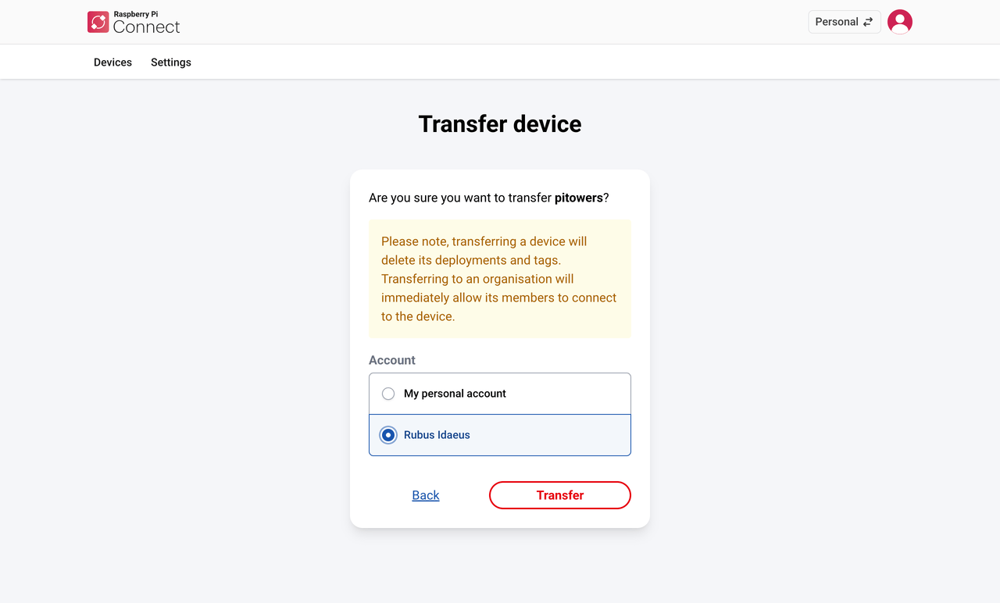
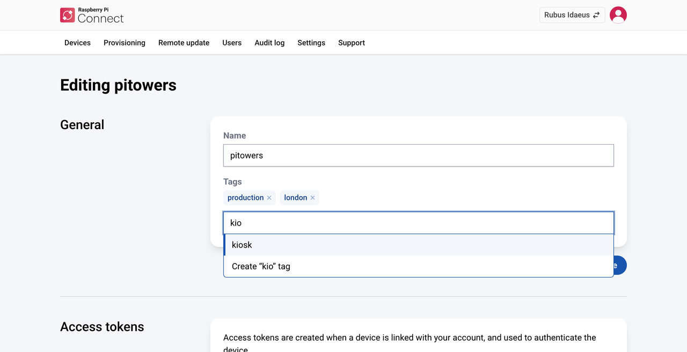
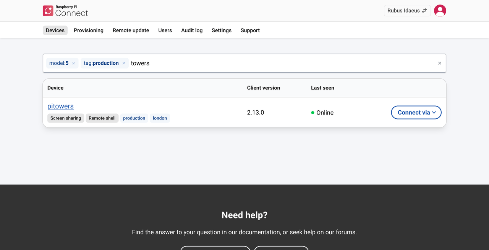

== Introduction

**Connect for Organisations** lets multiple users share access to devices using xref:../services/connect.adoc[Raspberry Pi Connect].

Devices in an organisation support all of Connect's features, including xref:../services/connect.adoc#screen-sharing-interface[screen sharing], xref:../services/connect.adoc#remote-shell[remote shell] access, and xref:../services/connect.adoc#remoteupdate-intro[remote updates]. Connect for Organisations also offers:

* **Shared access with roles.** Invite users as members or administrators. For more information, see <<manage-users,Manage users>>.
* **Device tagging and search.** Organise and find devices by tag, model, memory, or operating system. For more information, see <<tag-devices,Tag devices>> and <<search-filter-devices,Search and filter devices>>.
* **Artefact library and self-hosted artefacts.** Deploy the same update more than once, and host artefacts yourself so that they don't expire. For more information, see <<deploy-remote-updates,Deploy remote updates>>.
* **Audit log.** Review 90 days of activity in your organisation. For more information, see <<audit-log,View the audit log>>.
* **Two-factor authentication requirement.** Require all members to use 2FA. For more information, see <<require-two-factor-authentication,Require two-factor authentication>>.
* **Provisioning.** Link devices without signing in on each one, using auth keys or device identities, and provision many devices at once. For more information, see <<provision-devices,Provision devices>>.
* **Management API.** Manage devices, auth keys, device identities, and updates automatically. For more information, see <<organisations-management-api,Management API>>.

Creating your first organisation automatically starts a free, four-week trial for that organisation. After the trial, organisations are billed monthly. For more information, see <<set-up-your-subscription,Set up your subscription>>.

[[organisation-roles]]
=== Roles

Every user in an organisation has one of the following roles:

* **Member.** Can access all the organisation's devices using screen sharing and remote shell. Can't deploy remote updates or make any changes to the organisation.
* **Administrator.** Can access all the organisation's devices, deploy remote updates, and make changes to the organisation. Administrators also receive organisation-wide notification emails for sensitive actions, such as the addition of new devices and new management API access tokens.

[[switch-accounts]]
=== Switch between accounts

If you belong to an organisation, the Connect website shows one account at a time: your personal account, or one of your organisations.

To switch between accounts, select the **account switcher icon** (two opposing arrows) at the top right of the navigation menu, then select the account you want.

.The account switcher.

The procedures in this guide assume that you've signed in to https://connect.raspberrypi.com[connect.raspberrypi.com] and switched to your organisation, unless they say otherwise.

[[create-an-organisation]]
== Create an organisation

. Sign in to https://connect.raspberrypi.com[connect.raspberrypi.com].
. Select the **account switcher icon** at the top right of the page.
+

+
. Select **+New organisation**, then enter the organisation's name.
. Select **Start your free trial** if this is your first organisation, or **Create organisation** if you've created one before.
+
Connect creates the organisation and adds you to it as an administrator.

If your personal account has linked devices, Connect offers to transfer them to the new organisation. To transfer them now:

. Select the **Transfer them all to this organisation** link.
+

+
The **Transfer personal devices** page opens and asks you to confirm the transfer.
+

+
. Select the **personal devices** link to review the devices, or select **Transfer x devices** (where _x_ is the number of devices) to confirm. Devices you transfer become billable devices in the organisation.

You can also transfer devices later. For more information, see <<transfer-device,Transfer a device>>.

[[set-up-your-subscription]]
== Set up your subscription

A Connect for Organisations subscription starts when your four-week trial ends. After that, you're billed monthly, in arrears. If you don't set up a subscription before your trial ends, you can't access the organisation's devices remotely until you do.

IMPORTANT: If you still haven't set up billing, Connect deletes the organisation. About two weeks after the trial ends, Connect sends a deletion warning. About two weeks after that, Connect deletes the organisation, with its devices and memberships.

You must be an administrator to set up a subscription.

. Select **Set up billing** in the trial banner below the tabs at the top of the page.
. Enter the email address that you want billing notifications, such as invoices, sent to.
. Enter your payment details, then submit them:
** If your trial hasn't ended, the button says **Start trial**. Your trial continues, and monthly billing starts when it ends.
** If your trial has ended, the button says **Pay and subscribe**. Your monthly subscription starts immediately.

.The billing page.

[[manage-users]]
== Manage users

You must be an administrator to invite users, remove users, or change a user's role.

[[invite-a-user]]
=== Invite a user

. Select the **Users** tab, then select **Invite someone**.
+

+
. Choose a **Role**. For a description of each role, see <<organisation-roles,Roles>>.
. Enter the email address to send the invitation to.
. Select **Send invitation**.
+

Connect emails an invitation to the address you entered. The user can follow the link in the email and sign in with that email address, or with any other Raspberry Pi ID.

[[remove-a-user]]
=== Remove a user

. Select the **Users** tab.
. Next to the user you want to remove, select the **more options icon** (three vertical dots), then select **Remove...**.
. In the confirmation window, select **Remove user**.

The user is removed from the organisation immediately. Any screen-sharing or remote shell sessions they have with the organisation's devices end within a few minutes.

[[change-a-users-role]]
=== Change a user's role

. Select the **Users** tab.
. Next to the user whose role you want to change, select the **more options icon** (three vertical dots), then select **Change role...**.
. Select the new role, then select **Change role**.

[[organisation-devices]]
== Manage devices in an organisation

[[link-a-raspberry-pi-device-with-an-organisation]]
=== Link a device to an organisation

You must be an administrator to link a device to an organisation. There are three ways to do it:

* **Sign in on the device.** Link the device as described in xref:../services/connect.adoc#link-connect[Turn on Connect and link your device]. When you choose an account, select the organisation.
* **Provision the device.** Use an auth key or a device identity, so that nobody has to sign in on the Connect website. For more information, see <<provision-devices,Provision devices>>.
* **Transfer the device.** If the device is already linked to your personal account or another organisation, <<transfer-device,transfer it>>.

You're billed for a device from the time it's linked to your organisation.

[[transfer-device]]
=== Transfer a device

You can transfer a device between your personal account and an organisation, or between organisations. You must be an administrator of each organisation involved.

. Switch to the account that currently owns the device.
. Select the device in the **Devices** tab, then select **Settings** on the device page.
. Under **Danger zone**, select **Transfer device...**.
+

+
. Select the account to transfer the device to, then select **Transfer**.

[[tag-devices]]
=== Tag devices

Tags help you categorise and find devices. For example, you can tag devices by location (`london`, `leeds`), environment (`production`, `staging`), or function (`point-of-sale`, `kiosk`). Tags appear below the device name on the device page and in the device list.

You must be an administrator to add or remove tags.

. Select the device in the **Devices** tab, then select **Settings** on the device page.
+

+
. In the **Tags** field in the **General** section:
** To add a tag, start entering its name. Select an existing tag from the dropdown menu, or enter a new tag name and select **Create**.
** To remove a tag, select the **x** next to it.
. Select **Update Device**.

Each device can have up to ten tags. Tag names can be up to 30 characters long, and can only contain lowercase letters, numbers, hyphens, and underscores.

TIP: To apply tags automatically when a device is linked, set them on the auth key or device identity you use to link it. You can set tags, and a device name, when you <<organisation-auth-keys,create an auth key on the Connect website>>, or with the management API for <<create-an-auth-key,auth keys>> and <<device-identities,device identities>>.

[[search-filter-devices]]
=== Search and filter devices

The search bar at the top of the device list combines free-text search with filters.

To search by device name or serial number, enter any text in the search bar. The results update as you enter text.

To filter by an attribute, enter a qualifier, a colon, and a value:

[cols="1,3",options="header"]
|===
| Qualifier | Filters by

| `model:`
| Raspberry Pi model (for example, `model:5`, `model:4b`)

| `memory:`
| RAM size (for example, `memory:4gb`, `memory:512mb`)

| `os:`
| Operating system (for example, `os:raspios-13`)

| `tag:`
| Tag (for example, `tag:kiosk`, `tag:production`)
|===

NOTE: The `model:`, `memory:`, and `os:` qualifiers only find devices running Connect client version 2.9.0 or later. To update Connect on your devices, see xref:../services/connect.adoc#update[Update the client].

When you start entering text, a dropdown menu suggests qualifiers and values. Select a qualifier to see its values, then select a value to add it as a filter. Applied filters appear in the search bar. To remove a filter, select the **x** next to it, or press **Backspace**.

You can combine filters and free text in a single search. For example, `model:5 tag:production dashboard` finds Raspberry Pi 5 devices tagged `production` that have 'dashboard' in their name. If you use `tag:` more than once, Connect only finds devices that have _all_ the tags. For example, `tag:production tag:kiosk` finds devices that have both tags.

.The device list with filters applied.

TIP: Select a tag on any device in the list to add it as a filter.
