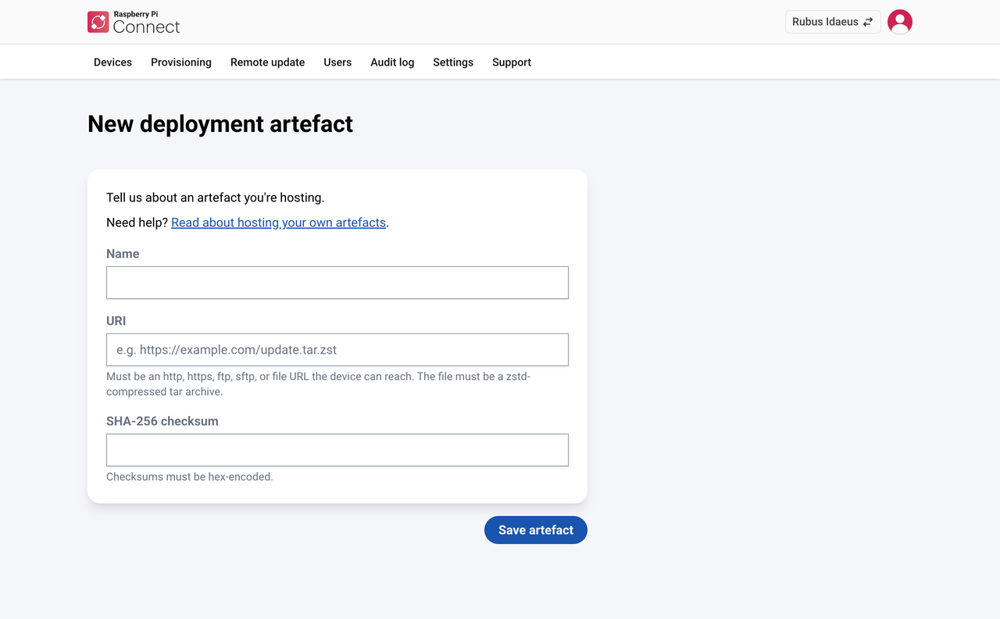
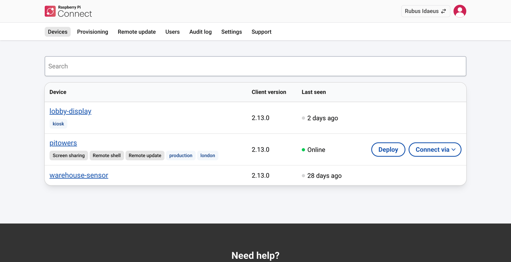
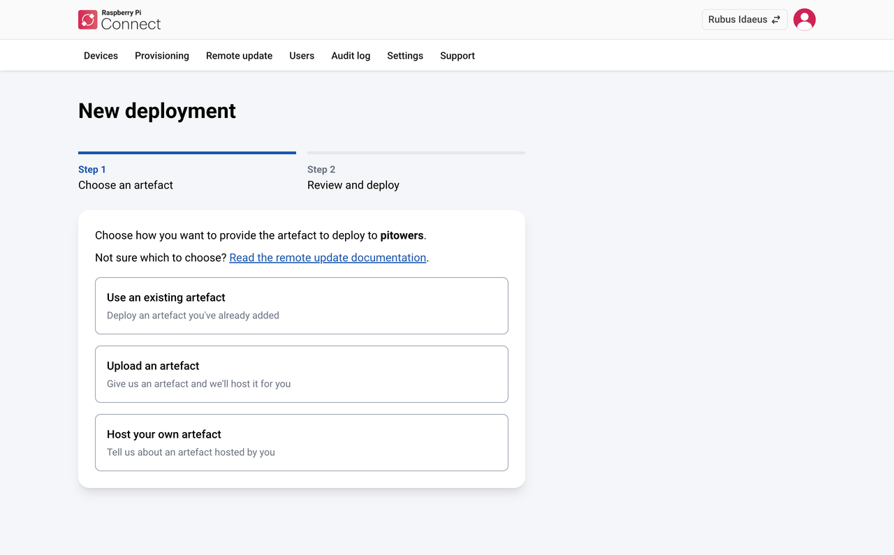

[[deploy-remote-updates]]
== Deploy remote updates

You can push updates to your organisation's devices using Connect's xref:../services/connect.adoc#remoteupdate-intro[remote update] feature. Deploying to an organisation's devices works much like xref:../services/connect.adoc#update-remotely[deploying to a personal device], with the following differences:

* An organisation keeps a <<artefact-library,library of artefacts>> that you can deploy more than once.
* As well as uploading an artefact, you can <<host-the-update-artefact,host an artefact yourself>>, so that it doesn't expire while you wait for a device to come online.
* You can manage artefacts and deployments with the <<organisations-management-api,management API>>.

NOTE: Only administrators can deploy remote updates and manage update artefacts.

To deploy an update:

. Build an update artefact, as described in xref:../services/connect.adoc#remoteupdate-otamaker[Build a script artefact] or xref:../services/connect.adoc#remoteupdate-ab[Set up A/B boot updates].
. Choose how to provide the artefact to Connect:
** **Upload an artefact.** Connect stores the file for you. Uploads are limited to 2 GB, and expire two hours after you upload them. A device that doesn't start the deployment within that time doesn't receive it.
** **Host your own artefact.** You store the file somewhere the recipient device can download it from, and give Connect its location. See <<host-the-update-artefact,Host the update artefact>>. Artefacts you host yourself don't expire, so choose this option for devices that might be offline for more than two hours, or to deploy the same artefact to many devices over time.
. Optionally, <<artefact-library,add the artefact to the library>> before you deploy it.
. <<deploy-an-artefact,Deploy the artefact>>.

[[host-the-update-artefact]]
=== Host the update artefact

When you host an artefact yourself, Connect doesn't store the file. Instead, you give Connect the file's location, and Connect passes it to the recipient device, which downloads the file directly.

You can host the artefact anywhere the recipient device can reach it: your own web server, an S3 bucket, an FTP or SFTP server, or a path on the recipient device itself, using a `file://` URI. Remote update supports HTTP, HTTPS, FTP, SFTP, and file URIs.

The location must be reachable from the recipient device, but it doesn't have to be reachable from the Connect servers or from the internet. For example, you can serve an artefact from another computer on the same local network as the recipient device.

For example, the URI `http://192.168.0.1:8080/path/to/app.update.tar.zst` contains:

* The host IP address: `192.168.0.1`
* The port: `8080`
* The path: `/path/to/app.update.tar.zst`

You also need the artefact's SHA-256 checksum. Connect passes it to the device, which uses it to check that the artefact wasn't corrupted or tampered with in transit. `otamaker` prints the checksum when it builds a script artefact; for other artefacts, calculate it with `sha256sum`.

Copy down the URI and the checksum. You need both when you deploy the artefact.

[[example-serve-an-artefact-from-a-raspberry-pi]]
==== Example: serve an artefact from a Raspberry Pi

This example serves an update artefact from a Raspberry Pi on the same network as the recipient device.

. On the host Raspberry Pi, start an HTTP server, replacing the directory with the one that contains your artefact:
+
[source,console]
----
$ python -m http.server 8080 --directory ./work/image-myapp
----
. Calculate the artefact's SHA-256 checksum, then copy it down:
+
[source,console]
----
$ sha256sum ./work/image-myapp/myapp-update.tar.zst
----
. Find the host's IP address on the local network, then copy it down to use in the artefact's URI:
+
[source,console]
----
$ hostname -I
----

[[artefact-library]]
=== Manage the artefact library

The **Remote update** tab lists your organisation's artefact library. Connect adds any artefact you create while deploying to the library automatically.

To add an artefact to the library before you deploy it, go to the **Remote update** tab, select **New**, then do one of the following:

* **Upload an artefact.** Enter a name and choose the file, as described in xref:../services/connect.adoc#upload-the-artefact[Upload an artefact], then select **Upload artefact**.
* **Host your own artefact.** Enter a name, the URI, and the SHA-256 checksum, then select **Save artefact**.

.The Host your own artefact screen, showing the required fields: Name, URI, and SHA-256 checksum.

For uploaded artefacts, the library shows when each one **Expires**, or when it **Expired**. Expired artefacts stay in the library so that you can see what was deployed, but you can't deploy them again. To deploy the same file again, upload it again.

NOTE: You can't delete an artefact after you've deployed it, or tried to deploy it. This keeps a record of what was deployed, in case your account is compromised.

[[deploy-an-artefact]]
=== Deploy an artefact

. Go to the **Devices** tab, then select **Deploy** next to the recipient device.
+
**Deploy** only appears for devices that are xref:../services/connect.adoc#remoteupdate-opt-in[opted in to remote updates].
+
.The device list shows a Deploy button for devices that are opted in to remote updates.

+
. On the **New deployment** screen, choose one of the following, then select **Next**:
** **Use an existing artefact.** Choose an artefact from the library. Each artefact shows its name, the first few characters of its checksum, its URI or file name and size, and, for uploaded artefacts, how long until it expires. Expired artefacts don't appear.
** **Upload an artefact.** Enter a name and choose the file, as described in xref:../services/connect.adoc#upload-the-artefact[Upload an artefact].
** **Host your own artefact.** Enter a name, the URI, and the SHA-256 checksum.
+
.The New deployment screen, with options to use an existing artefact, upload an artefact, or host your own.

+
. In **Step 2: Review and deploy**, check the artefact's details, then select **Deploy**.
+
For an uploaded artefact, this step also shows when the file expires. The deployment only succeeds if the recipient device comes online and downloads the file before then. If a queued deployment already exists for the device, this step warns you that deploying cancels it.

To track the deployment, see xref:../services/connect.adoc#monitor-the-deployment[Monitor the deployment].
