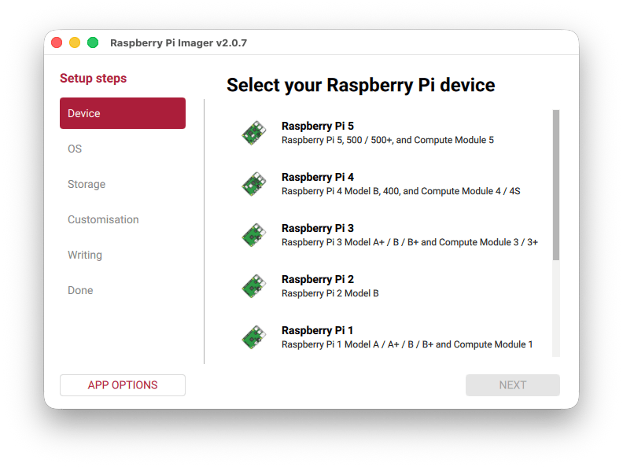

[[remoteupdate-ab]]
=== Set up A/B boot updates

An A/B boot update replaces a device's entire operating system, and prevents a failed or faulty update from leaving the device unusable.

A device configured for A/B boot has two independent slots, each made up of a boot partition and a system partition. One slot holds the current, working operating system; the update is written to the other slot. The device then boots from the updated slot, and if that fails, it reverts to booting from the known working slot. This repeats with each update.

Setting up A/B boot happens in two parts:

. <<ab-prepare-device,Prepare the device for A/B boot>>. You do this once for each device, and it needs physical access to the device, because you must write a new image with an A/B boot layout to its storage.
. <<ab-build-update,Build an A/B update artefact>>. You do this for each new version of your operating system. You then <<update-remotely,deploy the artefact>> remotely.

You use https://github.com/raspberrypi/rpi-image-gen[`rpi-image-gen`] to build both the A/B boot image (an `.img` file) and the update artefacts (`.tar.zst` files), and https://www.raspberrypi.com/software/[Raspberry Pi Imager] to write the image to the device's storage.

NOTE: Raspberry Pi 5 and later devices that use EEPROM boot can also use A/B updates for the bootloader. See xref:../computers/raspberry-pi.adoc#ab-bootloader-updates[A/B bootloader updates].

[[ab-prerequisites]]
==== Prerequisites

To build the image and update artefacts, you need a Raspberry Pi running:

* The latest 32-bit or 64-bit version of Raspberry Pi OS (_Trixie_).
* The latest version of Connect or Connect Lite.
* The latest version of https://www.raspberrypi.com/software/[Raspberry Pi Imager].

To prepare the recipient device, you need:

* A Raspberry Pi 4 or later, with an internet connection.
* A storage device (typically a microSD card) of at least 16 GB, and a way to connect it to the Raspberry Pi you build on.
+
Choose a size based on how much space you expect to need in future for the boot partition (firmware, kernel, device tree files, and possibly an initramfs) and the system partition (kernel modules and system software, such as the standard Linux command line utilities).

[[ab-prepare-device]]
==== Prepare a device for A/B boot

Standard Raspberry Pi OS installations don't use an A/B boot layout. In this procedure, you build an A/B boot image with `rpi-image-gen`, then write it to the recipient device's storage with Raspberry Pi Imager. The image also opts the device in to remote updates and links it to your Connect account, so you can send it updates remotely from then on.

[[ab-prepare-step-1]]
===== Step 1: Install rpi-image-gen

. On the Raspberry Pi you're building on, clone the `rpi-image-gen` repository from GitHub:
+
[source,console]
----
$ git clone https://github.com/raspberrypi/rpi-image-gen.git
----
. Go to the cloned directory and install the dependencies:
+
[source,console]
----
$ cd rpi-image-gen
$ sudo ./install_deps.sh
----

[[ab-prepare-step-2]]
===== Step 2: Configure the image

`rpi-image-gen` includes an example application, with layers and configuration, that builds an image compatible with remote updates. This procedure uses that example. For descriptions of the metadata in the `.yaml` files, see https://raspberrypi.github.io/rpi-image-gen/layer/index.html#_x_env_metadata[X-Env metadata] and https://raspberrypi.github.io/rpi-image-gen/layer/index.html[Layer].

. Go to the `rpi-image-gen` directory.
. Open `examples/ota/layer/ota.yaml` and customise the following metadata:
** `X-Env-Layer-Name`
** `X-Env-Layer-Category`
** `X-Env-Layer-Desc`
** `X-Env-Layer-Reqs`
. Open `examples/ota/config/ota.yaml` and set the following environment variables:
** **Version.** The version of the image. Set a starting version number now, and increase it each time you build an update artefact. If you don't set a version, it defaults to `1.0.0`.
** **Device hostname.** The device's hostname, used in all images you build for this device. It must be unique. If you don't set a hostname, each build uses the default, `ota-device-1`.
. (Optional) In `examples/ota/config/ota.yaml`, you can also:
** Define additional packages to install at build time. For more information, see https://raspberrypi.github.io/rpi-image-gen/config/index.html#_packages[Packages].
** Add wireless networking credentials. For more information, see https://github.com/raspberrypi/rpi-image-gen/tree/master/examples/ota[Wireless Networking].

[[ab-prepare-step-3]]
===== Step 3: Create an auth key

The image uses an auth key to link the recipient device to your Connect account. When the device first boots with the new image, it exchanges the auth key for an access token, which it saves in its user data partition. The access token persists across future updates, so you only need an auth key the first time.

Each auth key links one device, so create a new auth key for each recipient device.

<<create-an-auth-key,Create an auth key>> in your personal account, or in the organisation that you're adding the device to, and copy it for use in Step 4.

[[ab-prepare-step-4]]
===== Step 4: Build the image

. Go to the `rpi-image-gen` directory:
+
[source,console]
----
$ cd rpi-image-gen
----
. Build the image, replacing `rpuak_XXX` with the auth key you created in Step 3. Organisation auth keys start with `rpoak_`.
+
For Raspberry Pi 5 and later:
+
[source,console]
----
$ ./rpi-image-gen build -S ./examples/ota/ -c ota.yaml -- IGconf_connect_authkey=rpuak_XXX
----
+
For Raspberry Pi 4:
+
[source,console]
----
$ ./rpi-image-gen build -S ./examples/ota/ -c ota.yaml -- IGconf_device_layer=rpi4 IGconf_connect_authkey=rpuak_XXX
----

`rpi-image-gen` saves the `.img` file in the `rpi-image-gen/work/image-x.x.x` directory, where `x.x.x` is the version you set in Step 2.

[[ab-prepare-step-5]]
===== Step 5: Write the image

WARNING: Make sure you choose the right storage device in Raspberry Pi Imager. If the Raspberry Pi you're building on boots from its microSD card (`/dev/mmcblk0`), don't write to that card, or you'll overwrite its operating system. Only write to `/dev/mmcblk0` if your Raspberry Pi boots from another device, such as an NVMe SSD.

. If Raspberry Pi Imager isn't installed, install it:
+
[source,console]
----
$ sudo apt install rpi-imager
----
. Open **Raspberry Pi Imager** from the **Accessories** menu. Enter your password if prompted.
. Select the recipient device type, **Raspberry Pi 4** or **Raspberry Pi 5**, then select **Next**.
+

+
. On the **OS** tab, scroll to the bottom and select **Use Custom**.
. Go to the `.img` file you built in Step 4, select it, then select **Open**.
. Select **Next**, then choose the storage device to write the image to.
. Select **Write**, then follow the on-screen prompts.
. When Imager finishes writing, select **Finish**, then remove the storage device.

[[ab-prepare-step-6]]
===== Step 6: Boot the recipient device

. Power off the recipient device.
. Insert or attach the storage device you wrote in Step 5.
. Power on the recipient device, and wait for it to boot with the new image.
. Sign in to https://connect.raspberrypi.com[connect.raspberrypi.com], then go to the **Devices** tab.
+
The device appears, with a **Remote update** badge beneath its name.
. Check that the device is running the version you set in Step 2. Open a <<remote-shell,remote shell>> on the device, then run the following command:
+
[source,console]
----
$ cat /etc/rpi-issue
----
+
The output is similar to the following:
+
----
Generated using rpi-image-gen e3828f885c860f15991468883d3b8484b0eaf9d8 on 2025-12-09
Artefact version: 1.0.0
----

The device is now ready to receive remote updates.

[[ab-build-update]]
==== Build an A/B update artefact

After the device is set up for A/B boot, build an update artefact for each new version of your operating system. Update artefacts are `.tar.zst` files, much smaller than the `.img` file you used to prepare the device.

This procedure continues the example from <<ab-prepare-device,Prepare a device for A/B boot>>. If you use your own configuration, change the paths and file names to match.

. Increase the **Version** environment variable in the configuration file:
+
[source,console]
----
$ ${EDITOR:-vi} ./examples/ota/config/ota.yaml
----
. Build the update artefact:
+
[source,console]
----
$ ./rpi-image-gen build -S ./examples/ota/ -c ota.yaml
----

`rpi-image-gen` generates a _deploy bundle_, which includes the update artefact (a `.tar.zst` file) and other assets. It writes the deploy bundle to the directory set by https://raspberrypi.github.io/rpi-image-gen/layer/deploy-base.html[`IGconf_deploy_dir`]. This deploy directory is the canonical location for production device assets. You upload the `.tar.zst` file from the deploy directory when you deploy the update.

Next, <<update-remotely,deploy the artefact>>.
