== Access your device

After you've linked your Raspberry Pi to your Connect account, you can access it from anywhere using a browser, with either of the following methods:

* <<screen-sharing,Screen sharing>>: use your device's desktop.
* <<remote-shell,Remote shell>>: use your device's command line.

Both methods work whether your Raspberry Pi is on the same network as your browser or on a different network. However, a direct local connection is faster and more responsive than one that goes over the internet or through a <<relay-servers,relay server>>.

NOTE: When you sign in to the Connect website, your browser or operating system might ask for permission to find or connect to devices on your local network. Allow it. If you don't, Connect still works, but sessions with devices on your local network can't use the faster local route.

[[screen-sharing]]
=== Screen sharing

Screen sharing lets you use your Raspberry Pi's desktop in a browser window, as if you were using a local display, keyboard, and mouse.

Screen sharing requires:

* The full Connect client (`rpi-connect`). Connect Lite doesn't support screen sharing.
* The **Wayland** window server. Raspberry Pi OS _Bookworm_ and later use Wayland by default. Screen sharing doesn't work with systems that use the X window server.
* A desktop session that's already running on the device. Connect shares an existing desktop session; it doesn't start a new one. To start a desktop session automatically when the device boots, enable **Desktop Autologin** in the **System Options** in `raspi-config`.

[[start-screen-sharing]]
==== Start screen sharing

. Make sure your Raspberry Pi is linked to your Connect account, is powered on, and has finished booting Raspberry Pi OS.
. On your computer, tablet, or phone, sign in to https://connect.raspberrypi.com[connect.raspberrypi.com].
. Select the **Devices** tab.
+
Devices that are available for screen sharing show a grey **Screen sharing** badge below the device name.
+

+
. Select **Connect via** next to the device you want to access, then select **Screen sharing**.
+
A new browser window opens and waits for the device to respond.
+
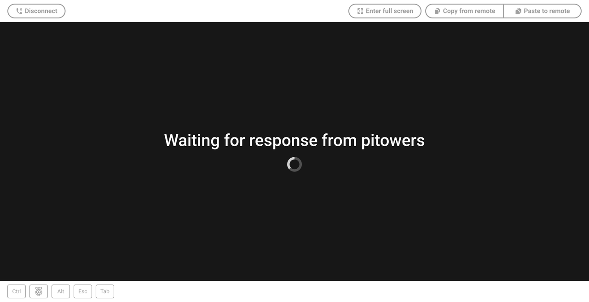
+
When the session starts, the window shows your device's desktop.

While a screen-sharing session is in progress:

* A green dot appears on the **Screen sharing** badge in the Devices tab. Move your cursor over the badge to see how many screen-sharing sessions are active.
+
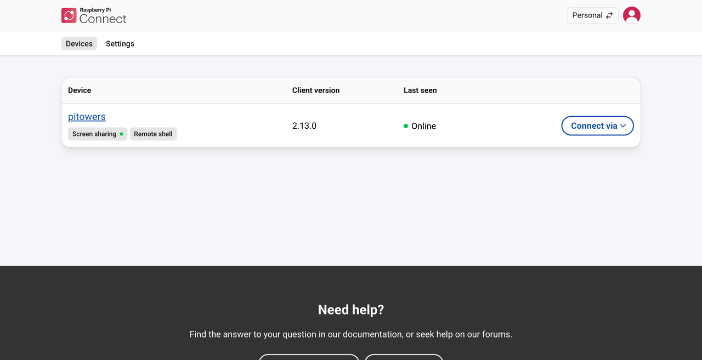
+
* On the device, a desktop notification appears when the session starts, and the Connect icon in the system tray rotates. To stop the icon rotating, see <<disabling-the-animated-icon,Turn off icon animation>>. Notifications are shown through the taskbar, so they only appear on Raspberry Pi OS Desktop while the taskbar is running.
+
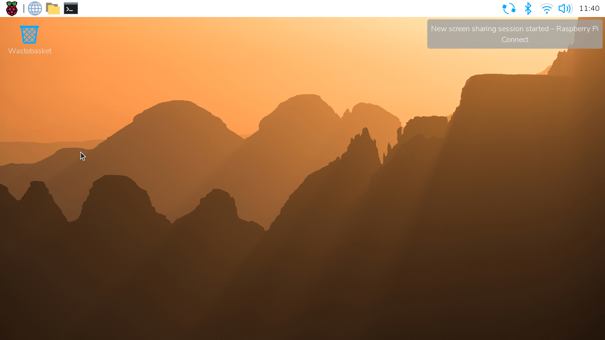

[[screen-sharing-interface]]
==== Use the screen-sharing interface

The screen-sharing interface works on both desktop and mobile devices.

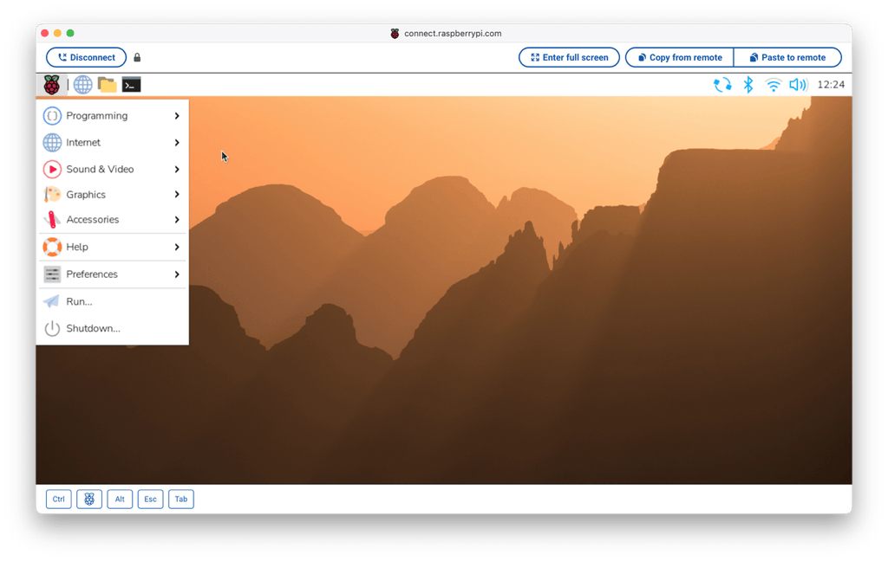

Browsers intercept some keys and key combinations, so you can't enter them directly in the screen-sharing window. Instead, use the buttons at the bottom left of the interface:

* **Keyboard.** Shows or hides the on-screen keyboard. Appears only on mobile devices.
* **Ctrl.** Holds down the **Ctrl** key.
* **Super key.** Holds down the **Super** key.
* **Alt.** Holds down the **Alt** key.
* **Esc.** Presses and releases the **Esc** key.
* **Tab.** Presses and releases the **Tab** key.

Use the buttons at the top of the window for the following tasks:

* **Copy from remote.** Copy text from your device's clipboard to your local clipboard.
* **Paste to remote.** Copy text from your local clipboard to your device's clipboard.
* **Enter full screen.** Expand the screen-sharing window to fill your screen.
* **Disconnect.** End the screen-sharing session.

[[screen-sharing-resolution]]
==== Screen resolution

Connect shows your device's desktop at the resolution of its display, scaled to fit your browser window. Where that resolution comes from depends on whether a display is connected to your Raspberry Pi:

* **Display connected.** The desktop runs at the resolution of the connected display. Resizing your browser window only scales the image; Connect never changes the resolution of a physical display. To use a different resolution, change it on the device, as described in xref:../computers/configuration.adoc#display-settings[Configure display settings]. You can do this from within a screen-sharing session.
* **No display connected.** Raspberry Pi OS creates a virtual display for the desktop. When a screen-sharing session starts, Connect resizes the virtual display to match your browser window, so the desktop fills the window with no scaling. Connect resizes it again whenever you resize the window or switch to full-screen mode, and replaces any resolution you set on the device the next time the window changes size. If you need the desktop to stay at a fixed resolution, for example for a kiosk, connect a display.

Connect only resizes the virtual display for one session at a time. The first session to connect controls the resolution for as long as it's connected, and other sessions show the same desktop scaled to fit their windows. When the controlling session disconnects, the next session to change its window size takes over.

[[stop-screen-sharing]]
==== Stop screen sharing

To end a screen-sharing session, select **Disconnect** at the top of the screen-sharing window.

.A screen-sharing session that has ended.
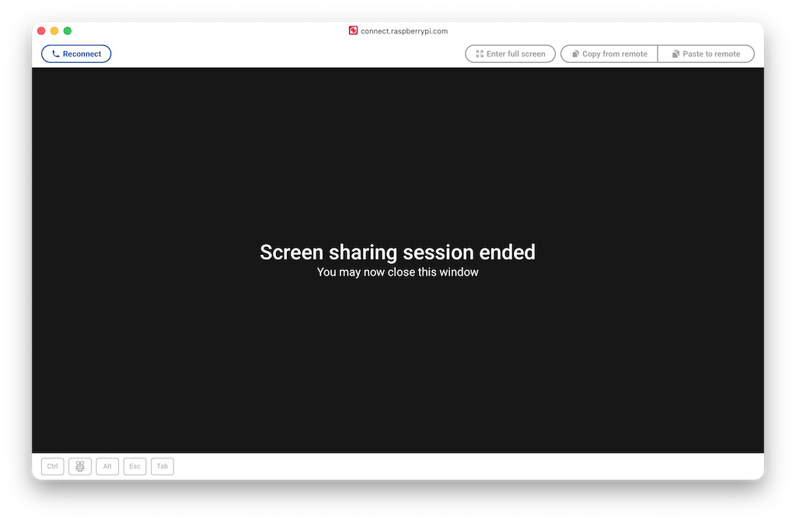

[[allow-disallow-screen-sharing]]
==== Allow and disallow screen sharing

Screen sharing is allowed by default. If you disallow screen sharing, your device stays linked and signed in to Connect, but nobody can start a screen-sharing session with it until you allow screen sharing again. Remote shell access isn't affected.

WARNING: If you disallow both screen sharing and remote shell access from within a Connect session, you can't use Connect to reach the device again until you allow one of them from the device itself. To do that without being physically present, you need another remote access method, such as SSH.

[tabs]
====
Desktop::
+
On your Raspberry Pi, select the Connect icon in the system tray, then:
+
* To disallow screen sharing, deselect **Allow Screen Sharing**.
* To allow screen sharing, select **Allow Screen Sharing**.
+
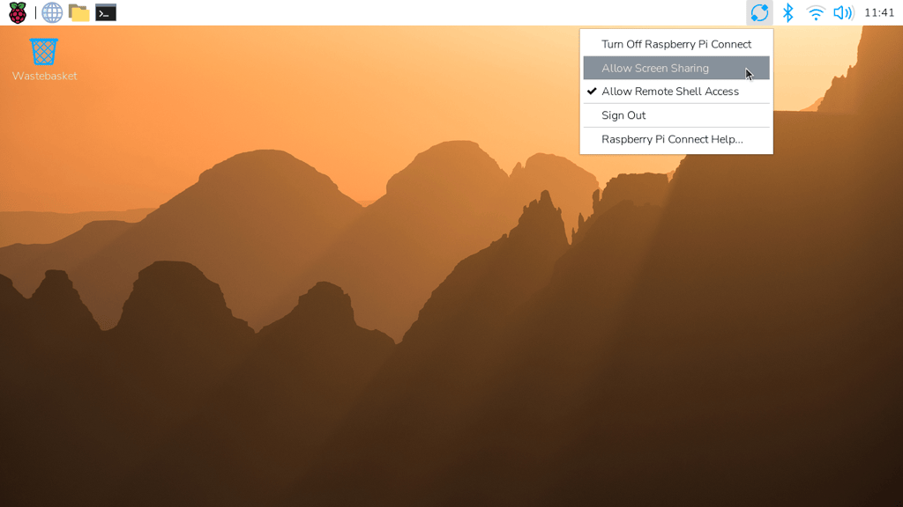

Command line::
+
On your Raspberry Pi, open a terminal, then:
+
* To disallow screen sharing, run the following command:
+
[source,console]
----
$ rpi-connect vnc off
----
* To allow screen sharing, run the following command:
+
[source,console]
----
$ rpi-connect vnc on
----
====

To check the change, sign in to https://connect.raspberrypi.com[connect.raspberrypi.com] and select the **Devices** tab. When screen sharing is disallowed, the **Screen sharing** badge and the **Screen sharing** option in the **Connect via** menu are crossed out.

[[remote-shell]]
=== Remote shell

Remote shell gives you access to your Raspberry Pi's command line in a browser window. It works with both Connect and Connect Lite.

[[start-remote-shell]]
==== Start a remote shell session

. On your computer, tablet, or phone, sign in to https://connect.raspberrypi.com[connect.raspberrypi.com].
. Select the **Devices** tab.
+
Devices that are available for remote shell access show a grey **Remote shell** badge below the device name.
+
. Select **Connect via** next to the device you want to access, then select **Remote shell**.
+
On a Connect Lite device, there's a single **Connect** button instead of **Connect via**. Select **Connect** to open the remote shell.
+
A new browser window opens and waits for the device to respond.
+
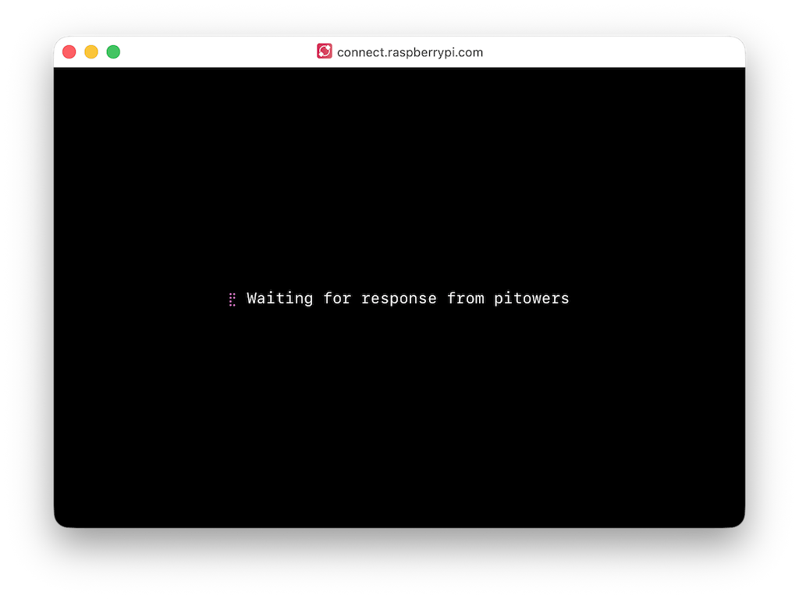
+
When the session starts, the window shows a shell prompt on your device.
+
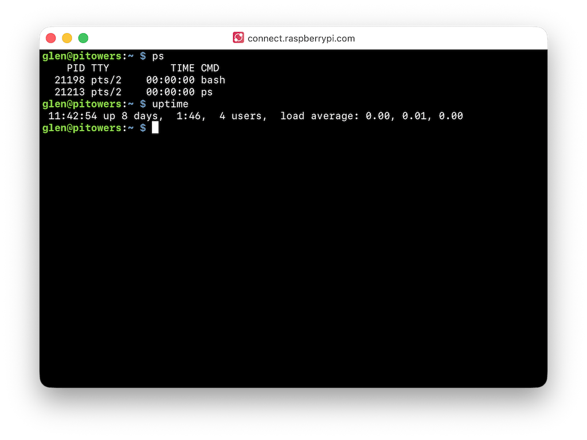

While a remote shell session is in progress:

* A green dot appears on the **Remote shell** badge in the Devices tab. Move your cursor over the badge to see how many remote shell sessions are active.
+
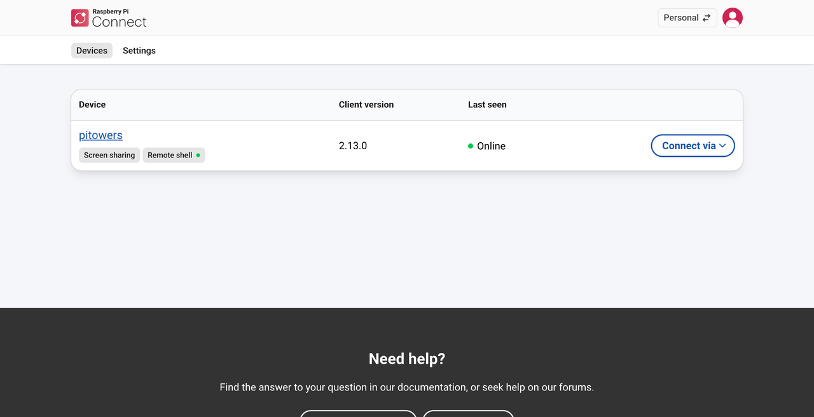
+
* On Raspberry Pi OS Desktop, a desktop notification appears when the session starts, as long as the taskbar is running.

Some things to know about remote shell sessions:

* Each remote shell session is a new login session, like an SSH connection. To keep commands running or keep configuration across sessions, use `screen` or `tmux`.
* On some operating systems, the browser intercepts key combinations such as **Ctrl+Shift+C** and **Ctrl+C**. Use the right-click menu, or **Ctrl+Insert** to copy and **Shift+Insert** to paste.
* Connect sets the `CONNECT_TTY` environment variable in remote shell sessions, so that scripts can detect that they're running in one.

[[end-a-remote-shell-session]]
==== End a remote shell session

To end a remote shell session, run the `exit` command, or close the browser window.

.A remote shell session that has ended.
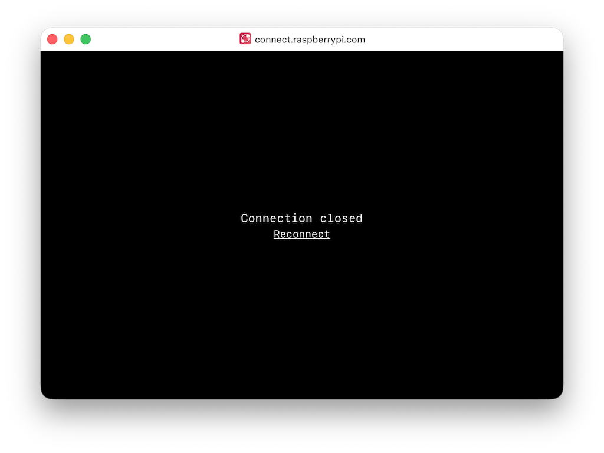

[[allow-disallow-remote-shell]]
==== Allow and disallow remote shell access

Remote shell access is allowed by default. If you disallow remote shell access, your device stays linked and signed in to Connect, but nobody can start a remote shell session with it until you allow remote shell access again. Screen sharing isn't affected.

WARNING: If you disallow both screen sharing and remote shell access from within a Connect session, you can't use Connect to reach the device again until you allow one of them from the device itself. To do that without being physically present, you need another remote access method, such as SSH.

[tabs]
====
Desktop::
+
On your Raspberry Pi, select the Connect icon in the system tray, then:
+
* To disallow remote shell access, deselect **Allow Remote Shell Access**.
* To allow remote shell access, select **Allow Remote Shell Access**.

Command line::
+
On your Raspberry Pi, open a terminal, then:
+
* To disallow remote shell access, run the following command:
+
[source,console]
----
$ rpi-connect shell off
----
* To allow remote shell access, run the following command:
+
[source,console]
----
$ rpi-connect shell on
----
====

To check the change, sign in to https://connect.raspberrypi.com[connect.raspberrypi.com] and select the **Devices** tab. When remote shell access is disallowed, the **Remote shell** badge and the **Remote shell** option in the **Connect via** menu are crossed out.

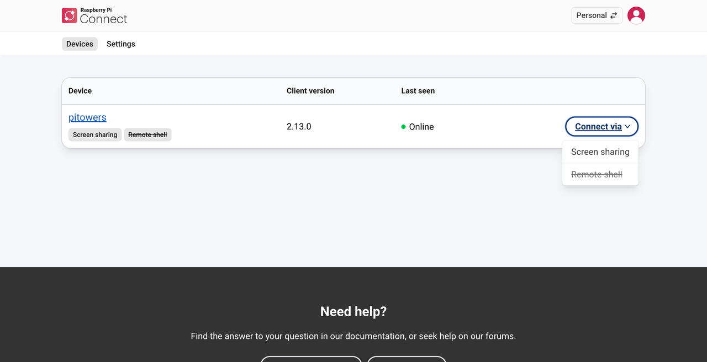

[[enable-remote-shell-at-all-times]]
==== Keep Connect running when you're logged out

The Connect client runs as part of your user account, not as root. By default, it only runs while you're logged in to your Raspberry Pi. If you reboot a device that doesn't log in automatically, the client doesn't start and you can't reach the device through Connect.

To keep the Connect client running even when you aren't logged in, turn on user lingering for your account. Lingering is a `systemd` feature that keeps a user's services running after they log out. Run the following command from your user account:

[source,console]
----
$ loginctl enable-linger
----

This keeps remote shell access available at all times. Screen sharing also needs a running desktop session; to start one automatically when the device boots, enable **Desktop Autologin** in the **System Options** in `raspi-config`.

TIP: We recommend turning on lingering for all headless Raspberry Pi OS Lite setups, so that your device stays reachable after a remote reboot.
