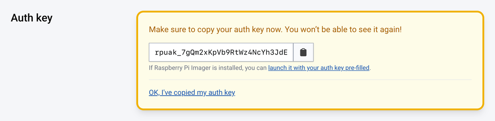

[[auth-keys]]
== Auth keys

An auth key is a single-use, temporary token that links a device to a Connect account without using the Connect website. Auth keys are useful for devices without a display, and for setting up several devices at once.

[cols="1,2,2",options="header"]
|===
| | Personal account | Organisation

| Prefix
| `rpuak_`
| `rpoak_`

| Expiry
| Six hours after creation
| Between 1 and 90 days after creation (one day by default)

| Active keys
| One at a time
| Several at once
|===

Each auth key links one device, so you need a separate auth key for each device. The device must boot and connect to the internet before the auth key expires.

To link many organisation devices without creating an auth key for each, organisations can also use xref:../services/connect-for-organisations.adoc#device-identities[device identities].

[[create-an-auth-key]]
=== Create an auth key

You can create an auth key in any of the following ways:

* **In Raspberry Pi Imager.** Imager can create and apply an auth key for you when you write Raspberry Pi OS. For more information, see xref:../computers/getting-started.adoc#imager-install[customisation options in Imager].
* **In a personal account.** Use the following procedure.
* **In an organisation.** Administrators can create auth keys on the Connect website, as described in xref:../services/connect-for-organisations.adoc#organisation-auth-keys[Create auth keys in an organisation], or with the xref:../services/connect-for-organisations.adoc#organisations-management-api[management API].

To create an auth key in a personal account:

. Sign in to https://connect.raspberrypi.com[connect.raspberrypi.com].
. Select the **Personal** account using the account switcher at the top right.
. Select the **Settings** tab, then select **Create auth key**.
+
Connect creates the auth key immediately.
. Copy the auth key.
+
IMPORTANT: Connect only shows the auth key once. Copy it now, because you can't view it again later.
+

A personal account can only have one usable auth key at a time. While a key is usable, the **Settings** tab only offers **Delete auth key**. When the key has been used or has expired, select **Create new auth key** to replace it.

To use the auth key, see the **Auth key** tab in <<link-connect,Turn on Connect and link your device>>.
