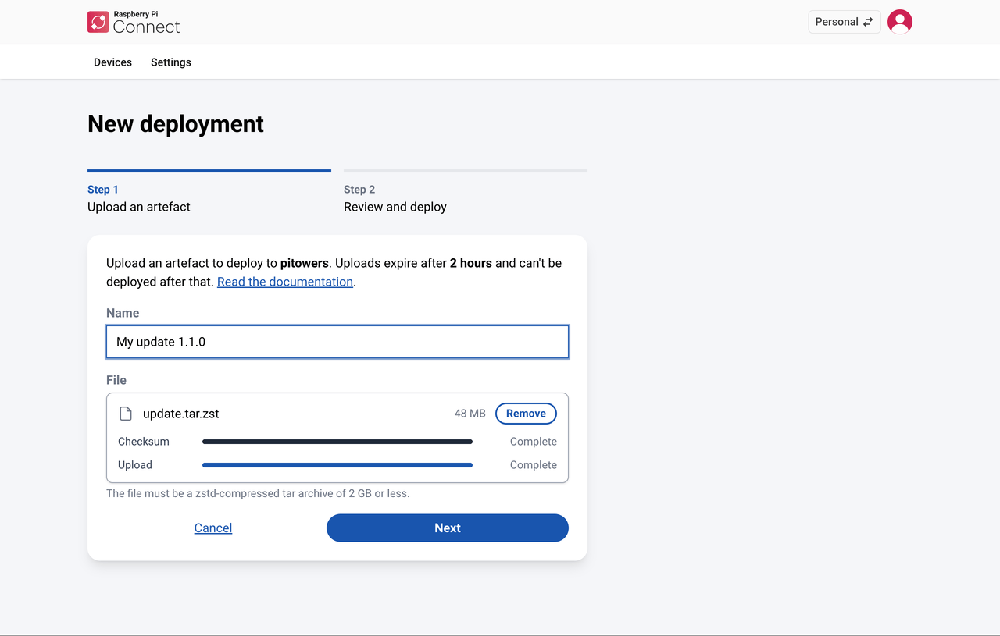
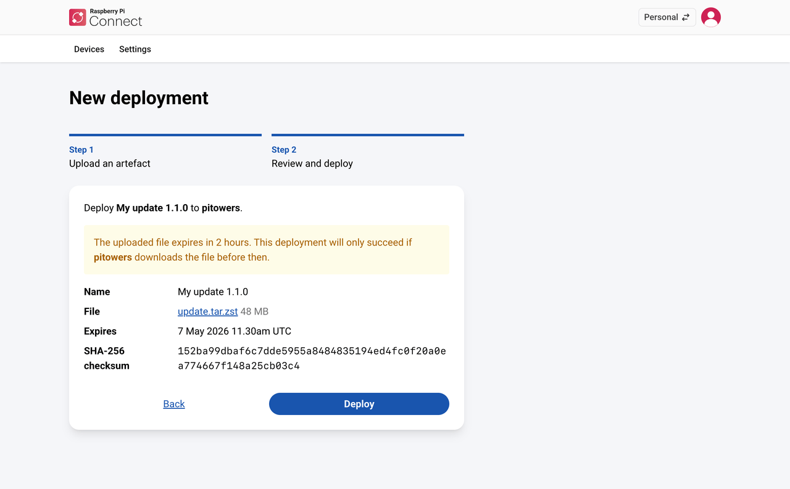

[[update-remotely]]
=== Deploy an update

After you've built a <<remoteupdate-otamaker,script artefact>> or an <<remoteupdate-ab,A/B update artefact>>, use the Connect website to deploy it to a device. You upload the artefact as part of the deployment, and Connect passes it to the recipient device.

NOTE: If the recipient device belongs to an organisation, follow xref:../services/connect-for-organisations.adoc#deploy-remote-updates[Deploy remote updates in an organisation] instead.

Deployments always start from the device you want to update:

. Sign in to https://connect.raspberrypi.com[connect.raspberrypi.com].
. Select the **Personal** account using the account switcher at the top right.
. Go to the **Devices** tab, then select **Deploy** next to the recipient device.
+
**Deploy** only appears for devices that are <<remoteupdate-opt-in,opted in to remote updates>>.

The **New deployment** form opens. It has two steps.

[[upload-the-artefact]]
In **Step 1: Upload an artefact**, upload the artefact you built:

. Enter a **Name** for the artefact. Names don't have to be unique, so use something that helps you recognise the deployment later, such as a version number.
. Drag the artefact onto the **File** area, or select **browse** to choose it. The file must be a Zstandard-compressed tar archive (a `.tar.zst` file) of 2 GB or less.
. Wait for both **Checksum** and **Upload** to show **Complete**.
+
To choose a different file, select **Remove**. To stop a file that's still uploading, select **Cancel**.
. Select **Next**.

.Step 1 of the New deployment form, showing the Name field and the uploaded artefact.

In **Step 2: Review and deploy**, check the name, file, and SHA-256 checksum, then select **Deploy**. If you spot a mistake, select **Back** to correct it. This step also shows when the uploaded file expires. If the device already has a queued deployment, this step warns you that deploying cancels it.

.Step 2 of the New deployment form, showing the artefact's details for confirmation.

The recipient device doesn't have to be online when you deploy.

IMPORTANT: Connect keeps an uploaded artefact for two hours, then deletes it. The deployment only succeeds if the recipient device comes online and downloads the file within those two hours. If it doesn't, the deployment stays **Queued** until the device next asks to start it, and is then marked **Invalidated**. To deploy the artefact after that, upload it again.

[[monitor-the-deployment]]
==== Monitor the deployment

To see the state of a deployment:

. Sign in to https://connect.raspberrypi.com[connect.raspberrypi.com].
. Select the **Personal** account using the account switcher at the top right.
. Go to the **Devices** tab, then select the device you deployed to.
+
The **Deployments** section appears after the device has had at least one deployment. It shows **Recent activity** (the last ten state changes) and an **All deployments** link.
. Select an artefact name to see more about the deployment's state, including any error messages for a failed deployment.

A deployment can be in one of the following states:

* **Queued.** Waiting for the recipient device to pick up the update.
* **In progress.** The device is applying the update.
* **Succeeded.** The device applied the update successfully.
* **Failed.** The update failed. See <<ab-troubleshooting,Remote update failures>>.
* **Cancelled.** The update was cancelled before the device applied it. Connect automatically cancels a queued deployment when you deploy another update to the same device.
* **Invalidated.** The update can no longer be applied, for example because the uploaded artefact expired.

While a deployment is **Queued** or **In progress**, the page updates automatically with its current state.

[[cancel-a-deployment]]
==== Cancel a deployment

You can only cancel a deployment that's **Queued**.

. Sign in to https://connect.raspberrypi.com[connect.raspberrypi.com].
. Select the **Personal** account using the account switcher at the top right.
. Go to the **Devices** tab, then select the device you deployed to.
. In the **Deployments** section, select the deployment you want to cancel, then select **Cancel deployment**.
. When your browser asks you to confirm, select **OK**.

[[verify-the-deployment]]
==== Verify the deployment

When the deployment shows as **Succeeded**, open a <<remote-shell,remote shell>> on the recipient device to check the result.

For a script artefact, view the script's output in the `systemd` journal:

[source,console]
----
$ journalctl -t rpi-ota-connector
----

For an A/B boot update, check the version of the image the device is running:

[source,console]
----
$ cat /etc/rpi-issue
----

The `Artefact version` in the output is the version you set when you built the update:

----
Generated using rpi-image-gen e3828f885c860f15991468883d3b8484b0eaf9d8 on 2025-12-09
Artefact version: 1.1.0
----
