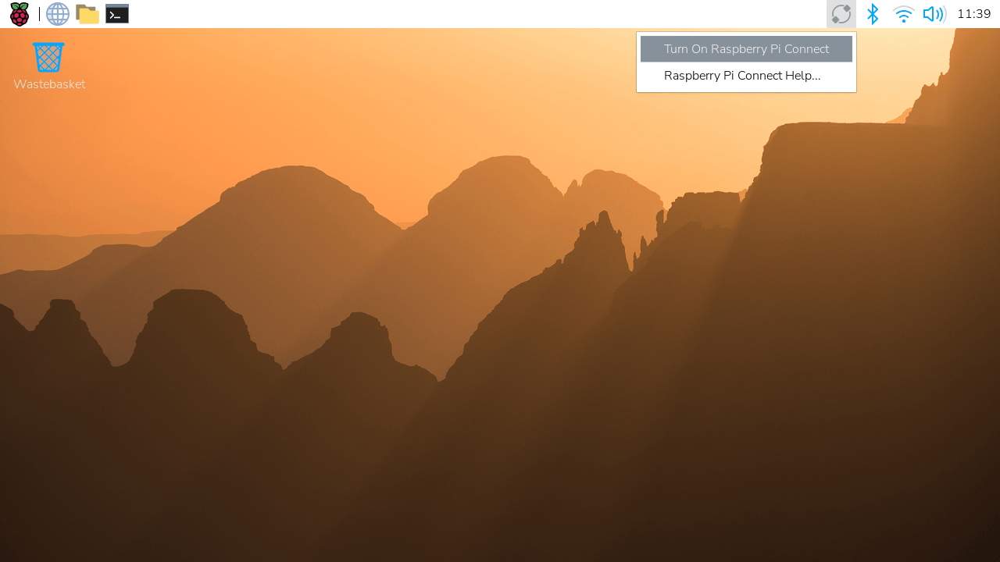
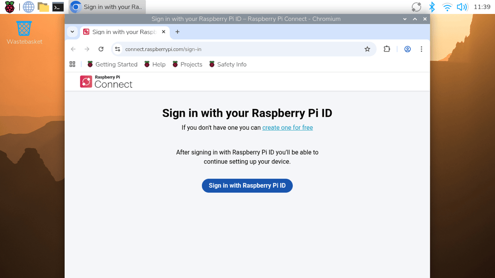
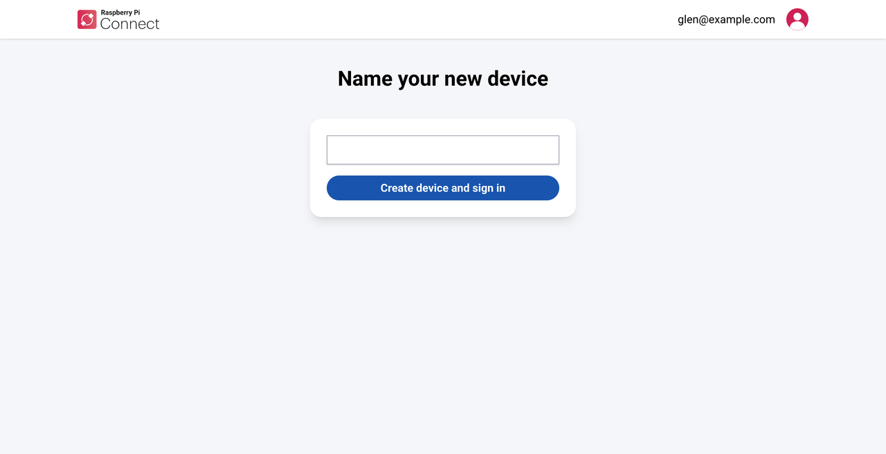
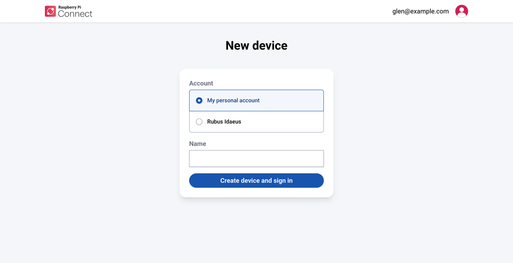
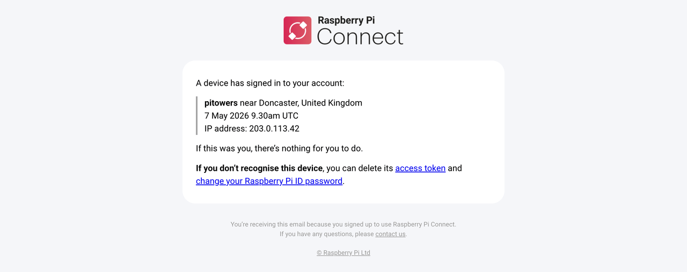

== Get started

To start using Connect, turn on the Connect client on your Raspberry Pi and link the device to your Connect account. You can then access the device from a browser on any other computer, tablet, or phone.

[[get-started-prerequisites]]
=== Prerequisites

You need:

* A Raspberry Pi ID. If you don't have one, see xref:../services/id.adoc#create-a-raspberry-pi-id[Create a Raspberry Pi ID].
* A Raspberry Pi running Raspberry Pi OS _Bookworm_ or later, connected to the internet.
* On the computer, tablet, or phone you want to connect from, a browser that supports https://caniuse.com/?search=es2022[ECMAScript 2022] (ES13). Most current browsers do.

[[turn-on-connect]]
=== Step 1: Turn on Connect

The Connect client is installed by default on Raspberry Pi OS, but it's turned off until you turn it on. Turning on Connect starts the client on your device; it doesn't link the device to an account.

[tabs]
====
Desktop::
+
. Power on your Raspberry Pi.
. Select the Connect icon in the system tray, then select **Turn On Raspberry Pi Connect**.
+
.The Connect menu in the system tray.

+
If the device isn't linked to an account yet, a browser opens so that you can sign in with your Raspberry Pi ID. Continue with <<sign-in-raspberry-pi-id,Sign in with your Raspberry Pi ID>>.

Command line::
+
Run the following command:
+
[source,console]
----
$ rpi-connect on
----
====

[[link-connect]]
=== Step 2: Link your device

Linking a device adds it to a Connect account, so that you can access it remotely. Choose one of the following ways to link your device:

.Ways to link a device
[cols="1,2,1",options="header"]
|===
| Method | How it works | Account types

| <<sign-in-raspberry-pi-id,Raspberry Pi ID>>
| You sign in with your Raspberry Pi ID, on the device or from another device.
| Personal and organisation

| <<link-with-auth-key,Auth key>>
| You give the device a single-use token, so nobody has to sign in. Useful for devices without a display.
| Personal and organisation

| <<link-with-device-identity,Device identity>>
| The device signs in with a private key stored in its one-time programmable (OTP) memory. Useful for preparing many devices.
| Organisation only
|===

NOTE: Connect identifies your device by its serial number. If you move your microSD card to a different Raspberry Pi, the Connect client signs out, and you must link the new device.

[[sign-in-raspberry-pi-id]]
==== Sign in with your Raspberry Pi ID

[tabs]
====
Desktop::
+
When you turn on Connect from the desktop, a browser opens if the device isn't linked to an account yet.
+
.The Connect sign-in page.

+
. Enter your Raspberry Pi ID email address and password, then select **Sign In**.
. Follow the on-screen prompts to give your device a name and choose which Connect account to link it to.
+
If the device's serial number matches a device you already administer, Connect offers to sign that device in again, instead of asking for a name.
+

+
If you're an administrator of an xref:../services/connect-for-organisations.adoc[organisation], choose whether to add the device to your personal account or to an organisation.
+

+
. Select **Create device and sign in**.
+
To sign in again later, select the Connect icon in the system tray, then select **Sign In...**.

Command line::
+
. Start the sign-in process:
+
[source,console]
----
$ rpi-connect signin
----
+
The command outputs a verification URL, similar to the following:
+
----
Complete sign in by visiting https://connect.raspberrypi.com/verify/XXXX-XXXX
----
+
. Visit the verification URL on any device, and sign in with your Raspberry Pi ID to link the device to your account.
====

[[link-with-auth-key]]
==== Use an auth key

An auth key is a single-use, temporary token that links a device to a Connect account without anyone signing in. For more information, including how long auth keys last, see <<auth-keys,Auth keys>>.

The easiest way to use an auth key is to set one in the xref:../computers/getting-started.adoc#imager-install[customisation options in Raspberry Pi Imager] when you write Raspberry Pi OS to your storage device.

To use an auth key on a device that's already running:

. <<create-an-auth-key,Create an auth key>>.
. Make sure that Connect is <<turn-on-connect,turned on>> on the device, and that the device is connected to the internet. Connect must be running before it can use an auth key, and the device must use the key before it expires.
. Give the auth key to the Connect client in one of the following ways:
** Run the `rpi-connect signin` command with the auth key:
+
[source,console]
----
$ rpi-connect signin --auth-key=rpuak_123456
----
** Save the auth key to a file, then pass the file's full path to the command, prefixed with `+@+`:
+
[source,console]
----
$ rpi-connect signin --auth-key=@/home/alice/auth.key
----
** Save the auth key to `+.config/com.raspberrypi.connect/auth.key+` in your home directory. Connect detects the file automatically, and deletes it after it tries to sign in, whether or not the sign-in succeeds.

[[link-with-device-identity]]
==== Use a device identity

NOTE: Device identities are only available for xref:../services/connect-for-organisations.adoc[organisations].

A device identity links a device to an organisation using a private key stored in the device's one-time programmable (OTP) memory, so nobody has to sign in on the device. Unlike an auth key, a device identity can be used more than once.

. Create a device identity for the device with the management API, either directly or through `rpi-sb-provisioner`. You can't create device identities on the Connect website. For more information, see xref:../services/connect-for-organisations.adoc#device-identities[Device identities].
. <<turn-on-connect,Turn on Connect>> on the device. The device signs in to your organisation automatically.

To provision many devices with device identities, see xref:../services/connect-for-organisations.adoc#bulk-provisioning[Bulk provisioning].

// TODO: Confirm the device-side steps for device identities. Does the device sign in automatically when Connect is turned on, or is a command needed?

[[link-connect-result]]
==== When your device is linked

* The Connect icon in the system tray turns blue to show that the client is signed in.
* Connect sends a notification to your Raspberry Pi ID email address to tell you that a new device is linked to your account. Devices linked to an organisation with an auth key or a device identity don't send an email; instead, the sign-in is recorded in the organisation's xref:../services/connect-for-organisations.adoc#audit-log[audit log].
+

To check the link from the command line, run `rpi-connect status`. For more information, see <<view-connect-status,Check the Connect client's status>>.

IMPORTANT: By default, the Connect client only runs while you're logged in to your Raspberry Pi. If you'll reboot the device remotely, or it doesn't log in automatically (for example, a headless or Raspberry Pi OS Lite setup), <<enable-remote-shell-at-all-times,keep Connect running when you're logged out>>, or you won't be able to reach the device after it restarts.

IMPORTANT: If you receive a notification email for a device that you don't recognise, follow the steps in <<unrecognised-device,If you don't recognise a linked device>>.

[[get-started-access]]
=== Step 3: Access your device from a browser

. On your computer, tablet, or phone, sign in to https://connect.raspberrypi.com[connect.raspberrypi.com] with your Raspberry Pi ID.
. Select the **Devices** tab. Connect lists all the devices linked to your account.
. Select **Connect via** next to the device you want to access, then choose a connection method:
** **Screen sharing**, to use your device's desktop. For more information, see <<screen-sharing,Screen sharing>>.
** **Remote shell**, to use your device's command line. For more information, see <<remote-shell,Remote shell>>.
+
**Connect via** only appears when the device offers both screen sharing and remote shell. A Connect Lite device has a single **Connect** button, which opens a remote shell.