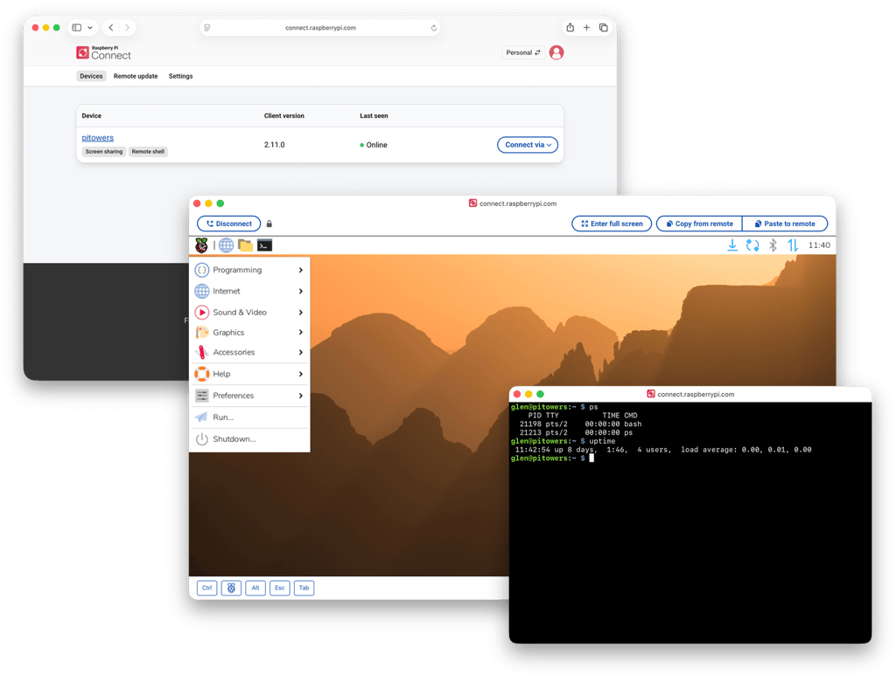

== Introduction

Raspberry Pi Connect gives you secure access to your Raspberry Pi from anywhere in the world, using only a browser.

Connect has two parts:

.The two parts of Connect
[cols="1,2,2",options="header"]
|===
| Part | What it is | How you use it

| **Connect service**
| The website at https://connect.raspberrypi.com[connect.raspberrypi.com], and the servers that set up connections between your browser and your devices.
| Sign in with your Raspberry Pi ID to see your linked devices, start remote sessions, and deploy updates.

| **Connect client**
| Software that runs on your Raspberry Pi and links it to your Connect account.
| Use the Connect icon in the system tray, or the `rpi-connect` command.
|===

The Connect client is installed by default on Raspberry Pi OS, but it's turned off until you <<link-connect,turn it on and link your device>>. There are two variants:

.Connect client variants
[cols="1,1,1,1,2",options="header"]
|===
| Variant | Package | Screen sharing | Remote shell | Installed by default on

| **Connect**
| `rpi-connect`
| Yes
| Yes
| Raspberry Pi OS Desktop and Raspberry Pi OS Full

| **Connect Lite**
| `rpi-connect-lite`
| No
| Yes
| Raspberry Pi OS Lite
|===

NOTE: To use Connect, your Raspberry Pi must run Raspberry Pi OS _Bookworm_ or later.

=== Features

* **Screen sharing.** Use your Raspberry Pi's desktop from a browser on your computer, tablet, or phone, with on-screen controls for keys that browsers intercept. For more information, see <<screen-sharing,Screen sharing>>.
* **Remote shell.** Open a terminal session on your Raspberry Pi from a browser, including on Raspberry Pi OS Lite. For more information, see <<remote-shell,Remote shell>>.
* **Remote update.** Push scripts or complete operating system updates to devices that are behind a firewall or hard to reach, with automatic rollback for A/B boot updates. For more information, see <<remoteupdate-intro,Remotely update your devices>>.
* **Works across networks.** Connect links your browser and your device directly where it can, and through an encrypted relay where it can't, usually without any changes to your network or firewall. For more information, see <<relay-servers,Relay servers>>.
* **End-to-end encryption.** Sessions are encrypted between your device and your browser. Raspberry Pi can't see their contents and retains only the metadata needed to run the service. For more information, see <<security,Security and privacy>>.

=== Account types

[cols="1,2,2,2",options="header"]
|===
| Account | Who can access devices | Includes | Cost

| **Personal**
| One user
| Screen sharing, remote shell, and remote update
| Free

| **Organisation**
| Multiple users, with roles
| Everything in a personal account, plus device tagging and search, an audit log, and a management API
| Billed monthly, after a free trial
|===

For more information about organisation accounts, see xref:../services/connect-for-organisations.adoc[Connect for Organisations].
