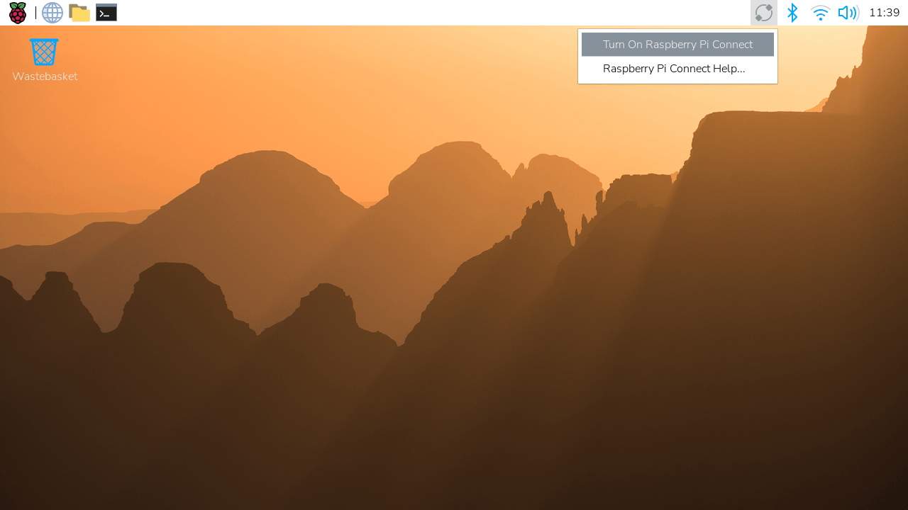
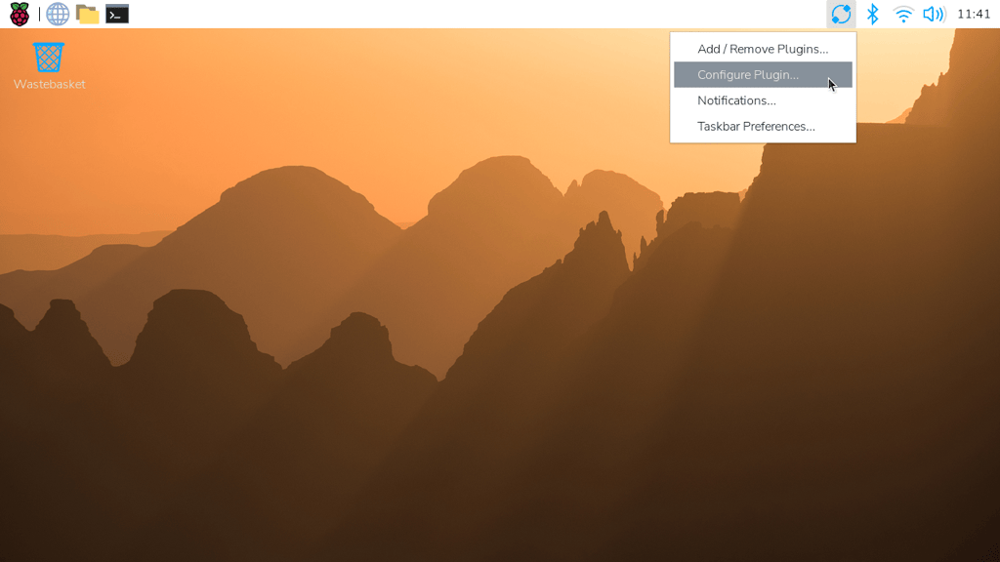
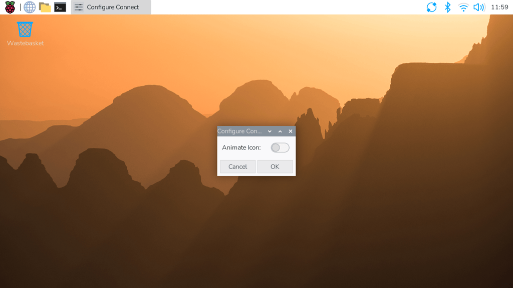
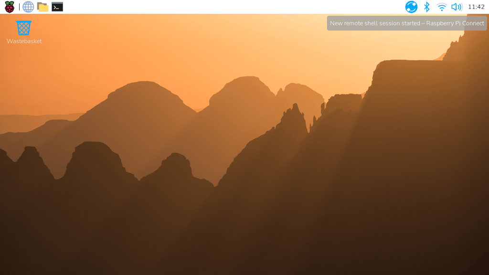

[[manage-the-connect-client]]
== Manage the Connect client

The Connect client is the software on your Raspberry Pi that links it to your Connect account. You can control it from the Connect menu in the system tray, or with the `rpi-connect` command. If you use Connect Lite, the command is still `rpi-connect`, but the package name is `rpi-connect-lite`.

[[connect-menu]]
=== The Connect menu

On Raspberry Pi OS Desktop, select the Connect icon in the system tray to open the Connect menu. From the menu, you can:

* Turn Connect on and off.
* Sign in to and out of Connect.
* <<allow-disallow-screen-sharing,Allow and disallow screen sharing>>.
* <<allow-disallow-remote-shell,Allow and disallow remote shell access>>.

The Connect icon shows the client's state:

* **Grey.** Connect is turned off, or the client isn't signed in.
* **Blue.** The client is signed in, and the device is available through Connect.
* **Rotating.** A screen-sharing or remote shell session is in progress. To show a static icon instead, see <<disabling-the-animated-icon,Turn off icon animation>>.

[[view-connect-status]]
=== Check the Connect client's status

To check the client's status, run the following command:

[source,console]
----
$ rpi-connect status
----

The output is similar to the following:

----
Signed in: yes
Subscribed to events: yes
Screen sharing: allowed (0 sessions active)
Remote shell: allowed (0 sessions active)
----

If the device is <<remoteupdate-opt-in,opted in to remote updates>>, the output also includes `Remote update: allowed`.

The output shows whether the client is signed in to Connect, and whether screen sharing and remote shell access are allowed.

If the output includes `Raspberry Pi Connect is not running, run rpi-connect on`, turn Connect on with `rpi-connect on`.

[[turn-connect-on-off]]
=== Turn Connect on and off

Turning Connect off disconnects the device from Connect and ends any active sessions. Connect stays off, even after a reboot, until you turn it on again.

Turning Connect off doesn't change whether screen sharing and remote shell access are allowed when you turn it on again.

[tabs]
====
Desktop::
+
Select the Connect icon in the system tray, then select **Turn On Raspberry Pi Connect** or **Turn Off Raspberry Pi Connect**.

Command line::
+
To turn Connect on, run the following command:
+
[source,console]
----
$ rpi-connect on
----
+
To turn Connect off, run the following command:
+
[source,console]
----
$ rpi-connect off
----
====

[[sign-out-remove-uninstall]]
=== Sign out, remove, or uninstall

There are several ways to stop using Connect on a device. They have different effects:

[cols="1,2,2,2",options="header"]
|===
| Action | Where | What happens | To use Connect again

| <<disconnect-a-device-from-connect,Sign out>>
| On the device, or on the Connect website
| The client signs out. The device stays listed in your account, but you can't access it. Screen sharing and remote shell access are reset to allowed.
| Sign in again on the device.

| <<remove-a-device,Remove the device>>
| On the Connect website
| The device is unlinked from your account, and the client on the device signs out.
| <<link-connect,Link the device>> again.

| <<uninstall,Uninstall the client>>
| On the device
| The client is removed. The device stays listed in your account, linked by its serial number, but you can't access it.
| Reinstall the client. The device reuses its existing name in your account, even with a different microSD card.
|===

To stop using a device with Connect completely, <<remove-a-device,remove it from your account>>. You can also uninstall the client if you no longer need it.

[[disconnect-a-device-from-connect]]
==== Sign out

To sign the Connect client out of your account, do one of the following:

* On the device, select the Connect icon in the system tray, then select **Sign Out**.
* On the device, run the following command:
+
[source,console]
----
$ rpi-connect signout
----
* On the Connect website, select the device in the **Devices** tab, select **Settings**, then select **Sign out device...**. The device stays listed in your account.

Signing out resets screen sharing and remote shell access to allowed. If you'd disallowed either of them, disallow it again after you sign back in. Signing out doesn't affect <<remoteupdate-opt-in,remote updates>>: if the device was opted in, remote updates work again as soon as you sign back in.

[[uninstall]]
==== Uninstall the client

To stop and remove the Connect client, run the following command:

[source,console]
----
$ sudo apt remove --purge rpi-connect
----

If you installed Connect Lite, replace `rpi-connect` with `rpi-connect-lite`.

[[update]]
=== Update the client

WARNING: Updating Connect ends any screen-sharing or remote shell sessions that are in progress, including the session you're updating from. If you update over a remote shell, run the update in `screen` or `tmux` so that it continues after the session ends.

To update to the latest version of Connect, run the following commands:

[source,console]
----
$ sudo apt update
$ sudo apt install --only-upgrade rpi-connect
----

If you installed Connect Lite, replace `rpi-connect` with `rpi-connect-lite`.

[[disabling-the-animated-icon]]
=== Turn off icon animation

By default, the Connect icon in the system tray rotates while a screen-sharing or remote shell session is in progress. To show a static icon instead:

. Right-click the Connect icon in the system tray, then select **Configure Plugin...**.
+

+
. Turn off **Animate Icon** using the toggle.
+

When a session is in progress, the icon now changes to a solid blue circle instead of rotating.

