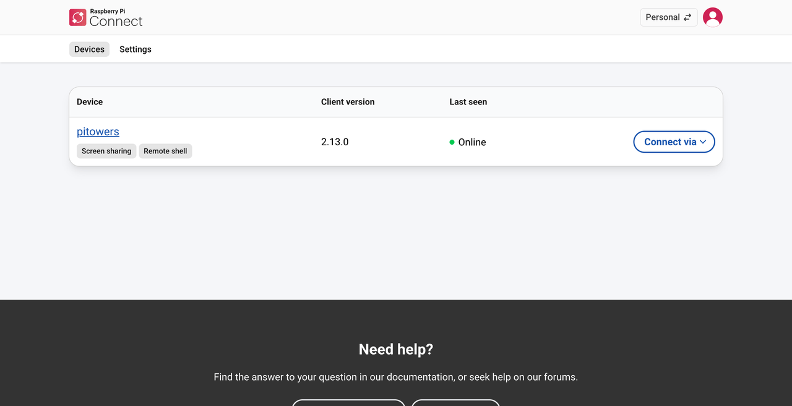
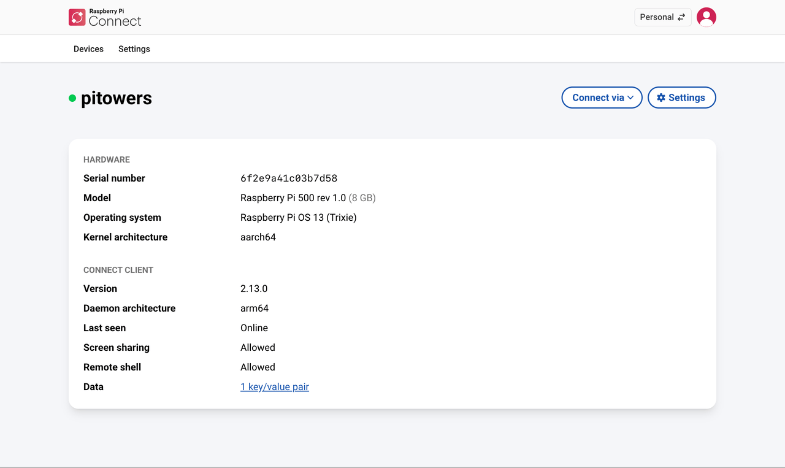

== Manage devices

The Connect website lists all the devices linked to your Connect account, and lets you view their details, rename them, and remove them from your account.

To manage the Connect client software on the device itself, such as updating or uninstalling it, see <<manage-the-connect-client,Manage the Connect client>>.

[[view-linked-devices]]
=== View your devices

. Sign in to https://connect.raspberrypi.com[connect.raspberrypi.com].
. Select the **Devices** tab.
+
Connect lists your linked devices, with badges showing which access methods each device supports.
+

In an organisation account, you can also xref:../services/connect-for-organisations.adoc#search-filter-devices[search and filter] the device list, and add xref:../services/connect-for-organisations.adoc#tag-devices[tags] to devices.

[[view-device-details]]
=== View device details

Select a device name in the **Devices** tab to open the device page. This page shows details about the device's hardware and the Connect client it's running.

NOTE: The device **Settings** page only appears for users who can administer the device. In an organisation, members don't see it.

[[rename-a-device]]
=== Rename a device

. Select the device in the **Devices** tab.
. Select **Settings** on the device page.
. Enter a new name for the device, then save your changes.

[[remove-a-device]]
=== Remove a device from your account

Removing a device unlinks it from your Connect account. Connect also signs out the Connect client on the device: the Connect icon in the system tray turns grey, and the Connect menu shows **Sign In...** instead of **Sign Out**.

To remove a device:

. Select the device in the **Devices** tab.
. Select **Settings** on the device page.
. Under **Danger zone**, select **Delete device...**.
. On the confirmation page, select **Delete**.

To use the device with Connect again, <<link-connect,link it>> again.

Removing a device is the only way to fully unlink it from your account. To compare removing a device with signing out or uninstalling the Connect client, see <<sign-out-remove-uninstall,Sign out, remove, or uninstall>>.

[[transfer-a-device]]
=== Transfer a device to another account

If you're an administrator of an organisation, you can transfer devices between your personal account and the organisation, or between organisations. For more information, see xref:../services/connect-for-organisations.adoc#transfer-device[Transfer a device].

[[unrecognised-device]]
=== If you don't recognise a linked device

Connect sends a notification to your Raspberry Pi ID email address whenever a new device is linked to your account. If you receive a notification for a device that you don't recognise:

. Sign the device out: select the device in the **Devices** tab, select **Settings**, then select **Sign out device...**.
. Change your Raspberry Pi ID password immediately.
. Consider xref:../services/id.adoc#enable-two-factor-authentication[turning on two-factor authentication] for your Raspberry Pi ID.
